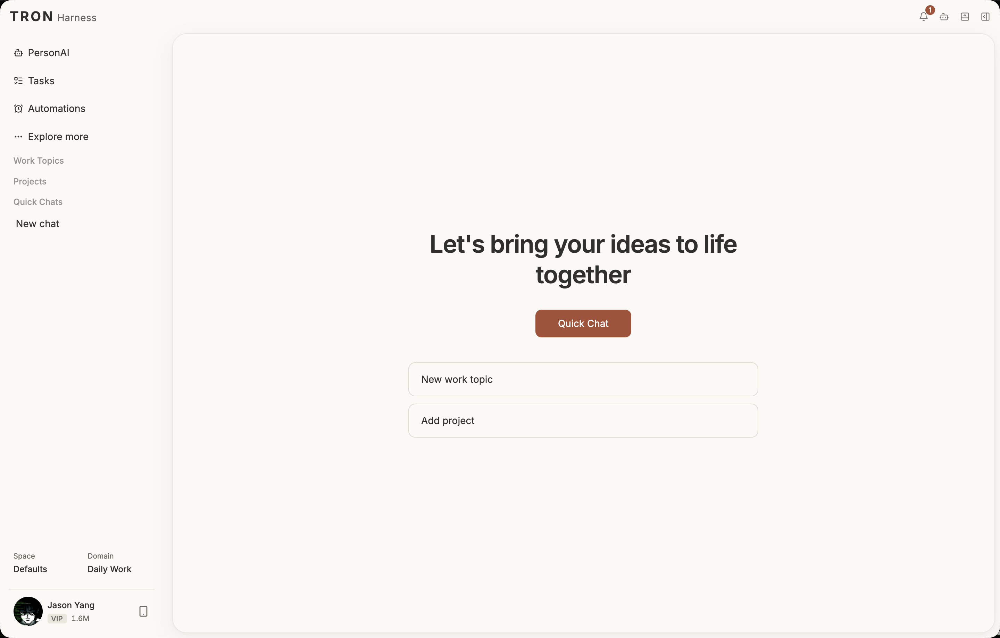
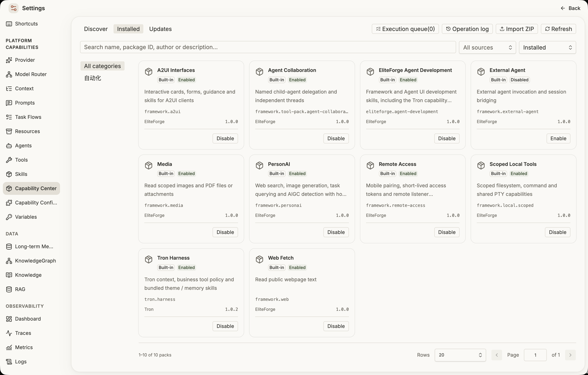
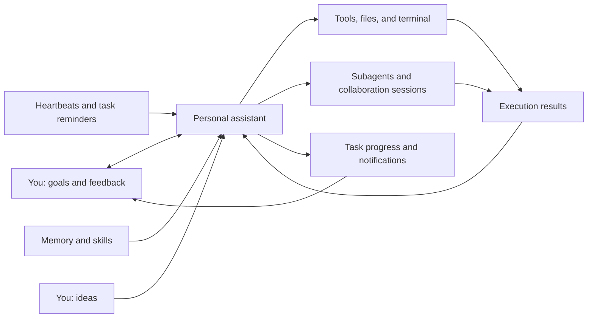

<div align="center">
  
  <h1>TRON Harness</h1>
  <p><strong>English</strong> · <a href="README.md">简体中文</a></p>
  <p>
    <a href="https://github.com/PersonAI-Official/Tron-Harness/releases/latest"></a>
    <a href="https://personai.chat/person-ai-index/"></a>
    <a href="LICENSE"></a>
    <a href="tron-backend"></a>
    <a href="tron-frontend"></a>
    <a href="electron"></a>
  </p>
  <p>
    <a href="#interface-preview"></a>
    <a href="#interface-preview"></a>
    <a href="#contributing"></a>
  </p>
  <p><strong>Build AI workflows for your own domain, right here.</strong></p>
  <p>🎉 The project is under active development. We welcome contributions made together with agents. o7</p>
</div>

## Interface Preview

<p align="center">
  
</p>
<p align="center"><sub>Workspace: start from a single sentence—chat right away, create a work topic, or add a workspace</sub></p>

<p align="center">
  
</p>
<p align="center"><sub>Capability Center: built-in and external capability packs, enabled on demand</sub></p>

The desktop app supports macOS Apple Silicon, Windows, and Linux. Windows users can run the native client or work through WSL2.

When the Windows desktop app uses WSL2, agent execution, commands, terminals, MCP, and background tasks all run inside the selected Linux distribution.

```text
Windows
└─ Tron desktop: chat, tasks, file panel, backend environment selection
      │
      │ HTTP / WebSocket over localhost
      ▼
WSL2 · Ubuntu / Debian
├─ Tron backend: personal assistant, agent collaboration, capability packs, background tasks
├─ Linux work environment: project directories, commands, terminals, MCP
└─ ~/.tron: databases, chats, attachments, logs, and managed working directories
```

## One Set of Capabilities, Three Ways to Use It

**Tron Harness is an open-source, extensible multi-agent work platform.** It gathers everything an agent needs to do a class of work—tools, skills, menus, pages, and permissions—into capability packs.

A capability pack is an installable, modifiable, and deliverable "vertical domain." You can use the same set of capabilities as-is, adapt and share it, or turn it into a standalone application that you deploy yourself.

<p align="center">
  
</p>

### Install a Capability Pack

A pack takes effect as soon as it is installed: the agent knows how this kind of work is done and has the right tools at hand, and the interface offers entry points. Pick one from the Capability Center, install and enable it, then start from a concrete goal—no need to study the framework first or configure everything from scratch.

### Build and Share a Capability Pack

Ready-made packs solve common problems; the differences are left to you. Describe your process, materials, and judgment criteria in natural language, and the agent generates a new capability pack—filling in tools, skills, menus, and pages—then keeps adjusting it while you use it. Once it is polished, publish it to the Capability Center so others can install it.

### Generate a Standalone Agent Application

When a set of capabilities needs to live outside Tron, it deserves its own form. Reusing the framework's capabilities, Tron Harness can turn it into an agent-native application: the app's main entry point is the agent, not a chat box in a conventional interface; the interface, tools, skills, and runtime logic are packaged into a project that can be deployed independently—to your own server, intranet, or computer.

## PersonAI: Your Built-in Personal Assistant

Open Tron and you have a built-in personal assistant, **PersonAI**. It has its own identity, sessions, and tasks. You can set its name, personality, and way of working with you, or create additional PersonAIs that take on different responsibilities.

Start with one sentence:

> Help me understand this project, break it into tasks, and run whatever can run in parallel. Call me in when there is a decision I need to make.

- **Turn ideas into tasks.** Clarify goals in conversation, create tasks, schedule them, and keep tracking progress and results.
- **Split work across agents.** Delegate subtasks or create independent collaboration sessions; check status, add requirements, answer questions, and cancel work when needed.
- **Follow up proactively.** With background execution enabled, PersonAI keeps working through heartbeats, task reminders, and work feedback, and uses notifications to report progress, completion, or decisions that need your input.
- **Remember useful experience.** The built-in "memory organization" PersonAI distills stable facts and validated experience from past work; generated Skills go to the pending-approval area by default and are installed once approved.
- **Know what it is doing at any time.** Conversations, delegated sessions, tasks, background work, and history each have dedicated entry points.



Background work requires the backend to stay running and uses configured models and tools. The heartbeat interval, whether background execution is enabled, and automatic skill approval can all be adjusted.

## Capability Packs: Extend Tron Around the Way You Work

**Install, inspect, and manage a set of related capabilities together.** Capability packs are Tron's core extension mechanism: they give agents execution capabilities and add menus and pages to the work interface.

| What a pack contains | What it is for |
| --- | --- |
| Tools and plugins | Provide callable operations and connect execution logic and runtime extensions |
| Skills and supporting resources | Distribute work methods, instructions, scripts, and reference material |
| MCP services | Bring external tool services under capability management |
| Menus and navigation | Add navigation entry points for specific work scenarios |
| Isolated pages | Provide pack-specific interfaces that receive the host theme and language context |
| Extension declarations, dependencies, and permissions | Describe a pack's composition, dependencies, and permission requirements |

## Bring AI Deeply into Your Workflow

| What you want to do | How Tron helps |
| --- | --- |
| Quick questions and research | Casual chat, knowledge base, and web search |
| Move a project forward | Work topics, workspaces, application management, task boards, and configurable task flows |
| Coordinate heterogeneous agents | Agent management, subtasks, and independent collaboration sessions; connect installed and configured system agent CLIs such as Codex, OpenCode, and DeepSeek Harness to make the most of your own AI subscriptions |
| Debug pages | Built-in headless browser with element annotations and CDP support |
| Control your computer | Provided by the CUA Driver capability pack |
| Run commands in a terminal | Built-in smart terminal; AI conversation keeps working across SSH hops and inside containers |
| Read material and organize knowledge | Conversation attachments, knowledge base retrieval, long-term memory, and knowledge graphs; document parsing and retrieval require the appropriate services and models |
| Repeat work on a schedule | Cron automation, manual triggers, execution history, and PersonAI's heartbeats and task reminders |
| Use your own model services | Custom model providers and automatic model routing policies |
| Understand the execution process | AGUI card replay, visualized short-term memory, and OTel (logs, traces, metrics) |

## Contributing

Tron is a single repository built with **Rust + React + Electron**; agent execution is powered by the [EliteForge Agent Framework](https://gitee.com/person-ai/eliteforge-agent-framework). The frontend handles interaction, the backend carries business logic and agent execution, and Electron manages desktop windows and the backend environment.

```text
Tron/
├─ tron-frontend/       React + TypeScript interface and chat component packages
├─ tron-backend/        Rust services, business logic, and agent runtime integration
│  ├─ crates/           Tron native capability packs
│  └─ examples/         Capability pack examples
├─ electron/            Desktop shell, WSL2 connection, and installer configuration
├─ scripts/             Version sync and WSL build scripts
└─ Makefile             Entry points for install, run, check, and build
```

Start with [AGENTS.md](AGENTS.md) and read the development conventions in the directories you modify. For details, see the [frontend stack](tron-frontend/docs/前端技术栈.md) and the [backend stack](tron-backend/docs/后端技术栈.md).

| Command | Purpose |
| --- | --- |
| `make help` | Show all common commands and parameters |
| `make fe-check` | Type-check TypeScript and build the frontend |
| `make be-check` | Compile-check the backend |
| `make desktop-check` | Check desktop scripts and validate the existing WSL and update flows |
| `make harness-capability-check` | Compile-check Tron's native capability packs |
| `make version-check` | Check that component versions are consistent |
| `make openapi` | Export the OpenAPI description |

<details>
<summary>Build caches and cleanup</summary>

By default, the Makefile keeps user-level build caches in `~/rust-cache/sccache` and `~/rust-cache/ccache`, or `%USERPROFILE%/rust-cache/` on Windows. Override the root with `RUST_CACHE_DIR`, or set `SCCACHE_DIR` and `CCACHE_DIR` separately.

Cargo artifacts live in `tron-backend/target`; frontend workspace packages are cached by Turbo. `make be-clean-package` cleans only backend crate build artifacts; `make fe-clean`, `make web-clean`, and `make desktop-clean` clean their respective outputs. `make clean` cleans everything and also removes Tron temporary files and desktop dependencies; these commands keep user-level build caches as well as the frontend `.turbo` directory and workspace package `dist` outputs.

</details>

<details>
<summary>Publishing desktop installers and the WSL2 backend</summary>

Versions are managed centrally in `version.properties`; update them with `make version VERSION=x.y.z`. Pull requests and pushes to `main` or `master` trigger CI; running the GitHub Actions `Build packages` workflow manually builds installers and the x86_64 WSL backend.

After pushing a `v<version>` tag that matches the repository version, the workflow creates a draft Release once the build succeeds and generates a SHA-256 manifest. Review the artifacts before publishing the draft. macOS packages currently use ad-hoc signing; configure proper signing and notarization before public distribution.

The Windows desktop app uses the Person-AI version service for its first WSL download. After building with `make be-build-wsl WSL_ARCH=all`, upload the backend binaries under `output/wsl2/<version>/<Rust target>/` to the corresponding Tron product version and register the package types:

| Distribution | x86_64 | ARM64 |
| --- | --- | --- |
| Ubuntu | `WSL_UBUNTU_X64` | `WSL_UBUNTU_ARM64` |
| Debian | `WSL_DEBIAN_X64` | `WSL_DEBIAN_ARM64` |

A binary for the same architecture can be registered as both an Ubuntu and a Debian package. The latest version returned by the version service must match the desktop version and include packages for the required platforms before the desktop app can complete its first installation.

</details>

## License

Tron Harness is licensed under the [GNU Affero General Public License v3.0](LICENSE) (`AGPL-3.0-only`). Third-party components and assets retain their respective licenses and copyright notices.

## Acknowledgements

Special thanks to **[OpenAI Codex](https://github.com/openai/codex)** and **[DeepSeek Harness](https://www.deepseek.com/en/harness/)**. **The entire Tron Harness project was built together with agents.** From discussing ideas and designing the architecture to writing code, troubleshooting, and authoring documentation, agents turned imagination into reality.

We hope Tron Harness becomes your partner, colleague, and confidant, and that together you bring your ideas to life.

Thanks also to every open-source package and project used here, and to their authors, maintainers, and contributors. Whether a component is used directly or is a transitive dependency, your work made Tron possible and keeps it improving.

Thanks to the [dbx](https://github.com/t8y2/dbx) project. Tron's capability pack design draws on dbx's plugin mechanism, including plugin manifests, installation and distribution, and the Sidecar runtime.

### Agent and Desktop Capabilities

| Project | Role in Tron |
| --- | --- |
| [EliteForge Agent Framework](https://gitee.com/person-ai/eliteforge-agent-framework) | Agent execution, tools, plugins, capability packs, memory, and storage |
| [EliteForge Agent UI](https://gitee.com/person-ai/eliteforge-agent-ui) | Chat, input, terminal, and agent interaction components |
| [Person-AI Rust SDK](https://gitee.com/person-ai/person-ai-index-rust-sdk) | Person-AI service integration |
| [Cua](https://github.com/trycua/cua) | Computer Use native SDK and supporting skills |
| [Electron](https://github.com/electron/electron) · [electron-builder](https://github.com/electron-userland/electron-builder) | Cross-platform desktop runtime and installer builds |

<details>
<summary>Frontend interface, editor, and visualization</summary>

| Project | Purpose |
| --- | --- |
| [React](https://github.com/react/react) · [React Router](https://github.com/remix-run/react-router) | Interface construction and routing |
| [TanStack Query](https://github.com/TanStack/query) · [TanStack Table](https://github.com/TanStack/table) · [Zustand](https://github.com/pmndrs/zustand) | Data fetching, tables, and state management |
| [Base UI](https://github.com/mui/base-ui) · [Radix UI](https://github.com/radix-ui/primitives) · [shadcn/ui](https://github.com/shadcn-ui/ui) | Core interactive components |
| [Tailwind CSS](https://github.com/tailwindlabs/tailwindcss) · [PostCSS](https://github.com/postcss/postcss) · [Sass](https://github.com/sass/dart-sass) | Styling and style processing |
| [CVA](https://github.com/joe-bell/cva) · [clsx](https://github.com/lukeed/clsx) · [cn](https://github.com/shadcn-ui/cn) · [tailwind-merge](https://github.com/dcastil/tailwind-merge) · [tw-animate-css](https://github.com/Wombosvideo/tw-animate-css) | Style composition and animation styles |
| [CodeMirror](https://github.com/codemirror/dev) · [Lezer Highlight](https://github.com/lezer-parser/highlight) | Code editing, language support, and syntax highlighting |
| [xterm.js](https://github.com/xtermjs/xterm.js) | Terminal display, resizing, and link interaction |
| [react-markdown](https://github.com/remarkjs/react-markdown) · [remark-gfm](https://github.com/remarkjs/remark-gfm) · [github-markdown-css](https://github.com/sindresorhus/github-markdown-css) | Markdown rendering and typography |
| [PDF.js](https://github.com/mozilla/pdf.js) | PDF preview |
| [AntV G2](https://github.com/antvis/G2) · [AntV G6](https://github.com/antvis/G6) | Charts and relationship graphs |
| [Three.js](https://github.com/mrdoob/three.js) · [Post Processing](https://github.com/pmndrs/postprocessing) · [GSAP](https://github.com/greensock/GSAP) | Visual effects and animation |
| [i18next](https://github.com/i18next/i18next) · [react-i18next](https://github.com/i18next/react-i18next) | Internationalization |
| [react-resizable-panels](https://github.com/bvaughn/react-resizable-panels) · [Pretext](https://github.com/chenglou/pretext) · [Lodash](https://github.com/lodash/lodash) | Panel layout, text measurement, and general utilities |
| [Lucide](https://github.com/lucide-icons/lucide) · [Fontsource](https://github.com/fontsource/font-files) · [Geist](https://github.com/vercel/geist-font) · [Inter](https://github.com/rsms/inter) | Icons, fonts, and font distribution |

</details>

<details>
<summary>Rust backend, data storage, and document processing</summary>

| Project | Purpose |
| --- | --- |
| [Tokio](https://github.com/tokio-rs/tokio) · [async-trait](https://github.com/dtolnay/async-trait) · [async-stream](https://github.com/tokio-rs/async-stream) | Async runtime and stream processing |
| [Axum](https://github.com/tokio-rs/axum) · [Tower HTTP](https://github.com/tower-rs/tower-http) · [Reqwest](https://github.com/seanmonstar/reqwest) · [Socketioxide](https://github.com/Totodore/socketioxide) | HTTP services, clients, and real-time communication |
| [Serde](https://github.com/serde-rs/serde) · [serde_json](https://github.com/serde-rs/json) · [serde_yaml](https://github.com/dtolnay/serde-yaml) · [serde_path_to_error](https://github.com/dtolnay/path-to-error) | Data serialization and parsing |
| [jsonschema](https://github.com/Stranger6667/jsonschema) · [Utoipa](https://github.com/juhaku/utoipa) | JSON Schema validation, OpenAPI, and API documentation |
| [tracing](https://github.com/tokio-rs/tracing) · [OpenTelemetry Rust](https://github.com/open-telemetry/opentelemetry-rust) | Logs, metrics, and traces |
| [rusqlite](https://github.com/rusqlite/rusqlite) · [tokio-rusqlite](https://github.com/programatik29/tokio-rusqlite) · [SQLx](https://github.com/transact-rs/sqlx) | Database access |
| [Grafeo](https://github.com/GrafeoDB/grafeo) · [Apache OpenDAL](https://github.com/apache/opendal) | Graph data and object storage access |
| [redis-rs](https://github.com/redis-rs/redis-rs) · [rskafka](https://github.com/influxdata/rskafka) · [ldap3](https://github.com/inejge/ldap3) · [Russh](https://github.com/Eugeny/russh) | Redis, Kafka, LDAP, and SSH connectivity |
| [Rustls](https://github.com/rustls/rustls) · [rustls-pemfile](https://github.com/rustls/pemfile) · [webpki-roots](https://github.com/rustls/webpki-roots) | TLS and certificate handling |
| [RustCrypto AEADs](https://github.com/RustCrypto/AEADs) · [MACs](https://github.com/RustCrypto/MACs) · [Hashes](https://github.com/RustCrypto/hashes) · [gm-crypto-rs](https://github.com/frankxue831/gm-crypto-rs) | Encryption, message authentication, and hashing |
| [bcrypt](https://github.com/Keats/rust-bcrypt) · [jsonwebtoken](https://github.com/Keats/jsonwebtoken) · [Rand](https://github.com/rust-random/rand) | Password hashing, tokens, and random numbers |
| [Chrono](https://github.com/chronotope/chrono) · [chrono-tz](https://github.com/chronotope/chrono-tz) · [cron](https://github.com/zslayton/cron) | Dates, time zones, and scheduling expressions |
| [sysinfo](https://github.com/GuillaumeGomez/sysinfo) · [fs2](https://github.com/danburkert/fs2-rs) · [tempfile](https://github.com/Stebalien/tempfile) · [rfd](https://github.com/PolyMeilex/rfd) · [windows-rs](https://github.com/microsoft/windows-rs) | System information, file operations, and native platform APIs |
| [flate2](https://github.com/rust-lang/flate2-rs) · [zip](https://github.com/zip-rs/zip2) · [base64](https://github.com/marshallpierce/rust-base64) · [hex](https://github.com/KokaKiwi/rust-hex) | Compression, archives, and encoding |
| [Regex](https://github.com/rust-lang/regex) · [rust-url](https://github.com/servo/rust-url) · [unicode-normalization](https://github.com/unicode-rs/unicode-normalization) · [shell-words](https://github.com/tmiasko/shell-words) | Text, URL, and command-line argument processing |
| [roxmltree](https://github.com/RazrFalcon/roxmltree) · [scraper](https://github.com/rust-scraper/scraper) · [umya-spreadsheet](https://github.com/MathNya/umya-spreadsheet) · [pdf-extract](https://github.com/jrmuizel/pdf-extract) · [image](https://github.com/image-rs/image) | XML, HTML, spreadsheet, PDF, and image processing |
| [semver](https://github.com/dtolnay/semver) · [snowflaked](https://github.com/MrGunflame/snowflaked-rs) | Version parsing and ID generation |

</details>

<details>
<summary>Languages and build tools</summary>

| Project | Purpose |
| --- | --- |
| [Rust](https://github.com/rust-lang/rust) · [Cargo](https://github.com/rust-lang/cargo) · [Node.js](https://github.com/nodejs/node) · [npm CLI](https://github.com/npm/cli) | Compilation, runtime, and dependency management |
| [TypeScript](https://github.com/microsoft/TypeScript) · [DefinitelyTyped](https://github.com/DefinitelyTyped/DefinitelyTyped) | Type checking and type definitions |
| [Vite](https://github.com/vitejs/vite) · [Vite React Plugin](https://github.com/vitejs/vite-plugin-react) · [esbuild](https://github.com/evanw/esbuild) · [vite-plugin-dts](https://github.com/qmhc/unplugin-dts) | Frontend development, bundling, and type declaration generation |
| [Turborepo](https://github.com/vercel/turborepo) · [Changesets](https://github.com/changesets/changesets) · [patch-package](https://github.com/ds300/patch-package) | Workspace builds, version management, and dependency patches |
| [sccache](https://github.com/mozilla/sccache) · [ccache](https://github.com/ccache/ccache) | Build caching |

</details>

Thanks also to the transitive dependencies, development tools, and community contributions not listed here. All third-party components and assets remain subject to their respective licenses and copyright notices.