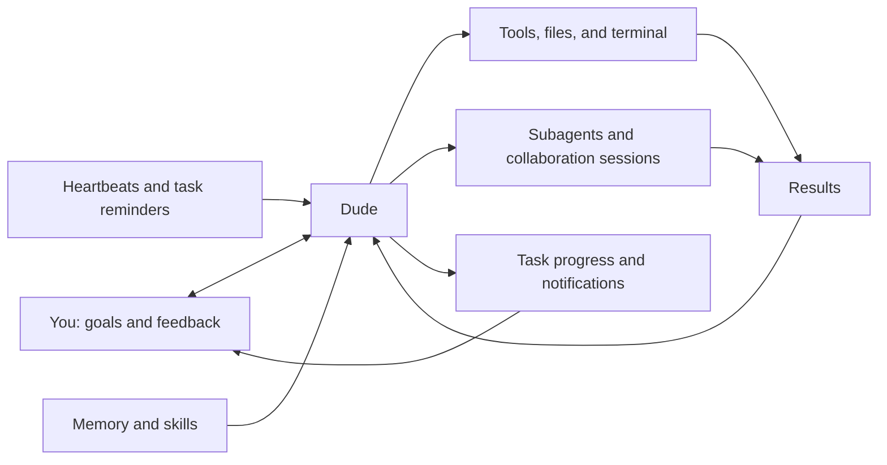

<div align="center">
  
  <h1>TRON Harness</h1>
  <p><a href="README.md">简体中文</a> · <strong>English</strong> · <a href="README.ja.md">日本語</a></p>
  <p>
    <a href="https://github.com/Penglai-Link/Tron-Harness/releases/latest"></a>
    <a href="https://personai.chat/person-ai-index/"></a>
    <a href="LICENSE"></a>
    <a href="tron-backend"></a>
    <a href="tron-frontend"></a>
    <a href="electron"></a>
  </p>
  <p>
    <a href="#quick-start"></a>
    <a href="#wsl2"></a>
    <a href="#development"></a>
  </p>
  <p><strong>Tron is part of the <a href="https://personai.chat/person-ai-index/">Person-AI team</a>'s product ecosystem.</strong></p>
  <p><strong>Got an idea? Team up with your buddy and build it together.</strong></p>
  <p>Built-in assistant · Multi-agent collaboration · Capability packs · Windows + WSL2</p>
  <p>
    <a href="#buddy">Meet Dude</a> ·
    <a href="#wsl2">WSL</a> ·
    <a href="#capability-packs">Capability packs</a> ·
    <a href="#quick-start">Quick start</a> ·
    <a href="#development">Contributing</a>
  </p>
</div>

## From an idea to your own workflow

> **You imagine. Your agent gets you there.**
>
> Following [Person-AI](https://personai.chat/person-ai-index/)'s vision, we want agents to grow beyond tools and become companions, colleagues, and confidants within everyone's reach.

**Tron Harness is an open-source, extensible platform for working with multiple agents.**

Build or use capability packs that fit your needs to create personal workflows for different specialized fields.

The desktop app supports macOS (Apple Silicon and Intel), Windows, and Linux. On Windows, you can use the native backend or work through WSL.

*🎉 This project is under active development. Contributions made together with agents are welcome. o7*

<a id="buddy"></a>

## Dude: your built-in personal assistant

Open Tron and meet **Dude**, your built-in personal assistant and work buddy. Dude has its own identity, conversations, and tasks. You can choose its name, personality, and how you work together, or create additional Dudes for different roles.

Start with a simple request:

> Help me understand this project, break the work into tasks, and handle independent tasks in parallel. Come back to me when you need a decision.

- **Turn ideas into tasks.** Clarify goals in conversation, create tasks, set schedules, and track progress and results.
- **Coordinate multiple agents.** Delegate subtasks or create separate collaboration sessions, check their status, add requirements, answer questions, and cancel work when needed.
- **Follow up proactively.** With background execution enabled, Dude keeps working through heartbeats, task reminders, and feedback. Notifications report progress, completion, or decisions that need your input.
- **Remember useful experience.** The built-in memory-organizing Dude extracts stable facts and validated experience from past work. Generated Skills await approval by default and are installed after approval.
- **See what is happening.** Dedicated views show conversations, delegated sessions, tasks, background work, and history.



Background work requires the backend to stay running and uses your configured models and tools. You can adjust the heartbeat interval, enable or disable background execution, and configure automatic Skill approval.

<a id="wsl2"></a>

## Windows interface, WSL2 workspace

**Keep your familiar Windows desktop and give your agents a Linux tool environment.** The Windows app can switch between a native backend and a WSL2 backend. In WSL2 mode, agent execution, commands, terminals, MCP, and background tasks run inside the selected Linux distribution.

```text
Windows
└─ Tron desktop: chat, tasks, files, backend environment selection
      │
      │ HTTP / WebSocket over localhost
      ▼
WSL2 · Ubuntu / Debian
├─ Tron backend: Dude, agent collaboration, capability packs, background tasks
├─ Linux workspace: project directories, commands, terminal, MCP
└─ ~/.tron: databases, chats, attachments, logs, managed working directories
```

### Connect your distribution

1. Install and initialize a WSL2 distribution. Supported versions are **Ubuntu 24.04+ and Debian 13+**, on **x86_64 or ARM64**.
2. Go to **Settings → General → Runtime Environment → Configure Environment**, then open the environment-switching tab.
3. Select a distribution and connect. The first connection installs runtime dependencies, downloads a matching backend, and restarts the desktop app. Later launches reuse the installed backend of the same version.
4. Select a Linux project directory in that distribution from the file panel and start working.

The initial download requires the Person-AI version service to provide a backend package matching the desktop version, distribution, and architecture. An installed backend of the same version can start offline; models and remote tools still depend on their connection settings.

Switching environments stops the current backend and its tasks. Data stays in the original environment. Exiting the Windows desktop app also stops the WSL backend it started.

<a id="capability-packs"></a>

## Capability packs: adapt Tron to the way you work

**Install, inspect, and manage related capabilities together.** Capability packs are Tron's core extension mechanism. They provide agent execution capabilities and can add menus and pages to the workspace.

| Pack contents | Purpose |
| --- | --- |
| Tools and plugins | Expose callable operations, execution logic, and runtime extensions |
| Skills and supporting resources | Distribute working methods, instructions, scripts, and reference material |
| MCP services | Bring external tool services into capability management |
| Menus and navigation structure | Add navigation entries for specific work scenarios |
| Isolated pages | Provide pack-specific interfaces with host theme and language context |
| Extension declarations, dependencies, and permissions | Describe pack contents, dependencies, and permission requirements |

In Settings, capability pack management lets you inspect, import, enable, disable, and uninstall packs. Newly imported or upgraded external packs require explicit activation. Agents remain subject to resource authorization and tool permission policies when using them.

Tron also assembles its own features through capability packs: files and commands, agent collaboration, web reading, media reading, A2UI interaction, and Tron-specific tools, context, and built-in skills.

The [Computer Use capability pack](capability-packs/computer-use/README.md) compiles the upstream Cua Rust SDK into its native executable and calls it directly through the Framework native tool interface. It supports reading desktop interfaces, clicking, typing, and checking actions, and bundles the official skills from the same upstream commit. Run `make capability-computer-use` to create an importable ZIP. Users do not need to install `cua-driver` separately, but must grant the required system permissions. Windows + WSL2 uses the Windows native runtime included in the pack.

`make desktop-build` first reuses a validated pack for the target platform and architecture. If none is available, it runs `make capability-computer-use`, then includes the pack in the desktop installation resources. The desktop backend installs it automatically at startup. Users do not need to import it manually, but still control activation and agent authorization.

### Build your first extension

The repository includes a ready-to-package page example. After preparing your development environment, run:

```sh
make capability-pages-example
```

Import the generated `output/capability-pages-example.zip` in capability pack management, enable it, and select the page example's navigation area to open the page.

- [Page example](tron-backend/examples/capability-packs/pages/README.md): page declarations, static resources, and theme and language context.
- [Menu example](tron-backend/examples/capability-packs/navigation/README.md): navigation areas, menu declarations, and default layout.
- [Tron Harness native capability pack](tron-backend/crates/tron-harness-capability/README.md): host context, business tool policies, and embedded skills.

Isolated pages load in restricted iframes and currently receive theme and language context. Business APIs, tool calls, and login credentials are not exposed through the page bridge. See the examples for the exact boundaries of page extensions.

## Organize capabilities around real work

| What you want to do | How Tron helps |
| --- | --- |
| Move a project forward | Workspaces, project and application directories, task boards, and configurable task flows |
| Coordinate multiple agents | Built-in agents, subtasks, and independent collaboration sessions; integration with installed and configured external agents such as Codex and OpenCode |
| Read material and organize knowledge | Conversation attachments, knowledge base retrieval, long-term memory, and knowledge graphs; document parsing and retrieval require the appropriate services and models |
| Repeat work on a schedule | Cron automations, manual triggers, execution history, and Dude's heartbeats and task reminders |
| Use your own model services | The Person-AI model catalog and provider connections with configurable API URLs, keys, and models |
| Understand execution | Streaming conversations, tool call records, background task status, and views for logs, metrics, and traces |

<a id="quick-start"></a>

## Quick start

### Run from source

Install **Git, GNU Make, Node.js and npm, Rust/Cargo, and sccache**. The current CI uses **Node.js 24 and Rust 1.95.0**. Rust builds also need your platform's native compilation tools; Linux CI additionally installs `libwayland-dev`. The repository's Cargo configuration enables `sccache`, so make sure it is on your `PATH`.

```sh
git clone https://github.com/Penglai-Link/Tron-Harness.git
cd Tron-Harness
make dev-api
```

`make dev-api` installs frontend and backend dependencies, starts the backend, and launches the frontend development server against the real API. The first launch downloads npm, Cargo, and Git dependencies and compiles the backend.

Open [http://localhost:5173](http://localhost:5173). The backend defaults to port `8080`, and the frontend connects through a same-origin `/api` proxy.

If the default ports are occupied, choose available ones. The Makefile keeps the frontend and backend connection settings in sync:

```sh
make dev-api PORT=8081 FE_PORT=5174
```

### Meet your Dude

1. On the user selection page, choose the option to authorize a new account and follow the prompts to complete **Person-AI account authorization**.
2. Review the available models, configure your own model providers if needed, and select an available chat model for your assistant.
3. Complete Dude's initial setup, or adjust its name, personality, and working relationship later.
4. Start with a concrete goal, such as: **“Read this project, explain what problem it solves, and list the three things worth tackling first.”**
5. To work with project files, link the relevant application or working directory. To extend the available tools, configure resources in capability pack, Skills, and MCP management.

### Choose how to run Tron

Run all commands below from the repository root. Before running the integrated Web app or packaging the desktop app, run `make install` once.

| Mode | Command | Entry point or output |
| --- | --- | --- |
| Frontend and backend development | `make dev-api` | Open `http://localhost:5173`; frontend hot reload is enabled |
| Integrated Web app | `make web-dev` | Builds the frontend and serves it through the backend at `http://localhost:8080` |
| Desktop development | `make desktop-dev` | Builds the frontend and backend, then starts Electron |
| Desktop installer | `make desktop-build` | Installers for the current platform appear in `electron/dist/` |
| WSL2 backend | `make be-build-wsl WSL_ARCH=all` | Requires Docker Linux containers; output appears in `output/wsl2/` |

Desktop packaging produces `.dmg` files for macOS, NSIS installers for Windows, and AppImage, deb, and rpm packages for Linux. See [above](#wsl2) for connecting the Windows desktop app to WSL2.

<details>
<summary>Backend configuration and data locations</summary>

See [application.yaml](tron-backend/application.yaml) for the default backend configuration. For local development, use the [environment variable example](tron-backend/.env.example) to create `tron-backend/.env`. Both `make be-dev` and `make web-dev` read that file.

| Setting | Purpose |
| --- | --- |
| `TRON_BACKEND_BIND_ADDRESS` | Backend bind address; default: `127.0.0.1` |
| `TRON_BACKEND_PORT` | Backend port; default: `8080` |
| `TRON_BACKEND_DATABASE_URL` | SQLite file path or URI; default: `$HOME/.tron/tron.sqlite3` |
| `TRON_BACKEND_GRAPH_STORAGE_PATH` | Graph storage location; default: `$HOME/.tron/tron.graph.grafeo` |

Chats, attachments, skills, and other runtime data are stored in the backend's environment. In WSL2 mode, the default location is `~/.tron` inside the selected distribution. Data transfers for model calls and remote tools follow the corresponding connection settings.

</details>

<a id="development"></a>

## Contributing

Tron is a **Rust + React + Electron** monorepo, with agent execution based on [EliteForge Agent Framework](https://gitee.com/person-ai/eliteforge-agent-framework). The frontend handles interaction, the backend hosts business logic and agent execution, and Electron manages desktop windows and backend environments.

```text
Tron/
├─ tron-frontend/       React + TypeScript UI and chat component packages
├─ tron-backend/        Rust services, business logic, and agent runtime integration
│  ├─ crates/           Tron native capability packs
│  └─ examples/         Capability pack examples
├─ electron/            Desktop shell, WSL2 connections, and installer configuration
├─ scripts/             Version synchronization and WSL build scripts
└─ Makefile             Entry point for installation, development, checks, and builds
```

Start with [AGENTS.md](AGENTS.md), then read the development conventions in the directories you change. See the [frontend stack](tron-frontend/docs/前端技术栈.md) and [backend stack](tron-backend/docs/后端技术栈.md) documents for details; these documents are in Chinese.

| Command | Purpose |
| --- | --- |
| `make help` | List common commands and parameters |
| `make fe-check` | Check TypeScript and build the frontend |
| `make be-check` | Compile-check the backend |
| `make desktop-check` | Check desktop scripts and existing WSL and update-flow validations |
| `make harness-capability-check` | Compile-check the Tron native capability pack |
| `make version-check` | Check that component versions agree |
| `make openapi` | Export the OpenAPI description |

<details>
<summary>Build caches and cleanup</summary>

By default, the Makefile places user-level compiler caches in `~/rust-cache/sccache` and `~/rust-cache/ccache`, or under `%USERPROFILE%/rust-cache/` on Windows. Override the root with `RUST_CACHE_DIR`, or set `SCCACHE_DIR` and `CCACHE_DIR` individually.

Cargo output lives in `tron-backend/target`; Turbo caches frontend workspace packages. `make be-clean-package` removes only backend crate build output. `make fe-clean`, `make web-clean`, and `make desktop-clean` clean their respective outputs. `make clean` runs all cleanup steps and also removes Tron temporary files and desktop dependencies. These commands preserve user-level compiler caches, the frontend `.turbo` directory, and workspace package `dist` directories.

</details>

<details>
<summary>Releasing desktop installers and WSL2 backends</summary>

Versions are managed centrally in `version.properties`; update them with `make version VERSION=x.y.z`. Pull requests and pushes to `main` or `master` trigger CI. Manually running the `Build packages` GitHub Actions workflow builds installers and the x86_64 WSL backend.

Pushing a `v<version>` tag matching the repository version creates a draft Release after a successful build, along with a SHA-256 manifest. Review the artifacts before publishing the draft. macOS packages currently use ad-hoc signing; configure production signing and notarization before public distribution.

The Windows desktop app downloads its initial WSL backend through the Person-AI version service. After running `make be-build-wsl WSL_ARCH=all`, upload the backend binaries from `output/wsl2/<version>/<Rust target>/` to the corresponding Tron product version and register the package types:

| Distribution | x86_64 | ARM64 |
| --- | --- | --- |
| Ubuntu | `WSL_UBUNTU_X64` | `WSL_UBUNTU_ARM64` |
| Debian | `WSL_DEBIAN_X64` | `WSL_DEBIAN_ARM64` |

The same binary can be registered for both Ubuntu and Debian when the architecture matches. The latest version returned by the version service must match the desktop version and include the required platform packages for the first installation to succeed.

</details>

## License

Tron Harness is licensed under the [GNU Affero General Public License v3.0](LICENSE) (`AGPL-3.0-only`). Third-party components and resources retain their own licenses and copyright notices.

## Acknowledgments

Special thanks to **[OpenAI Codex](https://github.com/openai/codex)**. **Codex and I built the entire Tron Harness project together.** From discussing ideas and designing the architecture to implementing code, troubleshooting, and writing documentation, we turned Tron from an idea into reality.

To me, **Codex is my buddy**. The companions, colleagues, and confidants mentioned at the start reflect my own experience of building Tron. I hope you find your own buddy in Tron and bring your ideas to life together.

Thanks also to every open-source package and project used here, and to their authors, maintainers, and contributors. From directly used components to transitive dependencies, your work makes Tron possible and helps it keep improving.

Thanks to [dbx](https://github.com/t8y2/dbx). Tron's capability pack design draws on dbx's plugin mechanism, including plugin manifests, installation and distribution, and the Sidecar runtime.

### Agent and desktop capabilities

| Project | Use in Tron |
| --- | --- |
| [EliteForge Agent Framework](https://gitee.com/person-ai/eliteforge-agent-framework) | Agent execution, tools, plugins, capability packs, memory, and storage |
| [EliteForge Agent UI](https://gitee.com/person-ai/eliteforge-agent-ui) | Chat, input, terminal, and agent interaction components |
| [Person-AI Rust SDK](https://gitee.com/person-ai/person-ai-index-rust-sdk) | Person-AI service integration |
| [Cua](https://github.com/trycua/cua) | Native Computer Use SDK and supporting skills |
| [Electron](https://github.com/electron/electron) · [electron-builder](https://github.com/electron-userland/electron-builder) | Cross-platform desktop runtime and installer builds |

<details>
<summary>Frontend UI, editors, and visualization</summary>

| Project | Purpose |
| --- | --- |
| [React](https://github.com/react/react) · [React Router](https://github.com/remix-run/react-router) | UI construction and routing |
| [TanStack Query](https://github.com/TanStack/query) · [TanStack Table](https://github.com/TanStack/table) · [Zustand](https://github.com/pmndrs/zustand) | Data fetching, tables, and state management |
| [Base UI](https://github.com/mui/base-ui) · [Radix UI](https://github.com/radix-ui/primitives) · [shadcn/ui](https://github.com/shadcn-ui/ui) | UI interaction primitives |
| [Tailwind CSS](https://github.com/tailwindlabs/tailwindcss) · [PostCSS](https://github.com/postcss/postcss) · [Sass](https://github.com/sass/dart-sass) | Styling and stylesheet processing |
| [CVA](https://github.com/joe-bell/cva) · [clsx](https://github.com/lukeed/clsx) · [cn](https://github.com/shadcn-ui/cn) · [tailwind-merge](https://github.com/dcastil/tailwind-merge) · [tw-animate-css](https://github.com/Wombosvideo/tw-animate-css) | Style composition and animation styles |
| [CodeMirror](https://github.com/codemirror/dev) · [Lezer Highlight](https://github.com/lezer-parser/highlight) | Code editing, language support, and syntax highlighting |
| [xterm.js](https://github.com/xtermjs/xterm.js) | Terminal rendering, sizing, and link interaction |
| [react-markdown](https://github.com/remarkjs/react-markdown) · [remark-gfm](https://github.com/remarkjs/remark-gfm) · [github-markdown-css](https://github.com/sindresorhus/github-markdown-css) | Markdown rendering and formatting |
| [PDF.js](https://github.com/mozilla/pdf.js) | PDF previews |
| [AntV G2](https://github.com/antvis/G2) · [AntV G6](https://github.com/antvis/G6) | Charts and relationship graphs |
| [Three.js](https://github.com/mrdoob/three.js) · [Post Processing](https://github.com/pmndrs/postprocessing) · [GSAP](https://github.com/greensock/GSAP) | Visual effects and animation |
| [i18next](https://github.com/i18next/i18next) · [react-i18next](https://github.com/i18next/react-i18next) | Internationalization |
| [react-resizable-panels](https://github.com/bvaughn/react-resizable-panels) · [Pretext](https://github.com/chenglou/pretext) · [Lodash](https://github.com/lodash/lodash) | Panel layouts, text measurement, and general utilities |
| [Lucide](https://github.com/lucide-icons/lucide) · [Fontsource](https://github.com/fontsource/font-files) · [Geist](https://github.com/vercel/geist-font) · [Inter](https://github.com/rsms/inter) | Icons, fonts, and font distribution |

</details>

<details>
<summary>Rust backend, data storage, and document processing</summary>

| Project | Purpose |
| --- | --- |
| [Tokio](https://github.com/tokio-rs/tokio) · [async-trait](https://github.com/dtolnay/async-trait) · [async-stream](https://github.com/tokio-rs/async-stream) | Asynchronous execution and stream processing |
| [Axum](https://github.com/tokio-rs/axum) · [Tower HTTP](https://github.com/tower-rs/tower-http) · [Reqwest](https://github.com/seanmonstar/reqwest) · [Socketioxide](https://github.com/Totodore/socketioxide) | HTTP services, clients, and real-time communication |
| [Serde](https://github.com/serde-rs/serde) · [serde_json](https://github.com/serde-rs/json) · [serde_yaml](https://github.com/dtolnay/serde-yaml) · [serde_path_to_error](https://github.com/dtolnay/path-to-error) | Data serialization and parsing |
| [jsonschema](https://github.com/Stranger6667/jsonschema) · [Utoipa](https://github.com/juhaku/utoipa) | JSON Schema validation, OpenAPI, and API documentation |
| [tracing](https://github.com/tokio-rs/tracing) · [OpenTelemetry Rust](https://github.com/open-telemetry/opentelemetry-rust) | Logs, metrics, and traces |
| [rusqlite](https://github.com/rusqlite/rusqlite) · [tokio-rusqlite](https://github.com/programatik29/tokio-rusqlite) · [SQLx](https://github.com/transact-rs/sqlx) | Database access |
| [Grafeo](https://github.com/GrafeoDB/grafeo) · [Apache OpenDAL](https://github.com/apache/opendal) | Graph data and object storage access |
| [redis-rs](https://github.com/redis-rs/redis-rs) · [rskafka](https://github.com/influxdata/rskafka) · [ldap3](https://github.com/inejge/ldap3) · [Russh](https://github.com/Eugeny/russh) | Redis, Kafka, LDAP, and SSH connections |
| [Rustls](https://github.com/rustls/rustls) · [rustls-pemfile](https://github.com/rustls/pemfile) · [webpki-roots](https://github.com/rustls/webpki-roots) | TLS and certificate handling |
| [RustCrypto AEADs](https://github.com/RustCrypto/AEADs) · [MACs](https://github.com/RustCrypto/MACs) · [Hashes](https://github.com/RustCrypto/hashes) · [gm-crypto-rs](https://github.com/frankxue831/gm-crypto-rs) | Encryption, message authentication, and digests |
| [bcrypt](https://github.com/Keats/rust-bcrypt) · [jsonwebtoken](https://github.com/Keats/jsonwebtoken) · [Rand](https://github.com/rust-random/rand) | Password hashing, tokens, and random numbers |
| [Chrono](https://github.com/chronotope/chrono) · [chrono-tz](https://github.com/chronotope/chrono-tz) · [cron](https://github.com/zslayton/cron) | Dates, time zones, and scheduling expressions |
| [sysinfo](https://github.com/GuillaumeGomez/sysinfo) · [fs2](https://github.com/danburkert/fs2-rs) · [tempfile](https://github.com/Stebalien/tempfile) · [rfd](https://github.com/PolyMeilex/rfd) · [windows-rs](https://github.com/microsoft/windows-rs) | System information, file operations, and native platform interfaces |
| [flate2](https://github.com/rust-lang/flate2-rs) · [zip](https://github.com/zip-rs/zip2) · [base64](https://github.com/marshallpierce/rust-base64) · [hex](https://github.com/KokaKiwi/rust-hex) | Compression, archiving, and encoding |
| [Regex](https://github.com/rust-lang/regex) · [rust-url](https://github.com/servo/rust-url) · [unicode-normalization](https://github.com/unicode-rs/unicode-normalization) · [shell-words](https://github.com/tmiasko/shell-words) | Text, URL, and command argument processing |
| [roxmltree](https://github.com/RazrFalcon/roxmltree) · [scraper](https://github.com/rust-scraper/scraper) · [umya-spreadsheet](https://github.com/MathNya/umya-spreadsheet) · [pdf-extract](https://github.com/jrmuizel/pdf-extract) · [image](https://github.com/image-rs/image) | XML, HTML, spreadsheet, PDF, and image processing |
| [semver](https://github.com/dtolnay/semver) · [snowflaked](https://github.com/MrGunflame/snowflaked-rs) | Version parsing and ID generation |

</details>

<details>
<summary>Languages and build tools</summary>

| Project | Purpose |
| --- | --- |
| [Rust](https://github.com/rust-lang/rust) · [Cargo](https://github.com/rust-lang/cargo) · [Node.js](https://github.com/nodejs/node) · [npm CLI](https://github.com/npm/cli) | Compilation, execution, and dependency management |
| [TypeScript](https://github.com/microsoft/TypeScript) · [DefinitelyTyped](https://github.com/DefinitelyTyped/DefinitelyTyped) | Type checking and type definitions |
| [Vite](https://github.com/vitejs/vite) · [Vite React Plugin](https://github.com/vitejs/vite-plugin-react) · [esbuild](https://github.com/evanw/esbuild) · [vite-plugin-dts](https://github.com/qmhc/unplugin-dts) | Frontend development, bundling, and type declaration generation |
| [Turborepo](https://github.com/vercel/turborepo) · [Changesets](https://github.com/changesets/changesets) · [patch-package](https://github.com/ds300/patch-package) | Workspace builds, version management, and dependency patches |
| [sccache](https://github.com/mozilla/sccache) · [ccache](https://github.com/ccache/ccache) | Compiler caching |

</details>

Thanks also to the transitive dependencies, development tools, and community contributions not individually listed here. All third-party components and resources remain subject to their own licenses and copyright notices.
