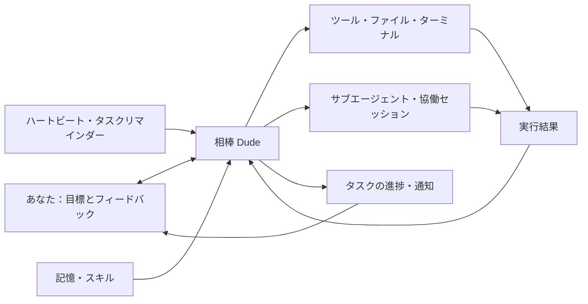

<div align="center">
  
  <h1>TRON Harness</h1>
  <p><a href="README.md">简体中文</a> · <a href="README.en.md">English</a> · <strong>日本語</strong></p>
  <p>
    <a href="https://github.com/Penglai-Link/Tron-Harness/releases/latest"></a>
    <a href="https://personai.chat/person-ai-index/"></a>
    <a href="LICENSE"></a>
    <a href="tron-backend"></a>
    <a href="tron-frontend"></a>
    <a href="electron"></a>
  </p>
  <p>
    <a href="#quick-start"></a>
    <a href="#wsl2"></a>
    <a href="#development"></a>
  </p>
  <p><strong>Tron は <a href="https://personai.chat/person-ai-index/">Person-AI チーム</a>のエコシステムを構成する製品の一つです。</strong></p>
  <p><strong>アイデアが浮かんだら、相棒と一緒に形にしよう。</strong></p>
  <p>内蔵パーソナルアシスタント · マルチエージェント協働 · 能力パックによる拡張 · Windows + WSL2</p>
  <p>
    <a href="#buddy">Dude を知る</a> ·
    <a href="#wsl2">WSL</a> ·
    <a href="#capability-packs">能力パック</a> ·
    <a href="#quick-start">クイックスタート</a> ·
    <a href="#development">開発への参加</a>
  </p>
</div>

## アイデアから、自分だけのワークフローへ

> **あなたが想像し、エージェントが実現へと導く。**
>
> [Person-AI](https://personai.chat/person-ai-index/) のビジョンを受け継ぎ、エージェントが単なるツールを超え、誰にとっても身近なパートナー、同僚、そして理解者になることを目指しています。

**Tron Harness は、オープンソースで拡張可能なマルチエージェント作業プラットフォームです。**

自分に合った能力パックを開発・利用することで、さまざまな専門分野に向けた個人のワークフローを構築できます。

デスクトップアプリは macOS（Apple Silicon・Intel）、Windows、Linux に対応しています。Windows では、ネイティブのバックエンドでも WSL 経由でも利用できます。

*🎉 本プロジェクトは開発を継続しています。エージェントと一緒に取り組むコードへの貢献も歓迎します。o7*

<a id="buddy"></a>

## Dude：あなたのパーソナルアシスタント

Tron を開くと、内蔵のパーソナルアシスタントであり、仕事の相棒でもある **Dude（好兄弟）** が迎えてくれます。Dude は独自のアイデンティティ、会話、タスクを持ちます。名前や性格、接し方を設定したり、異なる役割を担う Dude を追加したりできます。

まずは、ひと言から始めてみましょう。

> このプロジェクトを理解するのを手伝って。作業をタスクに分け、並行して進められるものは一緒に進めて。私の判断が必要になったら声をかけて。

- **アイデアをタスクにする。** 会話で目標を明確にし、タスクの作成、日程の設定、進捗と実行結果の確認を行います。
- **複数のエージェントで分担する。** サブタスクの委任や独立した協働セッションの作成、状態の確認、要件の追加、質問への回答、必要に応じた作業の中止ができます。
- **自らフォローする。** バックグラウンド実行を有効にすると、Dude はハートビート、タスクリマインダー、作業からのフィードバックを通じて処理を続けます。進捗、完了、判断が必要な事項は通知で知らせます。
- **役立つ経験を記憶する。** 内蔵の記憶整理用 Dude が、過去の作業から継続的に有効な事実や検証済みの経験を整理します。生成された Skill は、既定では承認待ちとなり、承認後にインストールされます。
- **作業状況を把握する。** 会話、委任先のセッション、タスク、バックグラウンド処理、履歴をそれぞれの画面で確認できます。



バックグラウンド処理には、バックエンドを起動し続ける必要があります。処理には設定済みのモデルとツールを使用します。ハートビートの間隔、バックグラウンド実行の有効・無効、Skill の自動承認は設定で変更できます。

<a id="wsl2"></a>

## Windows の画面で、WSL2 の作業環境を使う

**使い慣れた Windows デスクトップから、エージェントに Linux のツール環境を提供できます。** Windows アプリでは、ネイティブのバックエンドと WSL2 バックエンドを切り替えられます。WSL2 を選択すると、エージェントの実行、コマンド、ターミナル、MCP、バックグラウンドタスクは、選択した Linux ディストリビューション内で動作します。

```text
Windows
└─ Tron デスクトップ：チャット、タスク、ファイル、バックエンド環境の選択
      │
      │ localhost 経由の HTTP / WebSocket
      ▼
WSL2 · Ubuntu / Debian
├─ Tron バックエンド：Dude、エージェント協働、能力パック、バックグラウンド処理
├─ Linux 作業環境：プロジェクトディレクトリ、コマンド、ターミナル、MCP
└─ ~/.tron：データベース、チャット、添付ファイル、ログ、管理対象の作業ディレクトリ
```

### ディストリビューションに接続する

1. WSL2 ディストリビューションをインストールし、初期設定を済ませます。**Ubuntu 24.04+、Debian 13+**、アーキテクチャは **x86_64、ARM64** に対応しています。
2. **設定 → 一般 → 実行環境 → 環境の設定** に進み、環境切り替えタブを開きます。
3. ディストリビューションを選んで接続します。初回は実行時依存関係のインストールと対応するバックエンドのダウンロードを行い、デスクトップアプリを再起動します。次回以降は、インストール済みの同じバージョンのバックエンドを再利用します。
4. ファイルパネルで、そのディストリビューション内の Linux プロジェクトディレクトリを選択して作業を始めます。

初回ダウンロードには、デスクトップのバージョン、ディストリビューション、アーキテクチャに一致するバックエンドパッケージが Person-AI のバージョンサービスに登録されている必要があります。同じバージョンのバックエンドがインストール済みなら、オフラインでも起動できます。モデルやリモートツールの利用は、それぞれの接続設定に依存します。

環境を切り替えると、現在のバックエンドとそのタスクは停止します。データは元の環境に残ります。Windows デスクトップアプリを終了すると、そのアプリが起動した WSL バックエンドも停止します。

<a id="capability-packs"></a>

## 能力パック：自分の仕事に合わせて Tron を拡張する

**関連する能力をまとめてインストールし、確認・管理できます。** 能力パック（Capability Pack）は Tron の中核となる拡張機構です。エージェントに実行能力を提供するとともに、作業画面にメニューやページを追加できます。

| パックの内容 | 用途 |
| --- | --- |
| ツールとプラグイン | 呼び出し可能な操作、実行ロジック、ランタイム拡張を提供 |
| Skills と関連リソース | 作業手順、説明、スクリプト、参考資料を配布 |
| MCP サービス | 外部ツールサービスを能力管理に組み込む |
| メニューとナビゲーション構成 | 特定の作業に向けたナビゲーション項目を追加 |
| 分離されたページ | ホストのテーマと言語コンテキストを受け取る独自の画面を提供 |
| 拡張宣言、依存関係、権限 | パックの構成、依存関係、必要な権限を定義 |

設定内の能力パック管理画面では、内容の確認、インポート、有効化、無効化、アンインストールができます。外部パックを新しくインポートした場合や更新した場合は、明示的な有効化が必要です。エージェントによる利用には、引き続きリソースの認可とツールの権限ポリシーが適用されます。

Tron 自身も能力パックで機能を構成しています。ファイルとコマンド、エージェント協働、Web・メディアの読み取り、A2UI の操作、Tron 固有のツール・コンテキスト・内蔵スキルに、それぞれ対応する能力パックがあります。

[Computer Use 能力パック](capability-packs/computer-use/README.md) は、上流の Cua Rust SDK をパック内のネイティブプログラムに組み込み、Framework のネイティブツールインターフェースから直接呼び出します。デスクトップ画面の読み取り、クリック、入力、操作結果の確認に対応し、同じコミットの公式スキルを同梱します。`make capability-computer-use` でインポート可能な ZIP を生成できます。`cua-driver` の別途インストールは不要ですが、必要なシステム権限の付与は必要です。Windows + WSL2 では、パックに含まれる Windows ネイティブランタイムを使用します。

`make desktop-build` は、対象プラットフォームとアーキテクチャ向けの検証済みパックを優先して再利用します。見つからなければ `make capability-computer-use` を実行し、パックをデスクトップのインストールリソースに含めます。デスクトップのバックエンドが起動時に自動インストールするため、手動のインポートは不要です。有効・無効の切り替えとエージェントへの利用許可は、ユーザーが管理します。

### 最初の拡張を作る

リポジトリには、そのままパッケージ化できるページのサンプルがあります。開発環境を準備してから、次を実行してください。

```sh
make capability-pages-example
```

生成された `output/capability-pages-example.zip` を能力パック管理画面でインポートして有効化し、ページサンプルのナビゲーション領域を選択すると、サンプルページを開けます。

- [ページサンプル](tron-backend/examples/capability-packs/pages/README.md)：ページ宣言、静的リソース、テーマと言語コンテキスト。
- [メニューサンプル](tron-backend/examples/capability-packs/navigation/README.md)：ナビゲーション領域、メニュー宣言、既定の配置。
- [Tron Harness ネイティブ能力パック](tron-backend/crates/tron-harness-capability/README.md)：ホストコンテキスト、業務ツールのポリシー、組み込みスキル。

分離されたページは、制限付きの iframe で読み込まれ、現在はテーマと言語コンテキストを受け取ります。業務 API、ツール呼び出し、ログイン認証情報は、ページブリッジ経由では公開されません。ページ拡張の具体的な制約は、サンプルの説明を参照してください。

## 実際の仕事に合わせて能力を組み合わせる

| やりたいこと | Tron が提供する機能 |
| --- | --- |
| プロジェクトを進める | ワークスペース、プロジェクトとアプリケーションのディレクトリ、タスクボード、設定可能なタスクフロー |
| 複数のエージェントを調整する | 内蔵エージェント、サブタスク、独立した協働セッション。インストール・設定済みの Codex、OpenCode などの外部エージェントとも連携可能 |
| 資料を読み、知識を整理する | 会話への添付、ナレッジベース検索、長期記憶、ナレッジグラフ。文書解析と検索には、対応するサービスとモデルの設定が必要 |
| 繰り返し作業を定期実行する | Cron 自動化、手動実行、実行履歴、Dude のハートビートとタスクリマインダー |
| 自分のモデルサービスを使う | Person-AI モデルカタログと、API URL・キー・モデルを設定できるプロバイダー接続 |
| 実行状況を把握する | ストリーミング会話、ツール呼び出し履歴、バックグラウンドタスクの状態、ログ・メトリクス・トレースの表示 |

<a id="quick-start"></a>

## クイックスタート

### ソースコードから起動する

**Git、GNU Make、Node.js と npm、Rust/Cargo、sccache** を用意してください。現在の CI は **Node.js 24、Rust 1.95.0** を使用しています。Rust のビルドには各プラットフォームのネイティブコンパイルツールも必要です。Linux の CI では `libwayland-dev` を追加でインストールします。リポジトリの Cargo 設定では `sccache` が有効なので、`PATH` に含まれていることを確認してください。

```sh
git clone https://github.com/Penglai-Link/Tron-Harness.git
cd Tron-Harness
make dev-api
```

`make dev-api` は、フロントエンドとバックエンドの依存関係をインストールし、バックエンドを起動した後、実際の API に接続するフロントエンド開発サーバーを起動します。初回起動では npm、Cargo、Git の依存関係のダウンロードと、バックエンドのコンパイルを行います。

[http://localhost:5173](http://localhost:5173) を開いてください。バックエンドの既定ポートは `8080` で、フロントエンドは同一オリジンの `/api` プロキシを通じて接続します。

既定ポートが使用中の場合は、空いているポートを指定してください。Makefile がフロントエンドとバックエンドの接続設定を同期します。

```sh
make dev-api PORT=8081 FE_PORT=5174
```

### 相棒と出会う

1. ユーザー選択画面で新しいアカウントの認可を選び、画面の案内に従って **Person-AI アカウントの認可**を完了します。
2. 利用可能なモデルを確認し、必要に応じて独自のモデルプロバイダーを設定して、アシスタント用の会話モデルを選びます。
3. Dude の初期設定を行います。名前や性格、接し方は後から変更することもできます。
4. **「このプロジェクトを読み、何を解決するものか説明して、優先して取り組むべきことを三つ挙げて」**など、具体的な目標から始めてください。
5. プロジェクトのファイルを操作する場合は、対応するアプリケーションまたは作業ディレクトリを関連付けます。ツールを拡張する場合は、能力パック、Skills、MCP の管理画面で必要なリソースを設定します。

### 実行方法を選ぶ

以下のコマンドは、すべてリポジトリのルートで実行してください。統合 Web アプリの起動やデスクトップアプリのパッケージ化の前に、一度 `make install` を実行します。

| 実行方法 | コマンド | アクセス先・生成物 |
| --- | --- | --- |
| フロントエンド・バックエンドの連携開発 | `make dev-api` | `http://localhost:5173`。フロントエンドのホットリロードに対応 |
| 統合 Web アプリ | `make web-dev` | フロントエンドをビルドし、バックエンドから `http://localhost:8080` で配信 |
| デスクトップ開発 | `make desktop-dev` | フロントエンドとバックエンドをビルドし、Electron を起動 |
| デスクトップインストーラー | `make desktop-build` | 現在のプラットフォーム向けのインストーラーを `electron/dist/` に生成 |
| WSL2 バックエンド | `make be-build-wsl WSL_ARCH=all` | Docker の Linux コンテナが必要。生成物は `output/wsl2/` |

デスクトップのパッケージ設定では、macOS 向けの `.dmg`、Windows 向けの NSIS インストーラー、Linux 向けの AppImage・deb・rpm を生成できます。Windows アプリから WSL2 へ接続する手順は[上記](#wsl2)を参照してください。

<details>
<summary>バックエンドの設定とデータの保存先</summary>

バックエンドの既定設定は [application.yaml](tron-backend/application.yaml) を参照してください。ローカル開発では[環境変数のサンプル](tron-backend/.env.example)を参考に `tron-backend/.env` を作成できます。`make be-dev` と `make web-dev` がこのファイルを読み込みます。

| 設定 | 用途 |
| --- | --- |
| `TRON_BACKEND_BIND_ADDRESS` | バックエンドの待ち受けアドレス。既定値は `127.0.0.1` |
| `TRON_BACKEND_PORT` | バックエンドのポート。既定値は `8080` |
| `TRON_BACKEND_DATABASE_URL` | SQLite ファイルのパスまたは URI。既定値は `$HOME/.tron/tron.sqlite3` |
| `TRON_BACKEND_GRAPH_STORAGE_PATH` | グラフストレージの保存先。既定値は `$HOME/.tron/tron.graph.grafeo` |

チャット、添付ファイル、スキルなどの実行時データは、バックエンドが動作する環境に保存されます。WSL2 モードでは、選択したディストリビューション内の `~/.tron` が既定の保存先です。モデル呼び出しやリモートツールのデータ転送は、それぞれの接続設定に従います。

</details>

<a id="development"></a>

## 開発への参加

Tron は **Rust + React + Electron** のモノレポで、エージェントの実行には [EliteForge Agent Framework](https://gitee.com/person-ai/eliteforge-agent-framework) を使用しています。フロントエンドが操作画面を、バックエンドが業務処理とエージェント実行を担当し、Electron がデスクトップウィンドウとバックエンド環境を管理します。

```text
Tron/
├─ tron-frontend/       React + TypeScript の画面とチャットコンポーネント
├─ tron-backend/        Rust サービス、業務処理、エージェント実行の統合
│  ├─ crates/           Tron ネイティブ能力パック
│  └─ examples/         能力パックのサンプル
├─ electron/            デスクトップシェル、WSL2 接続、インストーラー設定
├─ scripts/             バージョン同期と WSL ビルドスクリプト
└─ Makefile             インストール、起動、チェック、ビルドの入口
```

まず [AGENTS.md](AGENTS.md) を読み、変更するディレクトリ内の開発規約も確認してください。詳細は[フロントエンドの技術スタック](tron-frontend/docs/前端技术栈.md)と[バックエンドの技術スタック](tron-backend/docs/后端技术栈.md)を参照してください。これらの文書は中国語です。

| コマンド | 用途 |
| --- | --- |
| `make help` | 主なコマンドとパラメーターを表示 |
| `make fe-check` | TypeScript のチェックとフロントエンドのビルド |
| `make be-check` | バックエンドのコンパイルチェック |
| `make desktop-check` | デスクトップスクリプトと既存の WSL・更新フロー検証を実行 |
| `make harness-capability-check` | Tron ネイティブ能力パックのコンパイルチェック |
| `make version-check` | 各コンポーネントのバージョンの一致を確認 |
| `make openapi` | OpenAPI 定義をエクスポート |

<details>
<summary>ビルドキャッシュとクリーンアップ</summary>

Makefile は既定で、ユーザー単位のコンパイルキャッシュを `~/rust-cache/sccache` と `~/rust-cache/ccache` に保存します。Windows では `%USERPROFILE%/rust-cache/` 以下になります。`RUST_CACHE_DIR` でルートディレクトリを変更するか、`SCCACHE_DIR` と `CCACHE_DIR` を個別に設定できます。

Cargo の生成物は `tron-backend/target` に保存され、フロントエンドのワークスペースパッケージは Turbo がキャッシュします。`make be-clean-package` はバックエンド crate のビルド生成物のみを削除します。`make fe-clean`、`make web-clean`、`make desktop-clean` は、それぞれの生成物を削除します。`make clean` はすべてのクリーンアップに加え、Tron の一時ファイルとデスクトップの依存関係を削除します。ユーザー単位のコンパイルキャッシュ、フロントエンドの `.turbo`、ワークスペースパッケージの `dist` は保持されます。

</details>

<details>
<summary>デスクトップインストーラーと WSL2 バックエンドのリリース</summary>

バージョンは `version.properties` で一元管理し、`make version VERSION=x.y.z` で更新します。PR と `main`・`master` への push で CI が起動します。GitHub Actions の `Build packages` を手動実行すると、インストーラーと x86_64 向け WSL バックエンドをビルドできます。

リポジトリのバージョンと一致する `v<バージョン>` タグを push すると、ビルド成功後に Release の下書きと SHA-256 一覧を作成します。生成物を確認してから下書きを公開してください。macOS パッケージは現在 ad-hoc 署名を使用しているため、公開配布の前に正式な署名と公証を設定してください。

Windows アプリでの WSL バックエンドの初回ダウンロードには、Person-AI のバージョンサービスを使用します。`make be-build-wsl WSL_ARCH=all` を実行した後、`output/wsl2/<バージョン>/<Rust target>/` 内のバックエンドバイナリを、対応する Tron 製品バージョンにアップロードし、次のパッケージ種別を登録します。

| ディストリビューション | x86_64 | ARM64 |
| --- | --- | --- |
| Ubuntu | `WSL_UBUNTU_X64` | `WSL_UBUNTU_ARM64` |
| Debian | `WSL_DEBIAN_X64` | `WSL_DEBIAN_ARM64` |

同じアーキテクチャのバイナリは、Ubuntu 用と Debian 用としてそれぞれ登録できます。初回インストールを完了するには、バージョンサービスが返す最新バージョンがデスクトップのバージョンと一致し、必要なプラットフォーム向けパッケージを含んでいる必要があります。

</details>

## ライセンス

Tron Harness は [GNU Affero General Public License v3.0](LICENSE)（`AGPL-3.0-only`）で公開しています。サードパーティーのコンポーネントとリソースには、それぞれのライセンスと著作権表示が適用されます。

## 謝辞

**[OpenAI Codex](https://github.com/openai/codex)** に、心から感謝します。**Tron Harness は、プロジェクト全体を私と Codex が一緒に作り上げました。** アイデアの相談、アーキテクチャの設計、コードの実装、問題の調査、文書の執筆まで、私たちは一緒に Tron を想像から現実へと変えてきました。

私にとって、**Codex は「好兄弟」、大切な相棒です**。冒頭のパートナー、同僚、理解者という言葉は、Tron の開発を通じて実感したことでもあります。あなたも Tron で自分の相棒に出会い、一緒にアイデアを形にしてくれたらうれしいです。

このプロジェクトで使用しているすべてのオープンソースパッケージとプロジェクト、そして作者、メンテナー、コントリビューターの皆さんにも感謝します。直接利用するコンポーネントから間接的な依存ライブラリまで、皆さんの仕事が Tron の実現と継続的な改善を支えています。

[dbx](https://github.com/t8y2/dbx) にも感謝します。Tron の能力パック設計では、プラグインマニフェスト、インストールと配布、Sidecar ランタイムなど、dbx のプラグイン機構を参考にしました。

### エージェントとデスクトップの機能

| プロジェクト | Tron での用途 |
| --- | --- |
| [EliteForge Agent Framework](https://gitee.com/person-ai/eliteforge-agent-framework) | エージェント実行、ツール、プラグイン、能力パック、記憶、ストレージ |
| [EliteForge Agent UI](https://gitee.com/person-ai/eliteforge-agent-ui) | チャット、入力欄、ターミナル、エージェント操作のコンポーネント |
| [Person-AI Rust SDK](https://gitee.com/person-ai/person-ai-index-rust-sdk) | Person-AI サービスとの連携 |
| [Cua](https://github.com/trycua/cua) | Computer Use ネイティブ SDK と関連スキル |
| [Electron](https://github.com/electron/electron) · [electron-builder](https://github.com/electron-userland/electron-builder) | クロスプラットフォームのデスクトップ実行とインストーラーのビルド |

<details>
<summary>フロントエンドの画面、エディター、可視化</summary>

| プロジェクト | 用途 |
| --- | --- |
| [React](https://github.com/react/react) · [React Router](https://github.com/remix-run/react-router) | 画面構築とルーティング |
| [TanStack Query](https://github.com/TanStack/query) · [TanStack Table](https://github.com/TanStack/table) · [Zustand](https://github.com/pmndrs/zustand) | データ取得、テーブル、状態管理 |
| [Base UI](https://github.com/mui/base-ui) · [Radix UI](https://github.com/radix-ui/primitives) · [shadcn/ui](https://github.com/shadcn-ui/ui) | 基本的な UI 操作コンポーネント |
| [Tailwind CSS](https://github.com/tailwindlabs/tailwindcss) · [PostCSS](https://github.com/postcss/postcss) · [Sass](https://github.com/sass/dart-sass) | スタイルの記述と処理 |
| [CVA](https://github.com/joe-bell/cva) · [clsx](https://github.com/lukeed/clsx) · [cn](https://github.com/shadcn-ui/cn) · [tailwind-merge](https://github.com/dcastil/tailwind-merge) · [tw-animate-css](https://github.com/Wombosvideo/tw-animate-css) | スタイルの組み合わせとアニメーションのスタイル |
| [CodeMirror](https://github.com/codemirror/dev) · [Lezer Highlight](https://github.com/lezer-parser/highlight) | コード編集、言語サポート、構文ハイライト |
| [xterm.js](https://github.com/xtermjs/xterm.js) | ターミナル表示、サイズ調整、リンク操作 |
| [react-markdown](https://github.com/remarkjs/react-markdown) · [remark-gfm](https://github.com/remarkjs/remark-gfm) · [github-markdown-css](https://github.com/sindresorhus/github-markdown-css) | Markdown のレンダリングとレイアウト |
| [PDF.js](https://github.com/mozilla/pdf.js) | PDF プレビュー |
| [AntV G2](https://github.com/antvis/G2) · [AntV G6](https://github.com/antvis/G6) | チャートと関係グラフ |
| [Three.js](https://github.com/mrdoob/three.js) · [Post Processing](https://github.com/pmndrs/postprocessing) · [GSAP](https://github.com/greensock/GSAP) | 視覚効果とアニメーション |
| [i18next](https://github.com/i18next/i18next) · [react-i18next](https://github.com/i18next/react-i18next) | 国際化 |
| [react-resizable-panels](https://github.com/bvaughn/react-resizable-panels) · [Pretext](https://github.com/chenglou/pretext) · [Lodash](https://github.com/lodash/lodash) | パネル配置、テキスト計測、汎用ユーティリティ |
| [Lucide](https://github.com/lucide-icons/lucide) · [Fontsource](https://github.com/fontsource/font-files) · [Geist](https://github.com/vercel/geist-font) · [Inter](https://github.com/rsms/inter) | アイコン、フォント、フォント配布 |

</details>

<details>
<summary>Rust バックエンド、データストレージ、文書処理</summary>

| プロジェクト | 用途 |
| --- | --- |
| [Tokio](https://github.com/tokio-rs/tokio) · [async-trait](https://github.com/dtolnay/async-trait) · [async-stream](https://github.com/tokio-rs/async-stream) | 非同期実行とストリーム処理 |
| [Axum](https://github.com/tokio-rs/axum) · [Tower HTTP](https://github.com/tower-rs/tower-http) · [Reqwest](https://github.com/seanmonstar/reqwest) · [Socketioxide](https://github.com/Totodore/socketioxide) | HTTP サービス、クライアント、リアルタイム通信 |
| [Serde](https://github.com/serde-rs/serde) · [serde_json](https://github.com/serde-rs/json) · [serde_yaml](https://github.com/dtolnay/serde-yaml) · [serde_path_to_error](https://github.com/dtolnay/path-to-error) | データのシリアライズと解析 |
| [jsonschema](https://github.com/Stranger6667/jsonschema) · [Utoipa](https://github.com/juhaku/utoipa) | JSON Schema 検証、OpenAPI、API ドキュメント |
| [tracing](https://github.com/tokio-rs/tracing) · [OpenTelemetry Rust](https://github.com/open-telemetry/opentelemetry-rust) | ログ、メトリクス、トレース |
| [rusqlite](https://github.com/rusqlite/rusqlite) · [tokio-rusqlite](https://github.com/programatik29/tokio-rusqlite) · [SQLx](https://github.com/transact-rs/sqlx) | データベースアクセス |
| [Grafeo](https://github.com/GrafeoDB/grafeo) · [Apache OpenDAL](https://github.com/apache/opendal) | グラフデータとオブジェクトストレージへのアクセス |
| [redis-rs](https://github.com/redis-rs/redis-rs) · [rskafka](https://github.com/influxdata/rskafka) · [ldap3](https://github.com/inejge/ldap3) · [Russh](https://github.com/Eugeny/russh) | Redis、Kafka、LDAP、SSH 接続 |
| [Rustls](https://github.com/rustls/rustls) · [rustls-pemfile](https://github.com/rustls/pemfile) · [webpki-roots](https://github.com/rustls/webpki-roots) | TLS と証明書の処理 |
| [RustCrypto AEADs](https://github.com/RustCrypto/AEADs) · [MACs](https://github.com/RustCrypto/MACs) · [Hashes](https://github.com/RustCrypto/hashes) · [gm-crypto-rs](https://github.com/frankxue831/gm-crypto-rs) | 暗号化、メッセージ認証、ダイジェスト |
| [bcrypt](https://github.com/Keats/rust-bcrypt) · [jsonwebtoken](https://github.com/Keats/jsonwebtoken) · [Rand](https://github.com/rust-random/rand) | パスワードハッシュ、トークン、乱数 |
| [Chrono](https://github.com/chronotope/chrono) · [chrono-tz](https://github.com/chronotope/chrono-tz) · [cron](https://github.com/zslayton/cron) | 日時、タイムゾーン、スケジュール式 |
| [sysinfo](https://github.com/GuillaumeGomez/sysinfo) · [fs2](https://github.com/danburkert/fs2-rs) · [tempfile](https://github.com/Stebalien/tempfile) · [rfd](https://github.com/PolyMeilex/rfd) · [windows-rs](https://github.com/microsoft/windows-rs) | システム情報、ファイル操作、ネイティブプラットフォーム API |
| [flate2](https://github.com/rust-lang/flate2-rs) · [zip](https://github.com/zip-rs/zip2) · [base64](https://github.com/marshallpierce/rust-base64) · [hex](https://github.com/KokaKiwi/rust-hex) | 圧縮、アーカイブ、エンコード |
| [Regex](https://github.com/rust-lang/regex) · [rust-url](https://github.com/servo/rust-url) · [unicode-normalization](https://github.com/unicode-rs/unicode-normalization) · [shell-words](https://github.com/tmiasko/shell-words) | テキスト、URL、コマンド引数の処理 |
| [roxmltree](https://github.com/RazrFalcon/roxmltree) · [scraper](https://github.com/rust-scraper/scraper) · [umya-spreadsheet](https://github.com/MathNya/umya-spreadsheet) · [pdf-extract](https://github.com/jrmuizel/pdf-extract) · [image](https://github.com/image-rs/image) | XML、HTML、表計算、PDF、画像の処理 |
| [semver](https://github.com/dtolnay/semver) · [snowflaked](https://github.com/MrGunflame/snowflaked-rs) | バージョン解析と ID 生成 |

</details>

<details>
<summary>言語とビルドツール</summary>

| プロジェクト | 用途 |
| --- | --- |
| [Rust](https://github.com/rust-lang/rust) · [Cargo](https://github.com/rust-lang/cargo) · [Node.js](https://github.com/nodejs/node) · [npm CLI](https://github.com/npm/cli) | コンパイル、実行、依存関係管理 |
| [TypeScript](https://github.com/microsoft/TypeScript) · [DefinitelyTyped](https://github.com/DefinitelyTyped/DefinitelyTyped) | 型チェックと型定義 |
| [Vite](https://github.com/vitejs/vite) · [Vite React Plugin](https://github.com/vitejs/vite-plugin-react) · [esbuild](https://github.com/evanw/esbuild) · [vite-plugin-dts](https://github.com/qmhc/unplugin-dts) | フロントエンド開発、バンドル、型宣言の生成 |
| [Turborepo](https://github.com/vercel/turborepo) · [Changesets](https://github.com/changesets/changesets) · [patch-package](https://github.com/ds300/patch-package) | ワークスペースのビルド、バージョン管理、依存関係へのパッチ適用 |
| [sccache](https://github.com/mozilla/sccache) · [ccache](https://github.com/ccache/ccache) | コンパイルキャッシュ |

</details>

ここに個別に記載していない間接的な依存関係、開発ツール、コミュニティの貢献にも感謝します。すべてのサードパーティーのコンポーネントとリソースには、それぞれのライセンスと著作権表示が適用されます。
