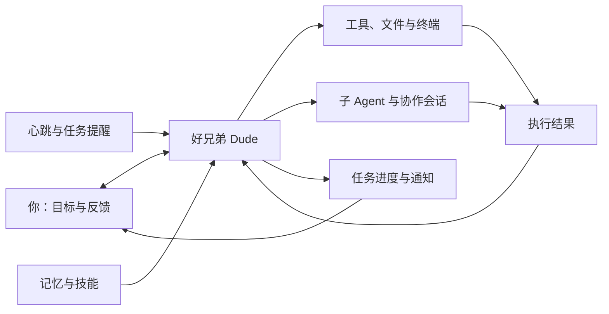

<div align="center">
  
  <h1>TRON Harness</h1>
  <p><strong>有个想法？叫上你的「好兄弟」，一起把它做出来。</strong></p>
  <p>内置个人助手 · 多 Agent 协作 · 能力包扩展 · Windows + WSL2</p>
  <p>
    <a href="#buddy">认识好兄弟</a> ·
    <a href="#wsl2">Windows + WSL2</a> ·
    <a href="#capability-packs">能力包</a> ·
    <a href="#quick-start">快速开始</a> ·
    <a href="#development">参与开发</a>
  </p>
</div>

> 「帮我看懂这个项目，拆好任务，能并行的就一起做。遇到需要我决定的事，再叫我。」

打开 Tron，你已经有了一位内置的个人助手——**好兄弟（Dude）**。你可以和它讨论想法、交代任务，让它调用工具、派发工作，再回来查看进展和结果。需要长期跟进的事情，可以交给心跳调度与自动化；值得保留的经验，可以整理成记忆和技能。

**Tron Harness 是一个开源、可扩展的多智能体工作平台。** 它把对话、任务、文件、终端、记忆和知识库放在同一个工作环境中。桌面端支持 macOS、Windows 和 Linux，也可以通过 Web 使用；Windows 用户还可以让 Agent 在 WSL2 中使用 Linux 工具与项目目录。

项目正在持续开发。下文描述当前源码中的能力，使用前需完成账号授权与模型配置。

<a id="buddy"></a>

## 好兄弟：你的内置个人助手

**从第一次见面，到下一次继续工作。** 好兄弟是 Tron 自带的个人助手 Agent，拥有自己的身份、会话与任务。你可以设定它的名字、性格和相处方式，也可以创建承担不同职责的 Dude。

- **把想法变成任务。** 在对话中明确目标，创建任务、安排时间，并持续查看进度与执行结果。
- **让多个 Agent 分工。** 派发子任务或创建独立协作会话，查看状态、补充要求、回答问题，必要时取消工作。
- **主动跟进。** 启用后台运行后，Dude 通过心跳、任务提醒和工作反馈继续处理事项，并通过通知报告进展、完成情况或需要你决定的问题。
- **记住有用的经验。** 内置的「记忆整理」Dude 从历史工作中整理稳定事实与已验证经验；生成的 Skill 默认进入待批准区，批准后安装。
- **随时了解它在做什么。** 对话、派发会话、任务、后台工作和历史记录都有对应入口。



后台工作需要后端保持运行，并使用已配置的模型与工具。心跳间隔、后台启用状态和技能自动批准选项都可以调整。

<a id="wsl2"></a>

## Windows 界面，WSL2 工作环境

**保留熟悉的 Windows 桌面，把 Linux 工具环境交给 Agent。** Tron 的 Windows 桌面端可以在本机后端与 WSL2 后端之间切换。选择 WSL2 后，Agent 执行、命令、终端、MCP 和后台任务都在所选 Linux 发行版中运行。

```text
Windows
└─ Tron 桌面：对话、任务、文件面板、后端环境选择
      │
      │ HTTP / WebSocket，经 localhost 连接
      ▼
WSL2 · Ubuntu / Debian
├─ Tron 后端：好兄弟、Agent 协作、能力包、后台任务
├─ Linux 工作环境：项目目录、命令、终端、MCP
└─ ~/.tron：数据库、聊天、附件、日志与托管工作目录
```

### 连接你的发行版

1. 安装并初始化 WSL2 发行版：支持 **Ubuntu 24.04+、Debian 13+**，架构支持 **x86_64、ARM64**。
2. 进入 **设置 → 通用 → 运行环境 → 配置环境**，打开“切换环境”页签。
3. 选择发行版并连接。首次连接会安装运行依赖、下载配套后端并重启桌面；后续启动复用已安装的同版本后端。
4. 在文件面板中选择该发行版内的 Linux 项目目录，开始工作。

首次下载要求 Person-AI 版本服务已提供与桌面版本一致、匹配发行版与架构的后端包。已安装的同版本后端可以离线启动，模型和远程工具仍取决于各自的连接配置。

切换环境会停止当前后端及其任务，数据保留在原环境；Windows 桌面退出时，由它启动的 WSL 后端也会停止。

<a id="capability-packs"></a>

## 能力包：让 Tron 按你的工作方式扩展

**把一组相关能力一起安装、查看和管理。** 能力包（Capability Pack）是 Tron 的核心扩展机制：既能为 Agent 提供执行能力，也能为工作界面增加菜单和页面。

| 包内内容 | 用来做什么 |
| --- | --- |
| 工具与插件 | 提供可调用的操作，接入执行逻辑与运行时扩展 |
| Skills 与配套资源 | 分发工作方法、说明、脚本和参考资料 |
| MCP 服务 | 将外部工具服务纳入能力管理 |
| 菜单与目录编排 | 为特定工作场景增加导航入口 |
| 隔离页面 | 提供包自带的界面，接收宿主主题与语言上下文 |
| 扩展声明、依赖与权限 | 描述包的组成、依赖关系及权限需求 |

在设置中的能力包管理页面，可以查看包内容、导入、启用、停用和卸载。新导入或升级的外部能力包需要显式启用；Agent 使用相关资源时仍受资源授权和工具权限策略约束。

Tron 自身也使用能力包装配功能：文件与命令、Agent 协作、网页读取、媒体读取、A2UI 交互，以及 Tron 业务工具、上下文和内置技能，都有对应的能力包。

### 做出你的第一个扩展

仓库提供可直接打包的页面示例。在开发环境准备完成后，运行：

```sh
make capability-pages-example
```

将生成的 `output/capability-pages-example.zip` 导入能力包管理，启用后选择「页面示例」导航领域，即可查看示例页面。

- [页面示例](tron-backend/examples/capability-packs/pages/README.md)：页面声明、静态资源、主题和语言上下文。
- [菜单示例](tron-backend/examples/capability-packs/navigation/README.md)：目录领域、菜单定义与默认编排。
- [Tron Harness 原生能力包](tron-backend/crates/tron-harness-capability/README.md)：宿主上下文、业务工具策略和内嵌技能。

隔离页面通过受限 iframe 加载，目前接收主题与语言上下文；业务 API、工具调用和登录凭据不通过页面桥接开放。页面扩展的具体边界见示例说明。

## 围绕实际工作组织能力

| 你要做的事 | Tron 提供的支持 |
| --- | --- |
| 推进一个项目 | 工作区、项目与应用目录、任务看板、可配置任务流程 |
| 协调多个 Agent | 内置 Agent、子任务与独立协作会话；可接入已安装并配置的 Codex、OpenCode 等外部 Agent |
| 阅读资料、整理知识 | 会话附件、知识库检索、长期记忆与知识图谱；文档解析和检索需配置相应服务与模型 |
| 定期完成重复工作 | Cron 自动化、手动触发、执行历史，以及 Dude 的心跳与任务提醒 |
| 使用自己的模型服务 | Person-AI 模型目录，以及可配置 API 地址、密钥和模型的供应商连接 |
| 了解执行过程 | 流式对话、工具调用记录、后台任务状态，以及日志、指标与调用链视图 |

<a id="quick-start"></a>

## 快速开始

### 从源码启动

准备 **Git、GNU Make、Node.js 与 npm、Rust/Cargo、sccache**。当前 CI 使用 **Node.js 24、Rust 1.95.0**；Rust 构建还需要对应平台的原生编译工具，Linux CI 额外安装 `libwayland-dev`。仓库的 Cargo 配置已启用 `sccache`，请确保它在 `PATH` 中。

```sh
git clone https://github.com/Penglai-Link/Tron-Harness.git
cd Tron-Harness
make dev-api
```

`make dev-api` 会安装前后端依赖，启动后端，再启动使用真实 API 的前端开发服务器。首次启动需要下载 npm、Cargo 和 Git 依赖，并编译后端。

打开 [http://localhost:5173](http://localhost:5173)。默认后端端口为 `8080`，前端通过同源 `/api` 代理访问后端。

如果默认端口已被占用，换一组可用端口，Makefile 会同步配置前后端连接：

```sh
make dev-api PORT=8081 FE_PORT=5174
```

### 认识你的好兄弟

1. 在「选择用户」页面点击「授权新账号」，按页面提示完成 **Person-AI 账号授权**。
2. 检查可用模型，按需配置自己的模型供应商，并为助手选择可用的对话模型。
3. 完成好兄弟的初次设定，或稍后再调整它的名字、性格与相处方式。
4. 从一个具体目标开始，例如：**「阅读这个项目，告诉我它解决什么问题，并列出值得优先处理的三件事。」**
5. 需要操作项目文件时，关联对应的应用或工作目录；需要扩展工具时，在能力包、Skills 和 MCP 管理中配置相应资源。

### 选择运行方式

以下命令均从仓库根目录执行；独立运行 Web 或打包桌面前，先执行一次 `make install`。

| 方式 | 命令 | 入口或产物 |
| --- | --- | --- |
| 前后端联调 | `make dev-api` | 浏览器访问 `http://localhost:5173`，支持前端热更新 |
| 集成 Web | `make web-dev` | 构建前端并由后端提供页面，访问 `http://localhost:8080` |
| 桌面开发 | `make desktop-dev` | 构建前后端并启动 Electron |
| 桌面安装包 | `make desktop-build` | 当前平台的安装包位于 `electron/dist/` |
| WSL2 后端 | `make be-build-wsl WSL_ARCH=all` | 需要 Docker Linux 容器，产物位于 `output/wsl2/` |

桌面打包配置提供 macOS 的 `.dmg`、Windows 的 NSIS 安装包，以及 Linux 的 AppImage、deb、rpm。Windows 桌面连接 WSL2 的步骤见[上文](#wsl2)。

<details>
<summary>后端配置与数据位置</summary>

默认后端配置见 [application.yaml](tron-backend/application.yaml)。本地开发可参考 [环境变量示例](tron-backend/.env.example)，创建 `tron-backend/.env`；`make be-dev` 和 `make web-dev` 会读取该文件。

| 配置 | 用途 |
| --- | --- |
| `TRON_BACKEND_BIND_ADDRESS` | 后端监听地址，默认 `127.0.0.1` |
| `TRON_BACKEND_PORT` | 后端端口，默认 `8080` |
| `TRON_BACKEND_DATABASE_URL` | SQLite 文件路径或 URI，默认 `$HOME/.tron/tron.sqlite3` |
| `TRON_BACKEND_GRAPH_STORAGE_PATH` | 图存储位置，默认 `$HOME/.tron/tron.graph.grafeo` |

聊天、附件、技能和其他运行数据使用后端所在环境的存储。WSL2 模式下，默认数据保存在所选发行版内的 `~/.tron`。模型调用和远程工具的数据传输由对应连接配置决定。

</details>

<a id="development"></a>

## 参与开发

Tron 使用 **Rust + React + Electron** 单仓库结构，Agent 运行能力基于 [EliteForge Agent Framework](https://gitee.com/person-ai/eliteforge-agent-framework)。前端负责交互，后端承载业务与 Agent 执行，Electron 管理桌面窗口和后端环境。

```text
Tron/
├─ tron-frontend/       React + TypeScript 界面与聊天组件包
├─ tron-backend/        Rust 服务、业务逻辑与 Agent 运行集成
│  ├─ crates/           Tron 原生能力包
│  └─ examples/         能力包示例
├─ electron/            桌面壳、WSL2 连接与安装包配置
├─ scripts/             版本同步与 WSL 构建脚本
└─ Makefile             安装、运行、检查与构建入口
```

从 [AGENTS.md](AGENTS.md) 开始，并阅读所修改目录下的开发约定。前后端说明分别见[前端技术栈](tron-frontend/docs/前端技术栈.md)和[后端技术栈](tron-backend/docs/后端技术栈.md)。

| 命令 | 用途 |
| --- | --- |
| `make help` | 查看全部常用命令与参数 |
| `make fe-check` | 检查 TypeScript 并构建前端 |
| `make be-check` | 编译检查后端 |
| `make desktop-check` | 检查桌面脚本及已有 WSL、更新流程验证 |
| `make harness-capability-check` | 编译检查 Tron 原生能力包 |
| `make version-check` | 检查各组件版本是否一致 |
| `make openapi` | 导出 OpenAPI 描述 |

<details>
<summary>构建缓存与清理</summary>

Makefile 默认将用户级编译缓存放在 `~/rust-cache/sccache` 和 `~/rust-cache/ccache`，Windows 对应 `%USERPROFILE%/rust-cache/`。可用 `RUST_CACHE_DIR` 覆盖根目录，或分别设置 `SCCACHE_DIR`、`CCACHE_DIR`。

Cargo 产物位于 `tron-backend/target`；前端工作区包由 Turbo 缓存。`make be-clean-package` 仅清理后端 crate 构建产物；`make fe-clean`、`make web-clean`、`make desktop-clean` 分别清理对应产物。`make clean` 执行全部清理，并会清理 Tron 临时文件、桌面依赖；这些命令保留用户级编译缓存以及前端 `.turbo` 和工作区包 `dist`。

</details>

<details>
<summary>发布桌面安装包与 WSL2 后端</summary>

版本由 `version.properties` 统一管理，使用 `make version VERSION=x.y.z` 更新。PR 以及推送到 `main`、`master` 会触发 CI；手动运行 GitHub Actions 的 `Build packages` 可构建安装包与 x86_64 WSL 后端。

推送与仓库版本一致的 `v<版本号>` 标签后，工作流会在构建成功后创建 Release 草稿，并生成 SHA-256 清单。检查产物后再发布草稿。macOS 包当前使用 ad-hoc 签名，公开分发前需配置正式签名与公证。

Windows 桌面的 WSL 首次下载使用 Person-AI 版本服务。构建 `make be-build-wsl WSL_ARCH=all` 后，将 `output/wsl2/<版本>/<Rust target>/` 中的后端二进制上传至对应 Tron 产品版本，并登记安装包类型：

| 发行版 | x86_64 | ARM64 |
| --- | --- | --- |
| Ubuntu | `WSL_UBUNTU_X64` | `WSL_UBUNTU_ARM64` |
| Debian | `WSL_DEBIAN_X64` | `WSL_DEBIAN_ARM64` |

同架构二进制可分别登记为 Ubuntu、Debian 包。版本服务返回的最新版本必须与桌面版本一致，并包含所需平台的包，桌面才能完成首次安装。

</details>

## 许可证

Tron Harness 采用 [GNU Affero General Public License v3.0](LICENSE)（`AGPL-3.0-only`）。第三方组件与资源保留各自的许可证和版权声明。
