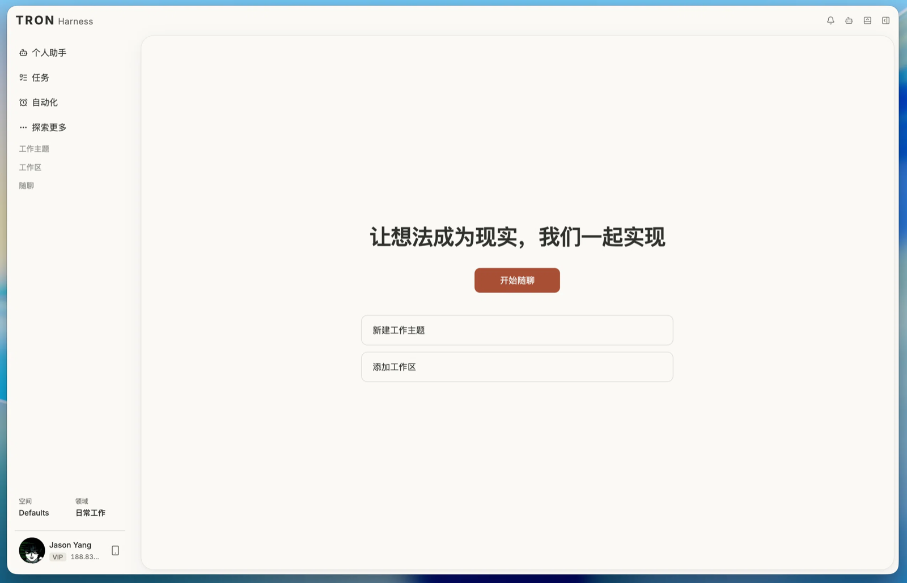
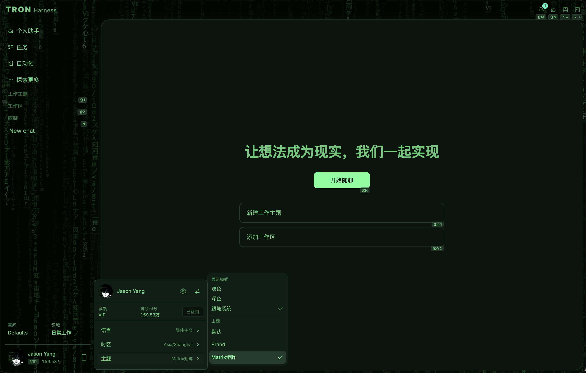
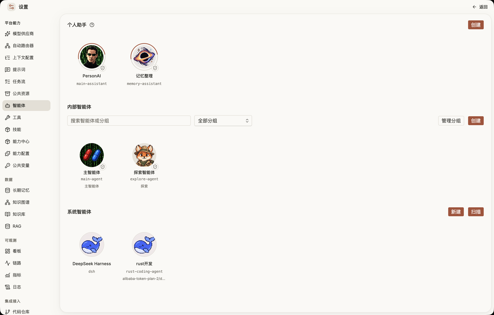
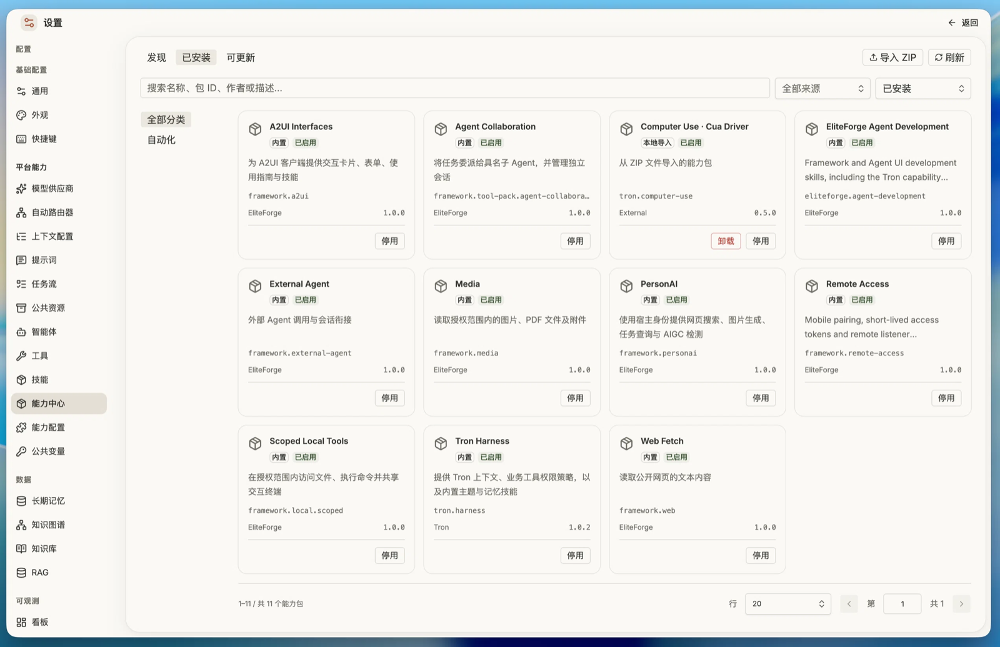
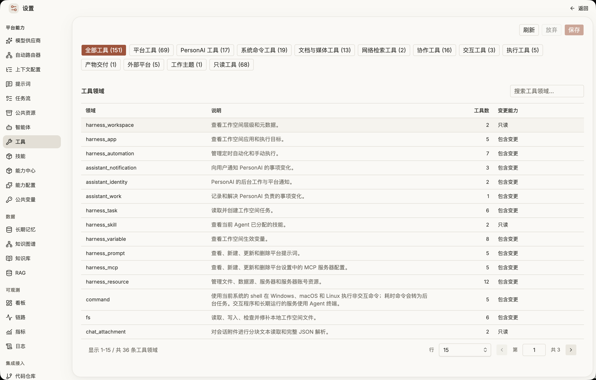
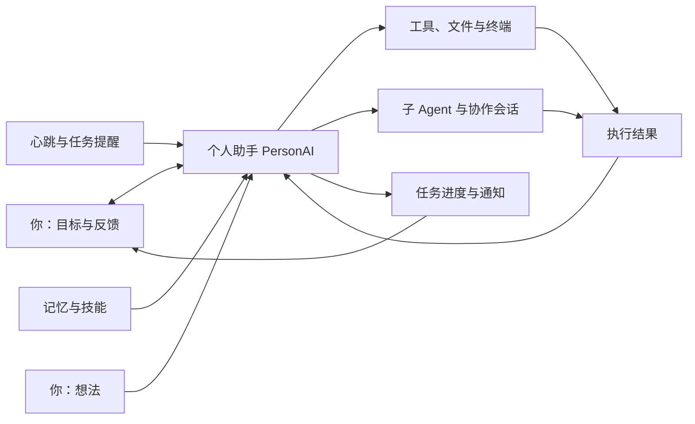

<div align="center">
  
  <h1>TRON Harness</h1>
  <p><strong>简体中文</strong> · <a href="README.md">English</a></p>
  <p>
    <a href="https://github.com/PersonAI-Official/Tron-Harness/releases/latest"></a>
    <a href="https://personai.chat/person-ai-index/"></a>
    <a href="LICENSE"></a>
    <a href="tron-backend"></a>
    <a href="tron-frontend"></a>
    <a href="electron"></a>
  </p>
  <p>
    <a href="#界面预览"></a>
    <a href="#界面预览"></a>
    <a href="#参与开发"></a>
  </p>
  <p><strong>在这里，打造自己的垂直领域AI工作流。</strong></p>
  <p>🎉 项目正在持续开发。我们欢迎你与智能体一起贡献源码。o7</p>
</div>

## 界面预览

<p align="center">
  
  
</p>
<p align="center"><sub>简约大方的现代UI，支持自定义主题</sub></p>

<p align="center">
  
  
</p>
<p align="center"><sub>统一管理和装配智能体</sub></p>

<p align="center">
  
  
</p>
<p align="center"><sub>按需扩展</sub></p>

桌面端支持 macOS Apple Silicon、Windows 和 Linux；Windows 用户既可以使用原生客户端，也可以通过 WSL2 使用。

Tron 的 Windows 桌面端选择 WSL2 后，Agent 执行、命令、终端、MCP 和后台任务都在所选 Linux 发行版中运行。

```text
Windows
└─ Tron 桌面：对话、任务、文件面板、后端环境选择
      │
      │ HTTP / WebSocket，经 localhost 连接
      ▼
WSL2 · Ubuntu / Debian
├─ Tron 后端：个人助手、Agent 协作、能力包、后台任务
├─ Linux 工作环境：项目目录、命令、终端、MCP
└─ ~/.tron：数据库、聊天、附件、日志与托管工作目录
```

## 一套能力，三种用法

**Tron Harness 是一个开源、可扩展的多智能体工作平台。** 它把 Agent 完成一类工作所需的能力——工具、技能、菜单、页面与权限——收进能力包。

一个能力包，就是一个可安装、可改造、可交付的「垂直领域」。同一套能力，你可以直接使用，可以再次改造并共享，甚至可以做成独立应用自己部署。

<p align="center">
  
</p>

### 安装能力包

装上之后，立刻生效：Agent 知道这类工作该怎么做，手上有对应的工具，界面里也有入口。到能力中心挑一个，安装、启用，然后从一个具体目标开始——不用先研究框架，也不用从零配置。

### 打造并分享能力包

现成的能力包解决共性问题，剩下的差异留给你。用自然语言描述你的流程、资料和判断标准，Agent 会生成新的能力包，补齐工具、技能、菜单与页面，并在使用中继续调整。打磨成熟后发布到能力中心，别人也能安装。

### 生成独立 Agent 应用

当一套能力要部署到 Tron 之外，它就该有自己的形态。复用框架的能力，让 Tron Harness 把它做成一个 Agent 原生应用：应用的主入口就是 Agent，而不是传统界面上的一个聊天框；界面、工具、技能与运行逻辑打包进一个可独立部署的工程。部署到你自己的服务器、内网或电脑上。

## PersonAI：你的内置个人助手

打开 Tron，你就有了一位内置的个人助手 **PersonAI**。它拥有自己的身份、会话与任务；你可以设定它的名字、性格和相处方式，也可以创建承担不同职责的 PersonAI。

你可以从一句话开始：

> 帮我看懂这个项目，拆好任务，能并行的就一起做。遇到需要我决定的事，再叫我。

- **把想法变成任务。** 在对话中明确目标，创建任务、安排时间，并持续查看进度与执行结果。
- **让多个 Agent 分工。** 派发子任务或创建独立协作会话，查看状态、补充要求、回答问题，必要时取消工作。
- **主动跟进。** 启用后台运行后，PersonAI 通过心跳、任务提醒和工作反馈继续处理事项，并通过通知报告进展、完成情况或需要你决定的问题。
- **记住有用的经验。** 内置的「记忆整理」PersonAI 从历史工作中整理稳定事实与已验证经验；生成的 Skill 默认进入待批准区，批准后安装。
- **随时了解它在做什么。** 对话、派发会话、任务、后台工作和历史记录都有对应入口。



后台工作需要后端保持运行，并使用已配置的模型与工具。心跳间隔、后台启用状态和技能自动批准选项都可以调整。

## 能力包：让 Tron 按你的工作方式扩展

**把一组相关能力一起安装、查看和管理。** 能力包（Capability Pack）是 Tron 的核心扩展机制：既能为 Agent 提供执行能力，也能为工作界面增加菜单和页面。

| 包内内容 | 用来做什么 |
| --- | --- |
| 工具与插件 | 提供可调用的操作，接入执行逻辑与运行时扩展 |
| Skills 与配套资源 | 分发工作方法、说明、脚本和参考资料 |
| MCP 服务 | 将外部工具服务纳入能力管理 |
| 菜单与目录编排 | 为特定工作场景增加导航入口 |
| 隔离页面 | 提供包自带的界面，接收宿主主题与语言上下文 |
| 扩展声明、依赖与权限 | 描述包的组成、依赖关系及权限需求 |

## 让AI深度融入你的工作流

| 你要做的事 | Tron 提供的支持 |
| --- | --- |
| 简单询问、调研 | 随聊、知识库、联网检索 |
| 推进一个项目 | 工作主题、工作区、应用管理、任务看板、可配置任务流程 |
| 协调异构 Agent | Agent管理、子任务与独立协作会话；可接入已安装并配置的 Codex、OpenCode、Deepseek Harness等系统 Agent CLI，让你充分利用自己的AI订阅服务 |
| 调试页面 | 内置无头浏览器，支持页面元素批注，支持CDP协议 |
| 操控电脑 | 提供cua driver能力包 |
| 去终端执行命令 | 内置智能终端，ssh多跳或进入容器后依然能够使用AI自然对话 |
| 阅读资料、整理知识 | 会话附件、知识库检索、长期记忆与知识图谱；文档解析和检索需配置相应服务与模型 |
| 定期完成重复工作 | Cron 自动化、手动触发、执行历史，以及 PersonAI 的心跳与任务提醒 |
| 使用自己的模型服务 | 可自定义模型供应商，以及模型自动路由策略 |
| 了解执行过程 | AGUI卡片回放、可视化短期记忆、OTel（日志、链路、指标） |

## 参与开发

Tron 使用 **Rust + React + Electron** 单仓库结构，Agent 运行能力基于 [EliteForge Agent Framework](https://gitee.com/person-ai/eliteforge-agent-framework)。前端负责交互，后端承载业务与 Agent 执行，Electron 管理桌面窗口和后端环境。

```text
Tron/
├─ tron-frontend/       React + TypeScript 界面与聊天组件包
├─ tron-backend/        Rust 服务、业务逻辑与 Agent 运行集成
│  ├─ crates/           Tron 原生能力包
│  └─ examples/         能力包示例
├─ electron/            桌面壳、WSL2 连接与安装包配置
├─ scripts/             版本同步与 WSL 构建脚本
└─ Makefile             安装、运行、检查与构建入口
```

从 [AGENTS.md](AGENTS.md) 开始，并阅读所修改目录下的开发约定。前后端说明分别见[前端技术栈](tron-frontend/docs/前端技术栈.md)和[后端技术栈](tron-backend/docs/后端技术栈.md)。

| 命令 | 用途 |
| --- | --- |
| `make help` | 查看全部常用命令与参数 |
| `make fe-check` | 检查 TypeScript 并构建前端 |
| `make be-check` | 编译检查后端 |
| `make desktop-check` | 检查桌面脚本及已有 WSL、更新流程验证 |
| `make harness-capability-check` | 编译检查 Tron 原生能力包 |
| `make version-check` | 检查各组件版本是否一致 |
| `make openapi` | 导出 OpenAPI 描述 |

<details>
<summary>构建缓存与清理</summary>

Makefile 默认将用户级编译缓存放在 `~/rust-cache/sccache` 和 `~/rust-cache/ccache`，Windows 对应 `%USERPROFILE%/rust-cache/`。可用 `RUST_CACHE_DIR` 覆盖根目录，或分别设置 `SCCACHE_DIR`、`CCACHE_DIR`。

Cargo 产物位于 `tron-backend/target`；前端工作区包由 Turbo 缓存。`make be-clean-package` 仅清理后端 crate 构建产物；`make fe-clean`、`make web-clean`、`make desktop-clean` 分别清理对应产物。`make clean` 执行全部清理，并会清理 Tron 临时文件、桌面依赖；这些命令保留用户级编译缓存以及前端 `.turbo` 和工作区包 `dist`。

</details>

<details>
<summary>发布桌面安装包与 WSL2 后端</summary>

版本由 `version.properties` 统一管理，使用 `make version VERSION=x.y.z` 更新。PR 以及推送到 `main`、`master` 会触发 CI；手动运行 GitHub Actions 的 `Build packages` 可构建安装包与 x86_64 WSL 后端。

推送与仓库版本一致的 `v<版本号>` 标签后，工作流会在构建成功后创建 Release 草稿，并生成 SHA-256 清单。检查产物后再发布草稿。macOS 包当前使用 ad-hoc 签名，公开分发前需配置正式签名与公证。

Windows 桌面的 WSL 首次下载使用 Person-AI 版本服务。构建 `make be-build-wsl WSL_ARCH=all` 后，将 `output/wsl2/<版本>/<Rust target>/` 中的后端二进制上传至对应 Tron 产品版本，并登记安装包类型：

| 发行版 | x86_64 | ARM64 |
| --- | --- | --- |
| Ubuntu | `WSL_UBUNTU_X64` | `WSL_UBUNTU_ARM64` |
| Debian | `WSL_DEBIAN_X64` | `WSL_DEBIAN_ARM64` |

同架构二进制可分别登记为 Ubuntu、Debian 包。版本服务返回的最新版本必须与桌面版本一致，并包含所需平台的包，桌面才能完成首次安装。

</details>

## 许可证

Tron Harness 采用 [GNU Affero General Public License v3.0](LICENSE)（`AGPL-3.0-only`）。第三方组件与资源保留各自的许可证和版权声明。

## 致谢

特别感谢 **[OpenAI Codex](https://github.com/openai/codex)** 和 **[DeepSeek Harness](https://www.deepseek.com/en/harness/)**。**Tron Harness 整个项目都是和 Agent 一起完成的**，从想法讨论、架构设计，到代码实现、问题排查和文档编写，Agents 把想象变成了现实。

希望Tron-Harness能成为你的伙伴、同事与知己一起把想法做出来。  

也感谢本项目用到的所有开源包、开源项目，以及它们的作者、维护者和贡献者。无论是直接使用的组件，还是间接依赖的基础库，你们的工作都让 Tron 得以实现并持续完善。

感谢 [dbx](https://github.com/t8y2/dbx) 项目。Tron 的能力包设计参考了 dbx 的插件机制，包括插件清单、安装分发与 Sidecar 运行时。

### Agent 与桌面能力

| 项目 | 在 Tron 中的用途 |
| --- | --- |
| [EliteForge Agent Framework](https://gitee.com/person-ai/eliteforge-agent-framework) | Agent 执行、工具、插件、能力包、记忆与存储 |
| [EliteForge Agent UI](https://gitee.com/person-ai/eliteforge-agent-ui) | 聊天、输入框、终端与 Agent 交互组件 |
| [Person-AI Rust SDK](https://gitee.com/person-ai/person-ai-index-rust-sdk) | Person-AI 服务接入 |
| [Cua](https://github.com/trycua/cua) | Computer Use 原生 SDK 与配套技能 |
| [Electron](https://github.com/electron/electron) · [electron-builder](https://github.com/electron-userland/electron-builder) | 跨平台桌面运行与安装包构建 |

<details>
<summary>前端界面、编辑器与可视化</summary>

| 项目 | 用途 |
| --- | --- |
| [React](https://github.com/react/react) · [React Router](https://github.com/remix-run/react-router) | 界面构建与路由 |
| [TanStack Query](https://github.com/TanStack/query) · [TanStack Table](https://github.com/TanStack/table) · [Zustand](https://github.com/pmndrs/zustand) | 数据请求、表格与状态管理 |
| [Base UI](https://github.com/mui/base-ui) · [Radix UI](https://github.com/radix-ui/primitives) · [shadcn/ui](https://github.com/shadcn-ui/ui) | 基础交互组件 |
| [Tailwind CSS](https://github.com/tailwindlabs/tailwindcss) · [PostCSS](https://github.com/postcss/postcss) · [Sass](https://github.com/sass/dart-sass) | 样式编写与处理 |
| [CVA](https://github.com/joe-bell/cva) · [clsx](https://github.com/lukeed/clsx) · [cn](https://github.com/shadcn-ui/cn) · [tailwind-merge](https://github.com/dcastil/tailwind-merge) · [tw-animate-css](https://github.com/Wombosvideo/tw-animate-css) | 样式组合与动画样式 |
| [CodeMirror](https://github.com/codemirror/dev) · [Lezer Highlight](https://github.com/lezer-parser/highlight) | 代码编辑、语言支持与语法高亮 |
| [xterm.js](https://github.com/xtermjs/xterm.js) | 终端显示、尺寸适配与链接交互 |
| [react-markdown](https://github.com/remarkjs/react-markdown) · [remark-gfm](https://github.com/remarkjs/remark-gfm) · [github-markdown-css](https://github.com/sindresorhus/github-markdown-css) | Markdown 渲染与排版 |
| [PDF.js](https://github.com/mozilla/pdf.js) | PDF 预览 |
| [AntV G2](https://github.com/antvis/G2) · [AntV G6](https://github.com/antvis/G6) | 图表与关系图 |
| [Three.js](https://github.com/mrdoob/three.js) · [Post Processing](https://github.com/pmndrs/postprocessing) · [GSAP](https://github.com/greensock/GSAP) | 视觉效果与动画 |
| [i18next](https://github.com/i18next/i18next) · [react-i18next](https://github.com/i18next/react-i18next) | 国际化 |
| [react-resizable-panels](https://github.com/bvaughn/react-resizable-panels) · [Pretext](https://github.com/chenglou/pretext) · [Lodash](https://github.com/lodash/lodash) | 面板布局、文本测量与通用工具 |
| [Lucide](https://github.com/lucide-icons/lucide) · [Fontsource](https://github.com/fontsource/font-files) · [Geist](https://github.com/vercel/geist-font) · [Inter](https://github.com/rsms/inter) | 图标、字体与字体分发 |

</details>

<details>
<summary>Rust 后端、数据存储与文档处理</summary>

| 项目 | 用途 |
| --- | --- |
| [Tokio](https://github.com/tokio-rs/tokio) · [async-trait](https://github.com/dtolnay/async-trait) · [async-stream](https://github.com/tokio-rs/async-stream) | 异步运行与流处理 |
| [Axum](https://github.com/tokio-rs/axum) · [Tower HTTP](https://github.com/tower-rs/tower-http) · [Reqwest](https://github.com/seanmonstar/reqwest) · [Socketioxide](https://github.com/Totodore/socketioxide) | HTTP 服务、客户端与实时通信 |
| [Serde](https://github.com/serde-rs/serde) · [serde_json](https://github.com/serde-rs/json) · [serde_yaml](https://github.com/dtolnay/serde-yaml) · [serde_path_to_error](https://github.com/dtolnay/path-to-error) | 数据序列化与解析 |
| [jsonschema](https://github.com/Stranger6667/jsonschema) · [Utoipa](https://github.com/juhaku/utoipa) | JSON Schema 校验、OpenAPI 与接口文档 |
| [tracing](https://github.com/tokio-rs/tracing) · [OpenTelemetry Rust](https://github.com/open-telemetry/opentelemetry-rust) | 日志、指标与调用链 |
| [rusqlite](https://github.com/rusqlite/rusqlite) · [tokio-rusqlite](https://github.com/programatik29/tokio-rusqlite) · [SQLx](https://github.com/transact-rs/sqlx) | 数据库访问 |
| [Grafeo](https://github.com/GrafeoDB/grafeo) · [Apache OpenDAL](https://github.com/apache/opendal) | 图数据与对象存储访问 |
| [redis-rs](https://github.com/redis-rs/redis-rs) · [rskafka](https://github.com/influxdata/rskafka) · [ldap3](https://github.com/inejge/ldap3) · [Russh](https://github.com/Eugeny/russh) | Redis、Kafka、LDAP 与 SSH 连接 |
| [Rustls](https://github.com/rustls/rustls) · [rustls-pemfile](https://github.com/rustls/pemfile) · [webpki-roots](https://github.com/rustls/webpki-roots) | TLS 与证书处理 |
| [RustCrypto AEADs](https://github.com/RustCrypto/AEADs) · [MACs](https://github.com/RustCrypto/MACs) · [Hashes](https://github.com/RustCrypto/hashes) · [gm-crypto-rs](https://github.com/frankxue831/gm-crypto-rs) | 加密、消息认证与摘要 |
| [bcrypt](https://github.com/Keats/rust-bcrypt) · [jsonwebtoken](https://github.com/Keats/jsonwebtoken) · [Rand](https://github.com/rust-random/rand) | 密码哈希、令牌与随机数 |
| [Chrono](https://github.com/chronotope/chrono) · [chrono-tz](https://github.com/chronotope/chrono-tz) · [cron](https://github.com/zslayton/cron) | 日期、时区与调度表达式 |
| [sysinfo](https://github.com/GuillaumeGomez/sysinfo) · [fs2](https://github.com/danburkert/fs2-rs) · [tempfile](https://github.com/Stebalien/tempfile) · [rfd](https://github.com/PolyMeilex/rfd) · [windows-rs](https://github.com/microsoft/windows-rs) | 系统信息、文件操作与原生平台接口 |
| [flate2](https://github.com/rust-lang/flate2-rs) · [zip](https://github.com/zip-rs/zip2) · [base64](https://github.com/marshallpierce/rust-base64) · [hex](https://github.com/KokaKiwi/rust-hex) | 压缩、归档与编码 |
| [Regex](https://github.com/rust-lang/regex) · [rust-url](https://github.com/servo/rust-url) · [unicode-normalization](https://github.com/unicode-rs/unicode-normalization) · [shell-words](https://github.com/tmiasko/shell-words) | 文本、URL 与命令参数处理 |
| [roxmltree](https://github.com/RazrFalcon/roxmltree) · [scraper](https://github.com/rust-scraper/scraper) · [umya-spreadsheet](https://github.com/MathNya/umya-spreadsheet) · [pdf-extract](https://github.com/jrmuizel/pdf-extract) · [image](https://github.com/image-rs/image) | XML、HTML、表格、PDF 与图像处理 |
| [semver](https://github.com/dtolnay/semver) · [snowflaked](https://github.com/MrGunflame/snowflaked-rs) | 版本解析与 ID 生成 |

</details>

<details>
<summary>语言与构建工具</summary>

| 项目 | 用途 |
| --- | --- |
| [Rust](https://github.com/rust-lang/rust) · [Cargo](https://github.com/rust-lang/cargo) · [Node.js](https://github.com/nodejs/node) · [npm CLI](https://github.com/npm/cli) | 编译、运行与依赖管理 |
| [TypeScript](https://github.com/microsoft/TypeScript) · [DefinitelyTyped](https://github.com/DefinitelyTyped/DefinitelyTyped) | 类型检查与类型定义 |
| [Vite](https://github.com/vitejs/vite) · [Vite React Plugin](https://github.com/vitejs/vite-plugin-react) · [esbuild](https://github.com/evanw/esbuild) · [vite-plugin-dts](https://github.com/qmhc/unplugin-dts) | 前端开发、打包与类型声明生成 |
| [Turborepo](https://github.com/vercel/turborepo) · [Changesets](https://github.com/changesets/changesets) · [patch-package](https://github.com/ds300/patch-package) | 工作区构建、版本管理与依赖补丁 |
| [sccache](https://github.com/mozilla/sccache) · [ccache](https://github.com/ccache/ccache) | 编译缓存 |

</details>

感谢清单未逐一列出的间接依赖、开发工具与社区贡献。所有第三方组件和资源均遵循各自的许可证与版权声明。
