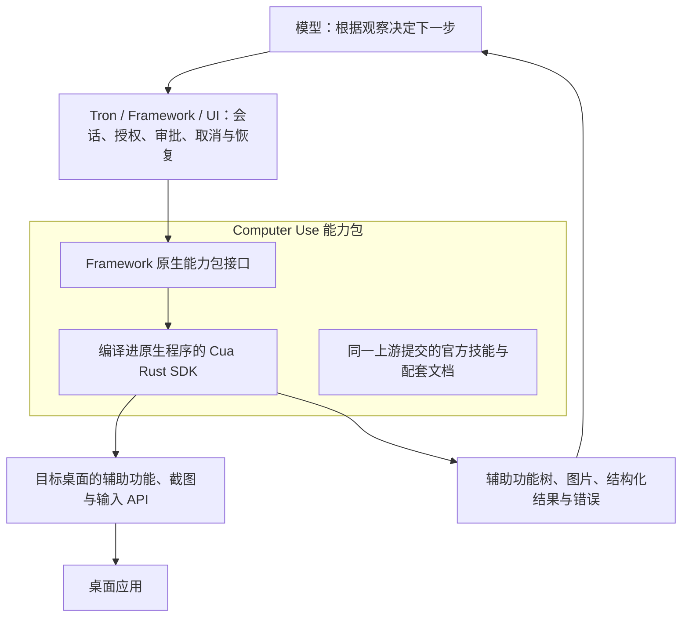
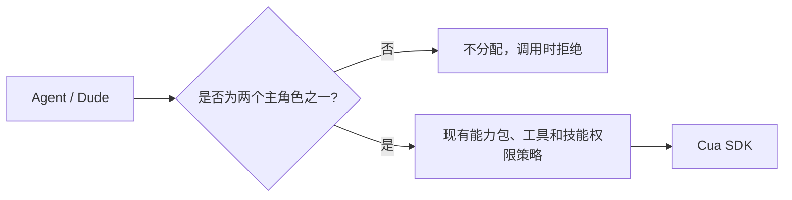

# Computer Use 能力包

`tron.computer-use` 把上游 Cua Rust SDK 编译进包内的 `tron-computer-use` 原生程序，并通过 Framework 原生工具接口为 Tron 提供桌面观察、输入和结果核验能力。用户从能力中心安装能力包即可使用，无需另外安装 `cua-driver`，运行时也不查找全局驱动、不启动外部驱动服务。



## 依赖与技能来源

`native/Cargo.toml` 通过 `git + rev` 引用 `https://github.com/trycua/cua.git` 中的 `cua-driver-sdk` 和 `cua-driver-core`；`native/Cargo.lock` 锁定依赖。当前固定提交为 `ebea2f86f06add31e6ccac1d7a2f25d5d52de520`，SDK 版本为 `0.47.17`。程序直接调用 `CuaDriver::create(None)`，因此原生桌面运行时属于能力包进程。

`skills/cua-driver/` 原样来自该提交的 `libs/cua-driver/rust/Skills/cua-driver/`，包含官方 `SKILL.md` 及全部配套 Markdown 文件。`upstream.json` 记录来源、版本和逐文件 SHA-256；打包时同时核对 Git 依赖的实际提交、官方源文件与本地副本。更新上游时，须同时更新 SDK pin、锁文件和官方技能副本，不能只更换文档。

Tron 通过 Framework 原生能力包 backend 协议贡献 `ToolProvider` 和 `SkillProvider`，包内直接调用 `CuaDriver`；manifest 不声明 MCP 服务，也不需要配置 MCP。包后端是 Framework 管理的独立原生进程，SDK 编译在这个进程内，未编译进 Tron 后端本身。生命周期、取消和资源释放复用 Framework 的能力包运行时。

工具以 `computer_*` 名称提供，例如 `computer_list_windows`；工具描述说明当前接入方式。官方文档中的全局 CLI 安装、更新、独立 daemon 示例不适用于此包。官方文件保持原样，`skill_load` 返回原始 `SKILL.md`，`skill_read_resource` 按白名单读取配套文档。官方技能含有嵌套厂商元数据，原生 `SkillProvider` 仅将目录摘要中的元数据映射到 Framework 的字符串契约，加载正文不会修改源文件。

工具目录通过 SDK 的 `inspect_host_tools` 元数据接口生成；构建和查看目录不创建桌面控制运行时。实际调用时才取得桌面锁并初始化 SDK。原生工具保留图片、结构化结果和错误，不经 MCP 协议转发。

上游 MIT 许可随包保留在 `CUA-LICENSE.md`。包内不含可选视觉识别模型或上游 CLI 的安装器。

## 构建与分发

每个平台单独一份能力包，通过能力中心在线分发。包 ID 带平台与架构，在哪台机器上构建，就产出那台机器适用的包。

| TARGET | 构建环境 | 平台键 | 能力包 ID |
| --- | --- | --- | --- |
| `windows` | Windows x86_64 | `x86_64-windows` | `tron.computer-use.windows-x86_64` |
| `macos` | macOS Apple Silicon | `aarch64-macos` | `tron.computer-use.macos-aarch64` |
| `macos` | macOS Intel | `x86_64-macos` | `tron.computer-use.macos-x86_64` |
| `linux` | 原生 Linux（非 WSL2） | `x86_64-linux` | `tron.computer-use.linux-x86_64` |
| `wsl` | WSL2 x86_64 或 Windows x64 | `x86_64-linux` | `tron.computer-use.wsl-x86_64` |
| `wsl` | WSL2 arm64 或 Windows arm64 | `aarch64-linux` | `tron.computer-use.wsl-aarch64` |

仓库里的 `manifest.json` 是变体模板，构建时写入实际的包 ID、显示名和平台入口。默认按当前系统和架构选择 TARGET，因此各平台机器上直接执行即可：

```sh
make capability-computer-use
```

需要交叉构建时显式指定：

```sh
# Apple Silicon 上构建 Intel Mac 包
make capability-computer-use TARGET=macos COMPUTER_USE_RUST_TARGET=x86_64-apple-darwin

# 在 WSL2 中组装 WSL 包，复用 Windows 上已构建好的同架构包
make capability-computer-use TARGET=wsl COMPUTER_USE_WINDOWS_PACKAGE=/mnt/c/build/tron.computer-use.windows-x86_64-0.5.0.zip
```

构建机器需要 Rust/Cargo、Git 及目标平台 SDK 的系统构建工具；用户运行 ZIP 不需要 Rust、Git 或 `cua-driver`。命令使用锁定依赖编译 release 原生程序，核对官方技能来源，生成 `build-info.json`，再通过 Framework 正式归档器和安装器校验。产物：

```text
output/capability-packs/computer-use/tron.computer-use.macos-aarch64-0.5.0.zip
```

`VERSION` 可留空，传入时必须与包 manifest 版本一致；包版本独立于 Tron 产品版本。`SKIP_TESTS` 接受 `true` 或 `false`，本目标不运行测试。当前归档是未签名包，能力中心安装使用同一份 ZIP。`manifest.json` 的版本属于能力包适配层；Cua SDK 的真实版本单独记录在 `upstream.json`，当前为 `0.47.17`。

能力中心按包 ID 和版本识别发布物：不同平台的包 ID 不同，同一个版本号可以分别上架；同一个包 ID 再传同版本会被拒绝，需要提升 `manifest.version`。上传后用户在能力中心下载、安装并启用，并确保 Agent 的工具和技能授权允许使用它。无需创建或启用 MCP 服务。

旧版单包 `tron.computer-use` 在已安装的机器上继续可用，宿主对它的权限规则不变，但不再产出新包。

所有变体共用同一份源码、官方技能和工具目录，只有 `backend.executables` 的平台键和包内二进制不同：Windows、macOS、Linux 是各自的 `bin/tron-computer-use[.exe]`；WSL2 的 `bin/tron-computer-use` 是 POSIX 桥接入口，另有 `bin/tron-computer-use-windows.exe`。

`make desktop-build` 只构建桌面外壳和 sidecar，不打包 Computer Use 能力包；能力包版本与桌面版本相互独立。

## Windows + WSL2

WSL2 后端的桌面能力由独立的 `tron.computer-use.wsl-<arch>` 包提供，包里带 Windows 原生运行时，经 WSL 互操作操作 Windows 桌面。构建方式二选一：

1. 在 Windows 上执行 `make capability-computer-use TARGET=wsl`，脚本先构建同架构 Windows 运行时，再组装 WSL 包。
2. 先在 Windows 上构建 Windows 包，再在同架构 WSL2 中组装：

```sh
make capability-computer-use TARGET=wsl COMPUTER_USE_WINDOWS_PACKAGE=/mnt/c/build/tron.computer-use.windows-x86_64-0.5.0.zip
```

组装时检查输入包的系统、架构、包版本、SDK 提交、原生程序哈希和工具目录；缺少或不匹配就失败。此路径不编译 Linux 桌面 SDK，也不要求运行用户额外安装驱动。

Windows 原生后端与 WSL2 后端使用各自的数据目录，安装各自平台的包即可。Linux 桌面与 WSL2 都使用 `x86_64-linux` 平台键；同一个后端环境里只安装其中一份，避免工具和技能重复注册。

## 工具展示与授权

工具在设置中归入「电脑操作」，领域为 `tron.computer-use`。界面使用简短的中英文名称和说明，例如「列出窗口」「点击元素」「查看操作指南」；上游详细调用说明保留给模型。类型严格按上游 `annotations.readOnlyHint` 映射：`true` 为查询、`false` 为操作、未声明则保持未知。当前 macOS 目录为 20 个查询、40 个操作。

电脑操作工具与官方技能只允许分配给主 Agent（`main-agent`）和主 Dude（`main-dude`）。其他 Agent/Dude 的旧分配会被收回，新建角色不会从主 Agent 继承这些权限；「全部工具」「全部只读工具」和分类选择均不能绕过此限制。新安装或升级该包时为两个主角色配置技能默认授权，之后的普通扫描保留它们的手动取消选择。



## 系统权限与运行范围

免安装不等于免授权。macOS 仍需为实际启动原生程序的 Tron 宿主授予辅助功能和屏幕录制权限，并在权限改变后完整重启宿主。Electron 必须保持直接启动后端及能力包程序的宿主责任链；发布签名、权限归属与后台输入行为需要在实际桌面包中验证。使用终端启动后端时，权限责任主体可能是该终端，而非 Tron 应用。

能力包不主动请求系统权限，只检查现有权限，不主动弹出授权窗口。系统设置中的授权由用户完成；原生程序的 `permissions grant` 仅供用户明确执行的本机诊断流程。SDK 不会替 Tron 授权。

同一用户桌面只允许一个能力包控制进程取得控制权，控制权在首次工具调用时获取，并在进程退出时释放。进程内串行执行工具；取消调用时转交 SDK 取消机制，结果不确定时要求模型重新观察，禁止自动重放。

包操作后端所在机器可达的桌面。远程浏览器访问 Tron 不会自动开放浏览器用户电脑的桌面。

## 使用与诊断

向已授权的 Agent 提问：

> 使用 cua-driver 官方技能，打开计算器计算 6 × 7，并从新的窗口状态读取实际结果。

辅助功能树足够时可以使用文本模型；依赖截图定位时需要视觉模型。工具 schema、返回的元素标识与当前界面状态是操作依据。

包内原生程序提供以下诊断入口，Windows 名称带 `.exe` 后缀：

```sh
bin/tron-computer-use --version
bin/tron-computer-use metadata
bin/tron-computer-use tools
bin/tron-computer-use doctor
bin/tron-computer-use permissions status
```

`metadata` 可确认运行的是包内 SDK；`doctor` 返回 SDK 元数据及权限检查结果。诊断时应检查完整结构化结果，不能只依赖进程退出码。手动解压后若未保留 Unix 执行权限，需要恢复入口执行权限；Tron 安装器会设置入口权限。

当前直接 SDK 模式不启用上游独立 App 的悬浮光标；可选视觉识别扩展和部分录制设施也不包含在包内。具体平台、工具是否可用，以运行时发现的工具清单和结构化能力报告为准。
