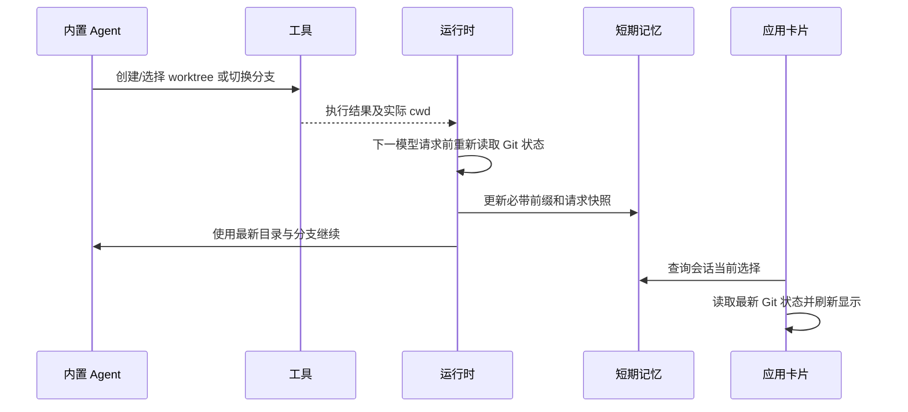

# 会话应用上下文与 Agent 工具验收

实现位于 `feature/clouds3n/agent-code-editing`。重启当前分支的前后端后测试；本次没有更新已安装的桌面包。

## 明早可以这样测试

1. 新建项目并关联一个本地 Git 应用，在项目里新建会话，打开右侧「属性 → 执行」。关联应用显示当前真实分支、Local/Worktree 和工作目录；不列出其他分支或 worktree。
2. 选择内置 Agent，发送：「使用 worktree_create 创建名为 morning-check 的工作区和 feature/morning-check 分支，在里面运行 git_status，然后告诉我当前目录。」目录名和分支名须尚未存在。新工具会创建并选中工作区；下一次模型请求带入新目录，页面约 3 秒内自动刷新。
3. 继续发送：「在当前工作区新建并切到 feature/morning-next，再使用 worktree_list 查询工作区，然后 worktree_select 切回原仓库。」核对卡片和 Agent 的下一步目录。查询本身不会切换目录。
4. 打开「属性 → 上下文 → 应用执行上下文」。默认显示卡片，内容来自最近一次模型请求。压缩历史、刷新页面、再发消息后，当前选择仍应保留。切换中文/英文检查界面。
5. 发送：「使用 Word 工具创建 morning-report.docx，包含标题、两段文字和两列表格；读回，再把其中一处文字替换到 morning-report-edited.docx。使用 Excel 工具创建 morning-data.xlsx，写入两笔数字和求和公式，读回，然后将一个数字更新到 morning-data-edited.xlsx。」检查新文件，源文件保持不变。

使用“全部平台工具”的 Agent 自动取得新增工具；手动指定工具的 Agent 需在其工具设置中加入所需工具。现有领域发现模式可按需展开新增领域，保留原有 Agent 的工具授权和暴露策略。

## 新增工具

| 领域 | 工具 | 用途 |
| --- | --- | --- |
| worktree | `worktree_list`、`worktree_create`、`worktree_select` | 按需查询、创建并选中、切换工作区 |
| git | `git_status`、`git_diff`、`git_log`、`git_switch_branch` | 检查状态、差异、历史和切换分支 |
| fs（升级） | `fs_apply_patch`、`fs_read_text` | 多文件上下文补丁、预览、过期检查；读取时返回完整文件哈希 |
| word | `word_read`、`word_create`、`word_replace_text` | 读取、创建 DOCX，精确替换并另存 |
| excel | `excel_read`、`excel_write` | 读取 XLSX，创建或另存单元格与公式修改 |

工具名称、说明和参数说明提供 en-US / zh-CN。文件操作沿用项目目录访问约束。Word 替换验证匹配次数，支持同一段落内跨文本片段；保留其余压缩包内容。输出文件必须不存在。

Word 支持 DOCX 正文和表格文字，不包含旧版 DOC 或页面渲染。Excel 支持 XLSX，公式保留并要求打开时重算，工具本身不计算公式；复杂工作簿特性不保证完整往返，因此始终另存。构建、测试等命令继续使用已有 `bash_exec`。编程检查工具及其独立领域已删除。

## 当前目录如何同步

前缀只包含关联应用的当前执行信息，不附带其他工作区清单。配置目录保留作关联来源，不能把它当作当前选中目录。当前工作区缺失或失效时保留失败路径并报错，避免回退到原仓库或后端进程目录。

原始 `git worktree add` 只创建，不代表切换；使用 `worktree_select` 明确选择。`bash_exec` 使用参数中的 cwd，脚本内部 `cd` 不代表修改会话默认目录。已有编码工具以明确 cwd/路径操作已允许的工作区时，下一模型边界会识别相应工作区。

上述逐模型请求同步适用于 Tron 内置 ReAct 运行时。外部 Codex/OpenCode CLI 适配器会获得启动时目录和前缀，但 Tron 无法接管其内部每一步模型上下文，不能声称已支持其内部自行切换目录的同步。

## 短期记忆内部名称

| 后端预算块 | 含义 |
| --- | --- |
| `seed_prompt_prefix` | 每次模型请求必须携带的前缀，包含系统提示词和应用执行上下文 |
| `tool_schema` | 本次向模型暴露的工具定义 |
| `current_session_checkpoint` | 当前会话压缩检查点 |
| `current_session_working_state` | 当前目标和待办 |
| `session_family_context` | 相关会话上下文 |
| `current_session_history` | 当前会话历史 |

`applicationContext` 是新增的可查看子块，消息类型为 `application_execution_context`。它使用 `seed_prompt_prefix` 的预算，界面单独展示其 token 用量，并从系统提示词显示用量中扣除，避免重复统计。

## 2026-09-22 验证记录

- `make be-check`：通过。
- `make be-test TEST='--test session_application_context --test tool_schema_budget'`：20 项通过。
- `make fe-check`：通过，完成类型检查及前端构建。
- 会话状态专项 `ChatManagementPage.state.test.ts`：22 项通过。
- 浏览器 1440×1000 实测：中文/英文应用卡片和上下文预览、当前目录自动刷新、打开中的上下文卡片自动刷新。浏览器使用受控 API 响应验证展示；后端专项使用真实 Git、SQLite 和 DOCX/XLSX 文件。单次运行使用脚本模型驱动真实工具调用，未调用付费模型。
- `make fe-unit-test`：370 项通过，5 项既有测试失败，涉及 `chat-core/transcript.test.ts` 的工具分组/推理摘要与 `chat-terminal/modelSession.test.ts`。这些包的源文件及测试没有被本次修改。
- 扩大的后端 `agent_runtime` / `short_term_memory_transcript` 测试集被既有测试构造缺少 `prompt_prefix_sources` 阻断；该字段已存在于分支基线。全量测试另有旧 DTO 字段与应用测试夹具问题，本次不宣称全量通过。

截图在 `output/playwright/`：`current-app-refreshed-zh.png`、`current-app-en.png`、`current-context-refreshed-zh.png`、`current-context-en.png`。

本机 Cargo 私有镜像不可用；验证使用隔离的 `/tmp/tron-cargo-productivity`，从 `/tmp` 调用仓库 Makefile，覆盖 `BACKEND_DIR` 为绝对路径。全局 Cargo 配置未修改。
