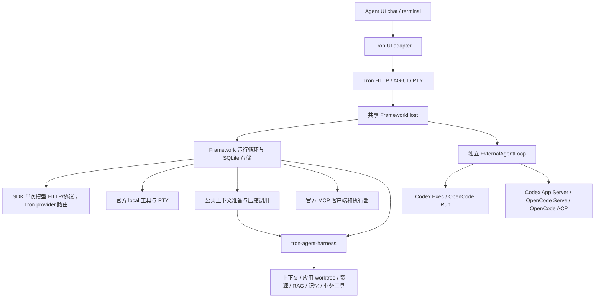

> 下方历史验收数字只描述对应的源码基线。本轮 SDK 接入与统一上下文整改的命令、退出码及源码对应关系以任务 `sdk-integration-correction-evidence/` 为准；旧验收数字不能验收当前源码。

相关设计见 [模型请求统一](model-framework-unification.md) 和 [memory 接入](memory-framework-migration.md)。`acceptance-evidence`、`model-unification-evidence` 与 `context-provider-correction-evidence` 保留各阶段历史证据。

# Agent Framework / Agent UI 接入

## 当前迁移状态

**本轮收敛原生运行时职责与统一上下文来源，验收独立记录。** Tron 的 Agent 模型/工具循环、模型重试、上下文压缩执行、
外部 CLI/JSON 服务桥执行和原生 PTY 由公共 Framework 提供；主聊天、临时 Agent 聊天和终端
使用公共 Agent UI。Tron 通过 `tron-agent-harness` 提供产品上下文、权限、业务存储和业务工具。

通用文件、搜索、patch、命令、终端、MCP 与提问能力复用官方插件。Tron 保留旧工具名称和
中英文说明的映射、附件 fileRef、应用/worktree 语义及产品卡片 DTO，不复制通用执行器。
模型服务适配器每次只调用一次模型；重试、溢出恢复、辅助压缩调用和总调用预算由 Framework 控制。
模型在工具执行后失败，只重试模型，不重放整轮工具副作用。

六种 runtime 已接入：ReAct 使用公共循环，两种 CLI 与三种服务模式通过独立 ExternalAgentLoop接入，
保留原生会话与既有桥接协议。JSON 服务桥不冒充 Codex app-server / OpenCode ACP 原生协议。
提问使用官方 human 的问题/选项 ID 和结构化回答，释放当前 run 后通过持久化交互恢复。
普通发送与流式发送都复用应用级 FrameworkHost，避免临时实例丢失交互、续传和命令状态。

此前阶段的真实浏览器记录验证连续对话、刷新后的历史与提问恢复、上下文窗口、回答后继续，以及真实 PTY
写文件、尺寸调整与退出。聊天、记忆和 AG-UI 使用真实后端；只有模型供应商响应使用本地 HTTP 测试服务。
测试明细和可重复执行方式见下方验收记录。

## 分支与执行链

Tron 从 `gh/master` 的 `c27ec9d89dcdc2f3312f96d57a4f7f603f2e610b` 创建
`feature/clouds3n/integrate-agent-framework-ui`。

生产入口已接入公共 Framework。HTTP 聊天、任务执行和自动化共享 `FrameworkHost`，
原 ReAct 模型/工具循环已移除；`ReactAgent` 保留为 Tron 模型路由、持久化、事件和业务策略的宿主接口。
授权目录与产品排序进入逐 run 的原生 ModelExecutionScope，SDK 选择/恢复真实绑定并在实际派发处执行窗口、输出及调用硬限额。工具由原生调度器执行，产品模型适配器不嵌套旧循环。
普通发送与流式发送入口显式复用 AppState 的共享 FrameworkHost；回答恢复、Agent API、任务与自动化也使用同一宿主。
真实浏览器提问恢复测试覆盖了这条装配要求，防止每次请求临时创建 Framework 实例造成交互状态丢失。

主聊天、临时 Agent 聊天和终端使用 Agent UI 的 chat、theme、terminal。
Tron 原 React、Vue、theme、terminal 实现包已移除；产品 DTO、页面、附件服务和终端协议适配保留。
`@tron/chat-agent-ui-adapter` 负责产品契约与公共 UI 契约的双向转换。



## 公共层和宿主的分工

`tron-backend/crates/tron-agent-harness` 使用公共 `ContextContributor`、`ToolProvider`、
`ToolBinding` 和 `CapabilityPackBuilder`。宿主注入用户、工作空间、会话、run、应用和任务作用域；
产品服务继续检查授权与资源归属。作用域标识本身不授予权限。

文件读写、搜索、patch、命令启动/读取/停止使用公共 local 执行器。
Tron 的旧 bash、filesystem、search、patch 执行器及重复 MCP HTTP/stdio 协议实现已删除。
旧调用名称保留为公共描述的映射，兼容已有策略和模型记录，不复制工具实现。
本地文件与命令方面，Tron 提供授权目录、动态 cwd 和附件 fileRef；业务工具继续由产品能力包提供。
MCP 的配置、变量解析与工作空间策略在 Tron，协议、发现及资源/工具调用在官方 MCP 插件。

公共层提供逐次调用的版本化本地 scope、附件读取、实时输入、工具结果处理与可见工具集更新。产品 ACL 通过原生 ToolPolicy 收窄目录和每次执行权限；实际产品注册实例与原 SDK lease 保持唯一执行所有者，纯授权 DTO 不制造重复执行器。typed Content 与 result reference 保持原生内容，审计另作投影。
这些能力位于公共项目，Tron 通过正式接口接入。

官方/外部表示来源，native/subprocess 表示执行方式，Cargo feature/运行时选包表示装配时机。
三者独立。Tron harness 编译进宿主，默认插件也在宿主进程中执行；MCP 服务和 CLI Agent
按各自协议创建或连接进程。用户扩展是否隔离执行由安装清单和执行方式决定，不能只看目录或作者。

## 能力保留与实现位置

| 能力 | 迁移后的实现与验证关注点 |
|---|---|
| 主聊天、临时聊天、Agent/模型选择、推理等级 | 公共 chat renderer/controller；Tron 选择器和双向 adapter |
| AG-UI、历史回放、错误、压缩状态 | 原产品事件契约保留；公共 UI 接收事件映射；reasoning 与公开 summary 分开 |
| 排队、steer、stop、重连 | 公共循环接入 `LiveInputSource`；Tron 保留 expectedRunCode 和运行预约/停止控制 |
| ask_user | 转为公共 durable interaction；提问结束当前 run，回答以 interaction ID 恢复，重启后仍可继续 |
| 附件、图片、fileRef | 产品上传/资源授权；公共文件工具通过 `FileReferenceReaderService` 读取受限内容 |
| 文件、多目录、动态 cwd | 公共 local scope 接收应用/worktree 授权根目录；下一步同步更新；失效目录报错，不回退到后端目录 |
| patch 与搜索 | 公共原子补丁、dry-run、move 和 diff；basename glob 支持子目录；越界与符号链接回归 |
| 超过 10 秒的命令 | 公共 command service 返回 ID，后续轮可读取、停止；界面名称为“命令清单”；shell 文本与显式 argv 分开 |
| 终端 | 公共 terminal renderer/controller、`framework.pty` 服务与官方 `terminal_*` 工具；Tron 保留 WebSocket 票据、目录授权、会话归属、shell hooks 和协议映射 |
| 模型路由与续传 | 宿主保留完整模型 ID、PersonAI、usage、cached/reasoning tokens 与路由选择规则；公共框架执行重试并禁止输出后重试 |
| 六种 runtime | ReAct 使用公共循环；另外五种外部 runtime 通过独立 ExternalAgentLoop 适配，保留原 CLI/HTTP 协议和原生会话恢复 |
| 持久化、压缩、上下文预算 | Framework memory 提供分块、预算与压缩策略；Tron 保留产品历史/projection/ACL；公共 conversation/checkpoint/interaction 持久化，可信指令前缀动态刷新 |
| MCP 与 skills | 公共 MCP 执行器；Tron 负责选包、变量、权限、来源和业务 skill 注册；准备失败也释放插件租约 |
| 目标、todo、自动化、RAG、数据源、CRUD | 由 Tron harness 调用原产品服务，继续使用产品数据与授权，不移入公共通用工具包 |
| 主题、Markdown 内链、注释 | 公共 UI 扩展和主题锚点；Tron 保留产品解析与操作 |

LSP 不在此次范围内。


目标续跑由原生 ContinuationLoop、正式 child admission、UsagePermit 和 fenced journal 驱动；Tron 保留 judge、目标 CAS、提示和业务提交。原始总预算、绝对 deadline、每步上限及已用 child slots 不重置。历史 checkpoint 未保存原始绝对时钟时不宣称恢复该历史 deadline；opaque 远端内部调用不可观测，未知用量保守收费并与 provider actual 分开。不能自动重放未确认完成的持久 child intent。最终响应保留实际最后 child 的状态与交互，普通 ChatSend 的 coordinator 覆盖初始调用、提交和续跑；direct invoke 跨业务入口不宣称原子交接。

展示消费官方 AgUiPlugin 的原生输出，以 native execution/sourceSequence/ordinal 保留身份，并通过 SUBAGENT 关系展示同一 goal 树。持久读写、通道溢出或产品完成确认丢失显式报告展示完整性，保留已知 usage 小计；这些故障不能改写原生成功、暂停或限额终态。Input/Approval 以原生 interaction ID 与 response schema 恢复；approval 传布尔值，已保存同答案可幂等重试，异答案和已完成 run 拒绝恢复。

## 原生限额终态的 HTTP 兼容性变化

`POST /api/v1/agents/runs` 收到 SDK 原生 `StepLimit` 或 `ToolCallLimit` 终态时，返回 HTTP 200 与完整运行 DTO；`data.status` 分别为 `STEP_LIMIT`、`TOOL_CALL_LIMIT`，`data.native.status` 分别为 `StepLimit`、`ToolCallLimit`。响应保留 `data.native.runId`、`data.stepCount` 和已有输出；内部工具观察不直接序列化到 HTTP DTO，历史记录以 `data.observationCount` 保留其计数。HTTP 200 表示已取得原生运行结果；客户端必须读取运行状态，不能据 HTTP 状态判定任务已完成。

这是对旧 HTTP 400 限额错误响应的兼容性变化，客户端需从顶层错误码判断迁移到 `data.status`/`data.native.status`。限额仍在 SDK 执行前检查，不会为了得到最终答案而再发一次模型请求。例如工作区策略 `maxSteps=1`、`maxToolCalls=1` 的工具轮只允许一次模型请求和一次工具执行，随后以 `STEP_LIMIT` 返回。

原错误码保留在 `GET /api/v1/agents/runs/{run_code}` 的历史记录：`data.status=FAILED`，`data.outcome` 为 `step_limit` 或 `tool_call_limit`，`data.errorCode` 为 `AGENT_MAX_STEPS_EXCEEDED` 或 `AGENT_MAX_TOOL_CALLS_EXCEEDED`。运行结果中的原生限额终态与产品历史失败分类同时保留。真实调用错误仍由 HTTP 错误映射处理，不转换为原生限额结果。

## 持久化与生命周期

文件数据库 `tron.sqlite3` 对应旁路公共数据库 `tron.agent-framework.sqlite3`，保存在同一目录。
生产文件数据库不使用临时存储。内存数据库测试才创建临时 Framework 存储。
旧产品消息、工具观察、目标、todo 和压缩记录仍由原服务读取；首次公共会话装入准备好的历史。
后续请求由 Tron 映射独立授权来源 DTO 与配置。所有 Instruction、History、Data 来源使用同一个 ContextContributor；唯一 DefaultContextAssembler 按 layout、source-aware budget 和每块 reducer 读一次、压缩与重组。共享 seed 配额按真实指令成本分给 application context，再按既有策略向 history 借出未用容量。原生 ContextProvider/ContextService/ContextPlugin 已移除，旧 v1 provider wire 仅在远端兼容边界映射；旧 data contributor 冒充指令的权限升级不再支持。真实原生历史作为出现次数 witness 保留媒体、资源和私有模型元数据，产品 JSON 不能伪造协议身份。

主 ReAct 的 Responses 续传策略仍以 `tron.responses.v2` 模型消息上下文保存到 SDK conversation；本轮上下文已绑定真实 scoped `ModelRef` 与协议，并校验产品 providerScope（用户、workspace、模型、endpoint、API 路径、配置凭据）和历史/prefix 指纹。旧 `tron.responses.v1` 或旧占位 `tron/route` 的 v2 不能证明当前真实绑定，安全回退完整历史，不发送旧 response ID，也不删除历史。跨账号的实际请求还由 scope-bound SDK transport 拒绝。
独立 HTTP model job 的 continuation 使用 SDK private witness 对已计入预算的公共消息作标识；`wire.response.v1` 是响应映射格式，两者不是主 conversation 的产品 v2 格式。普通 Data JSON 无法伪造这些协议标识。跨用户/workspace、真实模型/协议或最终 prefix/layout 变化时不复用失效续传信息。
外部 runtime 会话引用由宿主独立分支 `tron.external/<runtime>` 持久化，格式为 `tron.external-session.v2`；不写外部 Framework checkpoint。SQLite 排他租约覆盖远端调用直到保存/释放。同作用域最新相同引用不重复追加，回切旧引用更新最新选择。指纹包含 transport、用户、工作空间、执行目录/作用域、模型、凭据、API 路径和协议；产品自动传入的已知 ID 也必须校验归属，失配强制续聊会在 HTTP 前拒绝，普通 start 创建新会话。未知显式 ID 保留既有直接引用语义。

新分支未有记录时，仅从旧 main conversation 中精确匹配 `framework.external-session.v1` 的模型、协议及旧作用域导入原生引用；旧历史保持原样，不运行旧 checkpoint 或重放工具。新绑定建立后旧格式只用于已知 ID 归属判定，不能绕过新 API 路径/协议绑定。旧作用域本身没有 API 路径/协议信息，该初次导入限制保留，未扩展旧 Framework BLOB 自动迁移工程。Tron 产品附件由资源服务和 `attachments_json` 保存，重开历史与附件 HTTP 下载另行回归。

关闭先封闭宿主准入。取消或调用者 Drop 只发原生取消请求，owned wait/drain 保留 SDK 资源和产品 session 预约，直到原生清理及产品完成；Finishing 期间新调用明确 SessionBusy。单次共享关闭所有者继续清理独立模型/PTY 回调，超时返回明确 unfinished 报告并保留迟到任务；wait_shutdown_completion 观察最终汇总。依赖的 SQLite/cache 在真实原生和产品 drain 后关闭，不在超时后提前关闭。首次关闭也禁止 ReAct、外部 Agent 和 continuation 懒初始化复活。

ReAct 与 ExternalAgentLoop 分别缓存装配；外部调用尊重 runtime / external pack 开关，运行中修改返回 Busy。`LocalStoragePlugin` 以 SQLite 保存结构化记录，使用宿主创建的私有 `<database>.artifacts` 目录保存 artifact 字节；Unix 新目录权限为 0700，已存在目录由公共存储校验而不隐式修改。原生引用分支保留公共存储默认容量限制（每分支 2048 条、总会话 1024）。

三种服务模式保持 JSON Bridge 契约，`supports_streaming=false`；完整响应后文本观察不代表实时远端流。没有交互审批协议，不伪造可操作审批。取消沿既有 HTTP 契约尽力请求，不代表远端执行已确认停止；本地 future Drop 释放等待，CLI Drop 终止自有进程组。工具/审批/状态仅作为观察 metadata，不能触发宿主工具授权；转交队列和观察集合均有界，溢出明确失败。

MCP 租约从准备阶段的 guard 转交公共运行生命周期。准备失败、取消及正常结束都会清理连接。
CLI 创建独立进程组，取消 future 时回收后代进程。后台命令属于共享 FrameworkHost，
可以跨轮读取；进程关闭时统一停止。它们不是可跨后端重启继续运行的持久化作业。

## 本地联合开发

公共 framework 与 UI 当前均无 Git remote，UI 包尚未发布。本分支显式使用本地路径联合开发。
CI/分发前需发布固定版本或固定 Git revision 并替换本地依赖；当前依赖配置不能脱离两个公共项目源码独立构建。

```sh
TRON_AGENT_FRAMEWORK_DIR=/path/to/eliteforge-agent-framework \
TRON_AGENT_UI_DIR=/path/to/eliteforge-agent-ui \
make agent-deps
make agent-ui-install
make agent-ui-build
make fe-install
make fe-check
make agent-harness-test
make be-test
make fe-unit-test TEST="packages src"
PLAYWRIGHT_CHANNEL=chrome make fe-test
```

`agent-deps` 校验两个仓库再建立 `.agent-deps/` 链接，不复制源码、不猜测 checkout。
清单使用相对路径，链接不入库，必须指向包含本次公共项目改动的工作树。

## 历史验收证据（2026-10-01 北京时间）

以下整段为此前接手阶段的结果，包含当时的源码基线、测试计数和浏览器记录，不对应 2026-10-02 SDK 统一整改后的源码。本轮结果以任务归档 `sdk-integration-correction-evidence/results.json` 和最终源码快照为准；该归档完成前，本轮仍在验收。

本次于 2026-09-30 UTC 在 GLaDOS / macOS 执行。Tron 基线为
`7968ca079766e87199624f08c696dae9fb548ce1`，Framework 基线为
`fb8f5a74747a58cc2044574e5982e46eb061e844`，均在各自既有 feature worktree
保留未提交修改；未合并、推送或部署。以下为本次最终源码的结果，不使用历史计数代替。

| 门禁 | 本次结果 |
|---|---|
| Framework `make lint ALL_FEATURES=true` | 通过；fmt、严格 Clippy、check、严格 Rustdoc |
| Framework `make test ALL_FEATURES=true` | 501 常规、1 doc、168 无默认 feature 测试通过 |
| Framework `make build ALL_FEATURES=true` | workspace release 构建通过 |
| Framework page SDK check / build / browser | 通过；系统 Chrome 有界面真实指针及键盘路径分别通过完整页面验收 |
| Tron `make be-check` | 通过 |
| Tron `make be-test` | 63 组结果汇总、878 项通过，0 失败、0 忽略；包含空 binary / doc 目标 |
| Tron backend `cargo build --locked --manifest-path tron-backend/Cargo.toml --bins --example ui_acceptance_server` | debug binaries 与真实浏览器 fixture 构建通过；当前 Makefile 无 be-build target |
| Tron `CARGO_NET_OFFLINE=true make agent-harness-test` | 3 项通过；依赖使用已有缓存，在线镜像下载失败的尝试另留日志 |
| 两个 Rust manifest 的 `cargo fmt -- --check` | 通过 |
| Tron backend `cargo clippy --all-targets` | exit 0；保留仓库既有警告，本轮新增代码的警告已消除，不等同 Framework 的严格无警告门禁 |
| Tron `make fe-check` | 类型检查和生产构建通过；保留既有大 chunk 提示 |
| Tron `make fe-unit-test` | 54 个文件、283 项通过 |
| Tron `PLAYWRIGHT_CHANNEL=chrome CARGO_PROFILE_DEV_DEBUG=2 CARGO_INCREMENTAL=1 make fe-test` | 全量 114 项在本轮关闭竞态修复前通过；前端产品源码未变，关闭修复后的最终后端另外补验真实 Framework 聊天与 PTY 两项 |
| 关闭竞态修复后的真实浏览器 `make fe-test TEST='tests/chat-framework.spec.ts tests/terminal-pty.spec.ts'`（同上环境） | 最终后端两项通过；真实聊天 18.1 秒、PTY 3.9 秒 |
| 两仓 `git diff --check` | 通过 |

新增回归覆盖 provider 凭据变化后不发送旧 response ID、原生会话作用域与产品自动传入 ID、
旧外部引用只读导入、稳定引用不增长、A→B→显式 A→自动 A、Busy 开关、Drop 清理和同会话排他，
以及实际临时产品数据库重开后的旧历史及附件下载。ReAct 与外部观察洪流均明确失败并释放调用，
禁止部分输出后重试；官方 CLI 慢 sink 洪流也由 Framework 回归覆盖。追加的关闭竞态用例通过手动 poll 到 HTTP 已进入、暂停外层 future、close 后立即重开的方式验证释放，不依赖等待 lease TTL；还验证独立 store 的 owner 继续有效以及首次使用前 close 后拒绝两类 Agent 准入。

关闭修复后的最终日志为 `/tmp/tron-be-test-close-final.log`（878 项）、
`tron-be-check-close-final.log`、`tron-fmt-close-final.log`、`tron-clippy-close-final.log`、
`tron-be-build-close-final.log` 与 `tron-browser-real-close-final.log`，对应 exit 均为 0。
复现失败及磁盘不足的中间尝试单列保存，不计为通过。此前 Framework 源码门禁和未改前端产品源码的 283 / 114 项结果复用，未把此前 114 项称为生命周期修复后的全量后端浏览器结果。
仅回收经明确路径核查的可重建 Cargo incremental、已验证 release 和已验证测试 executable 缓存解决编译空间；源码、产品数据库与附件均未清理。

自动化持久化调度用例保持原 3 秒期限，使用与生产 `#[tokio::main]` 相同的多线程运行时；
同步 SQLite 持久化在单线程测试宿主上曾使后台执行错过该期限，此性能边界仍保留。
测试数据库按每次运行唯一目录隔离，未通过删除产品历史修复测试。

限制：未接真实 PersonAI 账户、真实外部服务或 Windows/Linux；未重跑未改动公共 Agent UI
仓库独立的 333 项历史测试。Framework 默认 Playwright Chromium 未安装，初次系统 Chrome
headless 指针路径失败，但 headed 真实指针及 headless 键盘路径均最终通过。
三种 JSON Bridge 服务没有实时流、交互审批或远端确认取消协议，能力声明和本地取消边界如上。
旧 Framework BLOB 自动迁移不在设计范围内，产品旧历史/附件的独立回归已经通过。

完整日志与命令、计数、exit code、worktree / branch / HEAD 和最终 diff 保存于
本次任务单独提供的 `acceptance-evidence/` 验收归档；归档不随源码提交。

## 历史验收证据（2026-09-27）

以下结果属于此前版本，不计入本次最终验证。

2026-09-27，macOS arm64。后端全量回归后，对最后的共享宿主修复补跑聊天 API 和真实浏览器；
宏文档示例补齐后单独执行文档测试，并完成 Framework 无默认 features 的完整回归。

| 范围 | 结果 |
|---|---|
| Tron 后端 | 63 个测试目标、871 项测试通过；最终共享宿主修复后的 35 项聊天 API 补测通过 |
| Tron harness 能力包 | 3 项通过 |
| 公共 Framework 全部 features | 121 个目标全部通过；449 项常规/文档测试，另 8 组 MCP 协议场景、4 组进程崩溃恢复场景通过 |
| 公共 Framework 无默认 features | 20 个目标、147 项测试通过 |
| 真实聊天浏览器链路 | 连续两轮对话、刷新恢复、128k 上下文窗口、历史与 token 数据、提问卡片刷新后提交并继续回答通过 |
| 真实 PTY 浏览器链路 | 公共 terminal UI 经 Tron 接入公共 PTY；实际写文件、resize 后行数增加、退出关闭通过 |
| Tron 前端同日回归 | 54 个文件、283 项单测通过；112 项浏览器交互通过 |
| 公共 Agent UI 同日回归 | core 40、React 53、Vue 14、terminal 226，合计 333 项通过 |
| 构建和格式 | Tron 前端生产构建、公共 UI 构建、Rust 格式检查、三仓库 `git diff --check` 通过 |

上述 2026-09-27 执行归属整改未改变前端产品代码；前端与公共 UI 的同日回归结果保留，新增真实聊天验收单独执行。
上述 2026-09-27 Rust 测试为 0 失败、0 忽略。旧宏示意代码已补为完整可编译例子，取消 `ignore` 并通过文档测试。
旧 CLI 聊天用例改为创建并关联真实临时项目/应用，按授权目录执行，不再依赖后端进程工作目录。
结构化提问测试同时校验稳定选项 ID 和原问题内容；真实浏览器覆盖卡片持久化到公共交互恢复的完整链路。

测试按 Cargo metadata 的目标分组执行，全部 features 不被省略。Tron 使用
`make be-test TEST="--test <target> -- --nocapture"`，库、二进制和文档目标使用 `--lib`、`--bin`、`--doc`。
公共 Framework 逐包、逐目标使用 `cargo test --all-features`，并单独完整验证 `--no-default-features`。
`RUST_TEST_THREADS=2`、`CARGO_BUILD_JOBS=2`，关闭增量编译和调试信息。
磁盘空间不足中断的编译产物已清理，对应目标重跑通过；未执行的测试未计作成功。

最终记录：

- `/tmp/tron-migration-final-tests/results.json`：Tron 63 个目标，引用最终补测日志。
- `/tmp/tron-migration-harness-final.log`：harness 装配和隔离。
- `/tmp/framework-migration-final-tests/results.json`：Framework 全 features 与补充验证记录。
- `/tmp/framework-migration-nodefault-tests/results.json`：无默认 features 完整回归。
- `/tmp/framework-macro-doc-final.log`：完整宏示例的文档测试。
- `/tmp/tron-migration-browser-results.json`：真实聊天与 PTY 两个用例的最终结果，引用各自通过记录和原始日志；失败重跑历史保留在原始日志中。
- `/tmp/tron-framework-final-evidence/real-framework-chat-context.png`、`real-framework-question-resumed.png`：实际页面截图。
- `/tmp/tron-migration-final-fe-check.log`、`/tmp/tron-fe-full-final4.log`：前端构建与同日回归。
