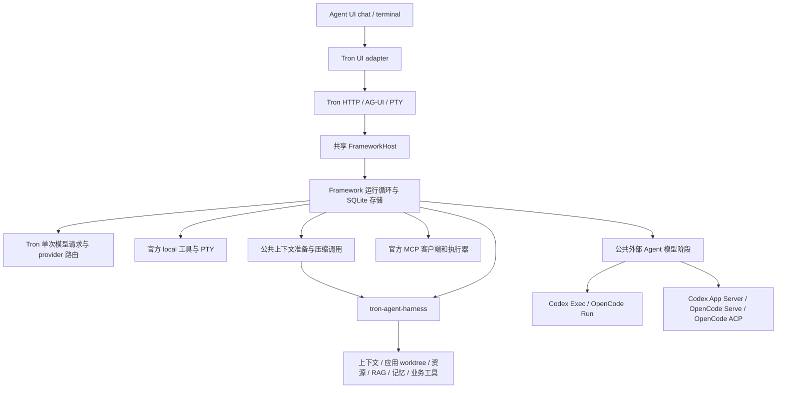

# Agent Framework / Agent UI 接入

## 当前迁移状态

**迁移与验收已完成。** Tron 的 Agent 模型/工具循环、模型重试、上下文压缩执行、
外部 CLI/JSON 服务桥执行和原生 PTY 由公共 Framework 提供；主聊天、临时 Agent 聊天和终端
使用公共 Agent UI。Tron 通过 `tron-agent-harness` 提供产品上下文、权限、业务存储和业务工具。

通用文件、搜索、patch、命令、终端、MCP 与提问能力复用官方插件。Tron 保留旧工具名称和
中英文说明的映射、附件 fileRef、应用/worktree 语义及产品卡片 DTO，不复制通用执行器。
模型服务适配器每次只调用一次模型；重试、溢出恢复、辅助压缩调用和总调用预算由 Framework 控制。
模型在工具执行后失败，只重试模型，不重放整轮工具副作用。

六种 runtime 已接入：ReAct 使用公共循环，两种 CLI 与三种服务模式通过公共外部 Agent 模型阶段接入，
保留原生会话与既有桥接协议。JSON 服务桥不冒充 Codex app-server / OpenCode ACP 原生协议。
提问使用官方 human 的问题/选项 ID 和结构化回答，释放当前 run 后通过持久化交互恢复。
普通发送与流式发送都复用应用级 FrameworkHost，避免临时实例丢失交互、续传和命令状态。

真实浏览器已验证连续对话、刷新后的历史与提问恢复、上下文窗口、回答后继续，以及真实 PTY
写文件、尺寸调整与退出。聊天、记忆和 AG-UI 使用真实后端；只有模型供应商响应使用本地 HTTP 测试服务。
测试明细和可重复执行方式见下方验收记录。

## 分支与执行链

Tron 从 `gh/master` 的 `c27ec9d89dcdc2f3312f96d57a4f7f603f2e610b` 创建
`feature/clouds3n/integrate-agent-framework-ui`。

生产入口已接入公共 Framework。HTTP 聊天、任务执行和自动化共享 `FrameworkHost`，
原 ReAct 模型/工具循环已移除；`ReactAgent` 保留为 Tron 模型路由、持久化、事件和业务策略的宿主接口。
公共循环每步调用一次宿主模型服务，再由公共工具调度器执行工具，不会在公共模型适配器里嵌套旧循环。
普通发送与流式发送入口显式复用 AppState 的共享 FrameworkHost；回答恢复、Agent API、任务与自动化也使用同一宿主。
真实浏览器提问恢复测试覆盖了这条装配要求，防止每次请求临时创建 Framework 实例造成交互状态丢失。

主聊天、临时 Agent 聊天和终端使用 Agent UI 的 chat、theme、terminal。
Tron 原 React、Vue、theme、terminal 实现包已移除；产品 DTO、页面、附件服务和终端协议适配保留。
`@tron/chat-agent-ui-adapter` 负责产品契约与公共 UI 契约的双向转换。



## 公共层和宿主的分工

`tron-backend/crates/tron-agent-harness` 使用公共 `ContextProvider`、`ToolProvider`、
`ToolBinding` 和 `CapabilityPackBuilder`。宿主注入用户、工作空间、会话、run、应用和任务作用域；
产品服务继续检查授权与资源归属。作用域标识本身不授予权限。

文件读写、搜索、patch、命令启动/读取/停止使用公共 local 执行器。
Tron 的旧 bash、filesystem、search、patch 执行器及重复 MCP HTTP/stdio 协议实现已删除。
旧调用名称保留为公共描述的映射，兼容已有策略和模型记录，不复制工具实现。
本地文件与命令方面，Tron 提供授权目录、动态 cwd 和附件 fileRef；业务工具继续由产品能力包提供。
MCP 的配置、变量解析与工作空间策略在 Tron，协议、发现及资源/工具调用在官方 MCP 插件。

公共层补充了逐 run 的本地工具授权、附件读取服务、宿主实时输入、工具结果处理、
工具调用标识、可见工具集更新和剩余批次预算策略。
这些能力位于公共项目，Tron 通过正式接口接入。

官方/外部表示来源，native/subprocess 表示执行方式，Cargo feature/运行时选包表示装配时机。
三者独立。Tron harness 编译进宿主，默认插件也在宿主进程中执行；MCP 服务和 CLI Agent
按各自协议创建或连接进程。用户扩展是否隔离执行由安装清单和执行方式决定，不能只看目录或作者。

## 能力保留与实现位置

| 能力 | 迁移后的实现与验证关注点 |
|---|---|
| 主聊天、临时聊天、Agent/模型选择、推理等级 | 公共 chat renderer/controller；Tron 选择器和双向 adapter |
| AG-UI、历史回放、错误、压缩状态 | 原产品事件契约保留；公共 UI 接收事件映射；reasoning 与公开 summary 分开 |
| 排队、steer、stop、重连 | 公共循环接入 `LiveInputSource`；Tron 保留 expectedRunCode 和运行预约/停止控制 |
| ask_user | 转为公共 durable interaction；提问结束当前 run，回答以 interaction ID 恢复，重启后仍可继续 |
| 附件、图片、fileRef | 产品上传/资源授权；公共文件工具通过 `FileReferenceReaderService` 读取受限内容 |
| 文件、多目录、动态 cwd | 公共 local scope 接收应用/worktree 授权根目录；下一步同步更新；失效目录报错，不回退到后端目录 |
| patch 与搜索 | 公共原子补丁、dry-run、move 和 diff；basename glob 支持子目录；越界与符号链接回归 |
| 超过 10 秒的命令 | 公共 command service 返回 ID，后续轮可读取、停止；界面名称为“命令清单”；shell 文本与显式 argv 分开 |
| 终端 | 公共 terminal renderer/controller、`framework.pty` 服务与官方 `terminal_*` 工具；Tron 保留 WebSocket 票据、目录授权、会话归属、shell hooks 和协议映射 |
| 模型路由与续传 | 宿主保留完整模型 ID、PersonAI、usage、cached/reasoning tokens 与路由选择规则；公共框架执行重试并禁止输出后重试 |
| 六种 runtime | ReAct 使用公共循环；另外五种外部 runtime 通过公共模型阶段适配，保留原 CLI/HTTP 协议和原生会话恢复 |
| 持久化、压缩、上下文预算 | 产品短期记忆/压缩和原历史继续使用；公共 conversation/checkpoint/interaction 持久化，可信指令前缀动态刷新 |
| MCP 与 skills | 公共 MCP 执行器；Tron 负责选包、变量、权限、来源和业务 skill 注册；准备失败也释放插件租约 |
| 目标、todo、自动化、RAG、数据源、CRUD | 由 Tron harness 调用原产品服务，继续使用产品数据与授权，不移入公共通用工具包 |
| 主题、Markdown 内链、注释 | 公共 UI 扩展和主题锚点；Tron 保留产品解析与操作 |

LSP 不在此次范围内。

## 持久化与生命周期

文件数据库 `tron.sqlite3` 对应旁路公共数据库 `tron.agent-framework.sqlite3`，保存在同一目录。
生产文件数据库不使用临时存储。内存数据库测试才创建临时 Framework 存储。
旧产品消息、工具观察、目标、todo 和压缩记录仍由原服务读取；首次公共会话装入准备好的历史。
后续请求由 Tron context policy 提供预算、压缩输入与当前执行上下文；公共 assembler 执行压缩与重组。

provider 续传信息作为公共 checkpoint 持久化，并绑定宿主作用域和请求摘要。
跨用户/工作空间复用、历史或可信指令变化时不复用失效的续传信息。
外部 runtime 会话 ID 同样存储并校验归属；CLI 与服务模式均覆盖重启后的继续执行。

MCP 租约从准备阶段的 guard 转交公共运行生命周期。准备失败、取消及正常结束都会清理连接。
CLI 创建独立进程组，取消 future 时回收后代进程。后台命令属于共享 FrameworkHost，
可以跨轮读取；进程关闭时统一停止。它们不是可跨后端重启继续运行的持久化作业。

## 本地联合开发

公共 framework 与 UI 当前均无 Git remote，UI 包尚未发布。本分支显式使用本地路径联合开发。
CI/分发前需发布固定版本或固定 Git revision 并替换本地依赖；当前依赖配置不能脱离两个公共项目源码独立构建。

```sh
TRON_AGENT_FRAMEWORK_DIR=/path/to/eliteforge-agent-framework \
TRON_AGENT_UI_DIR=/path/to/eliteforge-agent-ui \
make agent-deps
make agent-ui-install
make agent-ui-build
make fe-install
make fe-check
make agent-harness-test
make be-test
make fe-unit-test TEST="packages src"
PLAYWRIGHT_CHANNEL=chrome make fe-test
```

`agent-deps` 校验两个仓库再建立 `.agent-deps/` 链接，不复制源码、不猜测 checkout。
清单使用相对路径，链接不入库，必须指向包含本次公共项目改动的工作树。

## 验收证据

2026-09-27，macOS arm64。后端全量回归后，对最后的共享宿主修复补跑聊天 API 和真实浏览器；
宏文档示例补齐后单独执行文档测试，并完成 Framework 无默认 features 的完整回归。

| 范围 | 结果 |
|---|---|
| Tron 后端 | 63 个测试目标、871 项测试通过；最终共享宿主修复后的 35 项聊天 API 补测通过 |
| Tron harness 能力包 | 3 项通过 |
| 公共 Framework 全部 features | 121 个目标全部通过；449 项常规/文档测试，另 8 组 MCP 协议场景、4 组进程崩溃恢复场景通过 |
| 公共 Framework 无默认 features | 20 个目标、147 项测试通过 |
| 真实聊天浏览器链路 | 连续两轮对话、刷新恢复、128k 上下文窗口、历史与 token 数据、提问卡片刷新后提交并继续回答通过 |
| 真实 PTY 浏览器链路 | 公共 terminal UI 经 Tron 接入公共 PTY；实际写文件、resize 后行数增加、退出关闭通过 |
| Tron 前端同日回归 | 54 个文件、283 项单测通过；112 项浏览器交互通过 |
| 公共 Agent UI 同日回归 | core 40、React 53、Vue 14、terminal 226，合计 333 项通过 |
| 构建和格式 | Tron 前端生产构建、公共 UI 构建、Rust 格式检查、三仓库 `git diff --check` 通过 |

本轮执行归属整改未改变前端产品代码；前端与公共 UI 的同日回归结果保留，新增真实聊天验收单独执行。
本轮 Rust 测试为 0 失败、0 忽略。旧宏示意代码已补为完整可编译例子，取消 `ignore` 并通过文档测试。
旧 CLI 聊天用例改为创建并关联真实临时项目/应用，按授权目录执行，不再依赖后端进程工作目录。
结构化提问测试同时校验稳定选项 ID 和原问题内容；真实浏览器覆盖卡片持久化到公共交互恢复的完整链路。

测试按 Cargo metadata 的目标分组执行，全部 features 不被省略。Tron 使用
`make be-test TEST="--test <target> -- --nocapture"`，库、二进制和文档目标使用 `--lib`、`--bin`、`--doc`。
公共 Framework 逐包、逐目标使用 `cargo test --all-features`，并单独完整验证 `--no-default-features`。
`RUST_TEST_THREADS=2`、`CARGO_BUILD_JOBS=2`，关闭增量编译和调试信息。
磁盘空间不足中断的编译产物已清理，对应目标重跑通过；未执行的测试未计作成功。

最终记录：

- `/tmp/tron-migration-final-tests/results.json`：Tron 63 个目标，引用最终补测日志。
- `/tmp/tron-migration-harness-final.log`：harness 装配和隔离。
- `/tmp/framework-migration-final-tests/results.json`：Framework 全 features 与补充验证记录。
- `/tmp/framework-migration-nodefault-tests/results.json`：无默认 features 完整回归。
- `/tmp/framework-macro-doc-final.log`：完整宏示例的文档测试。
- `/tmp/tron-migration-browser-results.json`：真实聊天与 PTY 两个用例的最终结果，引用各自通过记录和原始日志；失败重跑历史保留在原始日志中。
- `/tmp/tron-framework-final-evidence/real-framework-chat-context.png`、`real-framework-question-resumed.png`：实际页面截图。
- `/tmp/tron-migration-final-fe-check.log`、`/tmp/tron-fe-full-final4.log`：前端构建与同日回归。
