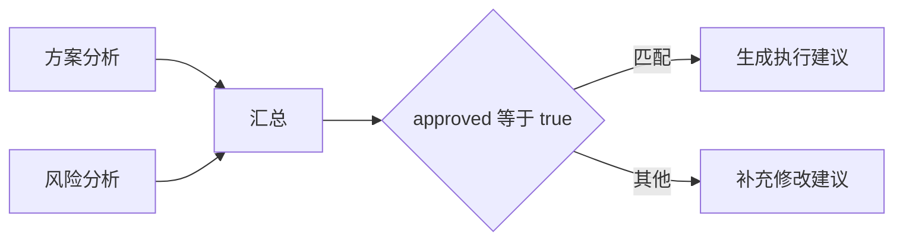
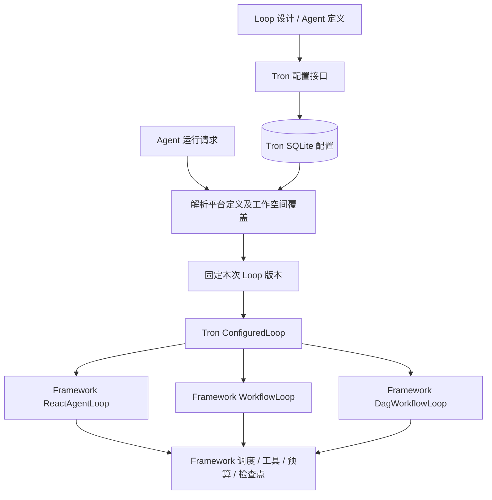

# Agent Loop 设计与管理

## 使用入口

在「设置 → 智能体管理 → Loop 管理」中创建、编辑和删除 Loop；在智能体定义的「Agent Loop」字段中选择已保存的设计。平台定义可以授权给工作空间，工作空间可以单独覆盖 Loop；重置配置后恢复平台选择。

| 类型 | 设计方式 | 执行行为 |
| --- | --- | --- |
| React | 无节点配置 | Agent 根据当前对话决定模型与工具调用 |
| Workflow | 添加模型阶段，调整顺序和指令 | 按阶段顺序执行，后续阶段继承前面的对话 |
| Dag | 在自由画布中拖动节点和连线，点击节点编辑属性 | 按依赖调度，可并行执行根节点并汇聚结果 |

内置 `builtin.react-loop` 为只读默认项。已有智能体不配置 `loopCode` 时保持 ReAct 行为。自定义编码保存后不可修改；新版本会用于下一次运行，已暂停的运行继续使用检查点内的原版本。

## DAG 配置

从画布工具栏添加模型或分支节点，也可以把工具栏中的节点拖到画布上。拖动节点调整位置，点击节点后在右侧编辑属性。拖动右侧输出端口到目标节点左侧输入端口建立依赖；分支节点分别使用「匹配」和「其他」出口，比较值在属性面板中填写。点击连线后可以删除，也支持 Delete 键。连线不能指向自身或形成循环。

拖动画布空白处平移，滚轮缩放，「适应画布」显示全部节点。键盘可以用方向键移动选中节点，Shift 加方向键移动更远；聚焦输出端口按 Enter，再聚焦输入端口按 Enter，也可以连接节点。

节点位置随 Loop 保存，重新打开时恢复布局。无依赖的模型节点可以并行执行，最大并行节点数为 1–16。所有阶段使用本次会话选定的模型、智能体权限和总体预算。存在多个最终节点时，运行结果按节点编码保留全部输出。



分支使用 JSON Pointer 读取直接前置节点的输出。模型输出是 JSON 文本时，会先解析 JSON，再读取字段。例如来源返回 `{"approved":true}`，配置指针 `/approved`、比较值 `true`，就选择匹配出口。指针留空时比较完整输出；字段不存在或文本无法解析为 JSON 时选择其他出口。比较采用 JSON 类型严格相等，因此 `true`、`"true"` 和 `1` 不相等。

汇聚方式 `Selected` 等待所有依赖确定后，只要求已选中的前置节点成功，适合互斥分支的汇聚。`All` 要求所有入边都选中且成功，适合并行分析后的汇聚；任何前置分支被跳过时，该节点也会跳过。

## 配置与执行边界

节点的 `position` 为画布坐标 `{x, y}`，没有设置时返回 `null`，旧配置可以省略。坐标必须有限且在 -100000 到 100000 之间；它只影响画布布局，Framework 执行时不使用坐标。接口仍使用现有 Loop 的 GET、POST 和 PUT 路由，布局与节点、连线在同一次版本更新中保存。



Tron 保存业务配置、授权和 Agent 的 Loop 选择；Framework 执行 Loop 并管理暂停恢复。DAG 模型节点沿用 Framework 的 ReactWorkflowNode，同时隔离 Tron 的模型上下文和续接状态，避免并行节点互相修改状态或被同一模型状态锁串行化。条件节点只做结果比较，不调用模型或工具。

## 接口与存储

响应沿用 `ApiResponse<T>`；请求字段为 camelCase，枚举使用 `React`、`Workflow`、`Dag` 等 PascalCase 值。

| 请求 | 用途 |
| --- | --- |
| `GET /api/v1/agents/loops` | 列出内置和自定义 Loop |
| `POST /api/v1/agents/loops` | 创建 Loop |
| `PUT /api/v1/agents/loops/{loopCode}` | 提交 `expectedVersion` 更新设计 |
| `DELETE /api/v1/agents/loops/{loopCode}` | 删除未被 Agent 引用的自定义 Loop |
| 智能体创建及 definition 更新接口中的 `loopCode` | 指定或覆盖 Loop |

配置存入 `agent_loop_designs`；工作空间定义使用可空的 `loop_code` 列，空值表示继承平台。平台配置沿用 JSON 中的 `loopCode`。迁移可重复执行，旧配置默认 ReAct。更新使用版本比较，冲突返回 409；删除在数据库事务中检查平台和工作空间引用，引用写入也受数据库触发器约束。

每个设计最多 64 个节点、256 条边、256 KiB 配置；单节点指令最多 64 KiB。保存前会检查唯一节点编码、依赖引用、分支出口和循环依赖。内置项以及被 Agent 引用的设计不可删除。

## 验证

相关检查使用根目录 Makefile：

```sh
make fe-check
make fe-unit-test TEST='src/domain/agent/model/loopValidation.test.ts src/domain/agent/pages/WorkspaceAgentsPage.test.tsx'
make be-check
make be-test TEST='--lib configured_loop'
make be-test TEST='--test agent_loop_management --test agent_management_api loop'
```

接口测试使用独立 SQLite 和本地模型 HTTP 夹具，覆盖持久化、继承与覆盖、版本冲突、非法图、阶段顺序、条件出口和并行汇聚。暂停恢复测试使用 Framework 工具交互夹具。自由画布在 API 模式下验证节点拖动、拖入节点、端口连线、分支出口、删除连线、键盘连接、平移，以及保存后刷新恢复坐标和连线；同时检查中英文桌面和中文手机布局。

自由画布验证结果：前端构建及后端检查通过；32 项前端测试、2 项 Loop 接口测试和 1 项暂停恢复测试通过。真实保存验收使用临时 Loop，完成后删除验收数据，未调用付费模型。
