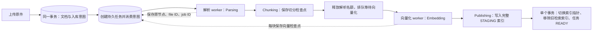

# 知识库持久化入库与 MinerU 路由

上传接口保存原件、文档和入库任务后返回。文档与入库意图在同一个 SQLite 事务中保存，任务创建事务同时消费意图。解析和向量化由两组后台 worker 执行，HTTP 请求结束不会停止任务。任务、节点身份、租约、重试时间和检查点保存在当前 Tron SQLite 数据库中；模型调用仍通过现有 Framework 适配器。



## 任务与恢复

- 保存文档后、任务创建前退出时，入库意图仍保留。启动后和运行中的维护循环会补建任务；暂时性存储错误保留意图并退避重试，永久错误显示在文档上。只恢复当前版本同事务保存的入库意图，不扫描或迁移旧文档；仅供预览的草稿上传不会自动入库。尚未建好任务的排队文档也可以取消。
- 文档状态为 `QUEUED / PARSING / CHUNKING / EMBEDDING / PUBLISHING / READY / FAILED / CANCELLED`。任务 `state` 为 `QUEUED / RUNNING / READY / FAILED / CANCELLED`，`stage` 为 `Parsing / Chunking / Embedding / Publishing`。不兼容旧入库状态，也不改写没有当前任务的旧文档。
- 每次认领增加 `attempt`，并记录 owner 和租约截止时间。心跳延长租约；取消、旧 owner、旧 attempt、过期租约和变化后的文档 revision 都不能保存检查点或发布。打开同一数据库不会抢占尚未过期的租约。
- 重启后自动认领排队任务和租约过期任务。切分完成后直接恢复向量化；已保存的向量块直接复用；发布阶段恢复时按新 attempt 写入独立 generation，旧 worker 的迟到暂存写入不能覆盖新结果。每块向量使用独立私有 Resource，任务引用一个清单，避免为每个块重复归档整份向量数组。
- 入库配置固定原件 SHA256、Resource revision、切分参数、解析质量、解析 profile、OCR 模式、节点集合、Embedding 模型和空间指纹。重试沿用快照；解析配置或模型空间变化会拒绝继续发布，需要显式发起新的索引任务。
- 暂时性存储、网络和服务端错误按持久化退避时间自动重试。`maxAttempts` 限制一轮任务允许的失败次数，解析和向量化正常交接不消耗这个预算。人工重试清零失败次数，但保留检查点和上游身份。

## 取消、发布与防重复

取消先提交本地状态和 revision，随后请求原 MinerU 节点取消。上游取消失败会保留 `cancellationPending`，后台继续尝试，服务重启后仍会恢复。人工重试可以返回排队状态，但是取消确认前不能再次认领。取消期间，旧回调不能修改文档或发布索引。

全部块完成且模型、空间指纹、维度和数值有效后，才写入 `STAGING` generation。发布事务核对整份块数和存在的向量索引，然后同时激活新 generation、禁用旧 generation、清理旧全文与向量索引、更新文档指针和任务状态。首次入库失败不会开放部分内容；重建失败或取消时，已发布的旧 generation 继续提供检索。

上传请求可带 multipart `idempotencyKey`，按用户、工作空间和知识库隔离。同一 key 的不同文件内容被拒绝；相同文件名和 SHA256 在同一知识库复用文档。重复上传和重复点击复用已有在途任务。SQLite 唯一索引保证一份文档只有一个 `QUEUED/RUNNING` 任务；两个数据库连接不能认领同一 attempt。已完成后显式重新索引会创建新任务。

## MinerU 配置

`tron-backend/application.yaml` 的 `mineru` 配置使用 MinerU 4 V1 API，固定版本和 OCR profile。以下示例使用两个本机节点；端口需与实际服务保持一致。

```yaml
mineru:
  enabled: true
  baseUrl: http://127.0.0.1:8000
  defaultTier: standard
  ocrMode: ocr
  parserProfile: mineru-4.0.10-ocr
  expectedParserVersion: 4.0.10
  ingestion:
    parseCapacity: 2
    embeddingCapacity: 2
    embeddingResourceGroup: null
    embeddingResourceGroupCapacity: 2
    leaseMs: 30000
    pollMs: 250
    maxAttempts: 3
    retryBackoffMs: 2000
  nodes:
    - id: parser_a
      baseUrl: http://127.0.0.1:8101
      enabled: true
      allowRemote: false
      capacity: 1
      weight: 1
      resourceGroup: parser-a-host
      resourceGroupCapacity: 1
    - id: parser_b
      baseUrl: http://127.0.0.1:8102
      enabled: true
      allowRemote: false
      capacity: 1
      weight: 1
      resourceGroup: parser-b-host
      resourceGroupCapacity: 1
```

`nodes: []` 沿用显式配置的 `baseUrl`，它也可以是 MinerU 自带 router。直连节点需要 `enabled: true`；非 loopback 节点还需要 `allowRemote: true`。新节点默认不启用、不允许远程传输。

认领时检查节点健康、版本和所选解析质量，按当前任务数与权重选节点，并分别限制全局、节点和硬件组容量。PDF 按所选质量处理；Word/Excel 使用 `flash`，不自动降低 PDF 质量。解析和 Framework Embedding 若共用硬件，可给节点与 `embeddingResourceGroup` 配置相同组名和相同组容量；两者仍保留独立并发上限和客户端。

节点健康检查失败、超时、版本不匹配、解析质量不支持、原节点被禁用或移除，以及并发名额用完，都会记录具体等待原因。文档和任务接口返回结构化 `waitReason`（`code / params / details`），不保存界面语言；详情页按当前语言显示原因，支持中英文切换，成功认领后清除。独立维护循环在解析 worker 忙碌时也检查节点，不依赖有空闲 worker 才更新排队原因。网络故障恢复后继续调度，配置问题会说明需要的操作；在途任务仍保留原节点约束。

设置页的「后端配置 → MinerU 解析 → mineru.nodes」支持从空列表添加第一个节点，也能修改地址、启用状态、远程传输授权、节点并发、权重和共享硬件组，或移除节点。列表作为一个结构化配置项保存，服务端先校验唯一 ID、地址、正数容量及远程授权，再写入 YAML。保存后需重启后端生效。

一旦认领，上传、创建 job、轮询、下载和取消都使用原节点。已保存 job ID 的恢复直接查询该 job，不依赖最近任务列表。创建 job 前先持久化对账标记；502、连接中断、坏 JSON 或非法 job ID 都可能意味着提交已被接收，因此继续在原节点按专属 file ID 分页对账，不自动再次 POST。对账找不到任务时会保留错误并等待重试，不能据此保证远端提交未发生。

解析缓存包含 OCR 模式、profile 和版本，强制 OCR 不复用旧的自动识别任务。取消使用任务中原先授权的节点快照，即使节点后来被禁用也能请求取消；该操作不会重新上传资料。

## HTTP 与前端

所有接口保留 `ApiResponse<T>` 的 `code / message / data`。上传、索引和重试返回当前文档，并附 `taskId / stage / waitReason`。新增接口：

| 接口 | 输入 | 返回 |
| --- | --- | --- |
| `POST /api/v1/knowledge-bases/{id}/documents/{doc}/cancel` | JSON `workspaceCode` | 当前文档 |
| `POST /api/v1/knowledge-bases/{id}/documents/{doc}/retry` | JSON `workspaceCode` | 当前文档 |
| `GET /api/v1/knowledge-bases/{id}/documents/{doc}/tasks` | query `workspaceCode` | 任务列表，含阶段、attempt、failures、退避时间、节点和取消待确认标记 |

接口先检查知识库所有者和工作空间权限，不返回内部配置快照或租约 owner。中英文详情页显示各阶段，处理中禁用配置修改，提供取消和重试，并每两秒刷新任务状态。

## 验证

通过 Makefile 执行前后端检查。后端集成测试覆盖持久化迁移、租约与双连接竞争、独立并发、硬件组限流、取消拦截、退避上限、解析与向量检查点恢复、发布恢复、整份可见性和权限。MinerU 测试使用两个真实 loopback HTTP mock 服务，验证节点绑定、健康排除、已知 job 恢复、丢失提交响应、坏 JSON 和取消失败后的重启恢复。浏览器测试覆盖中英文设置、阶段显示、取消、重试和轮询。

```sh
rtk proxy make be-check
rtk proxy make fe-check
rtk proxy env NO_PROXY=127.0.0.1,localhost,::1 make be-test TEST='--test knowledge_base_api --test knowledge_base_context --test knowledge_base_embedding_space --test knowledge_base_image_descriptions --test knowledge_base_ingestion --test knowledge_base_mineru_routing --test knowledge_base_mineru_v1 --test knowledge_base_office_visuals --test knowledge_ingestion_queue --test system_config_service'
rtk proxy make fe-unit-test TEST=src/domain/knowledge-base/pages/KnowledgeBaseFlow.test.tsx
rtk proxy env PLAYWRIGHT_CHANNEL=chrome make fe-test TEST='knowledge-base-mineru-ui.spec.ts --workers=1'
```

本机 HTTP mock 测试应让 loopback 地址绕过终端代理，否则健康检查和上游轮询可能被代理转发而超时。上面的 `NO_PROXY` 只作用于该次测试命令。

这些检查不代表真实 MinerU 集群、真实 PersonAI 服务、安装包或生产环境已经验收。需要 LibreOffice 的本地 Office 转换和已经退出正常入库流程的视觉再处理测试保持显式忽略。
