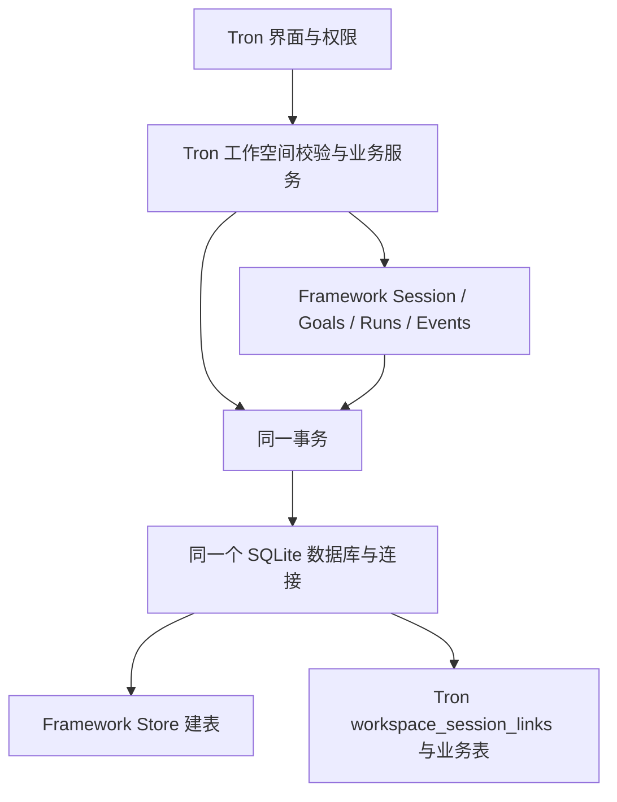

# Framework 会话存储接入

Tron 调用 Framework 的 Session、Goal、Run、Event、Conversation、Summary 和 Interaction 服务。Framework 安装 SQLite 存储插件，各个 Store 创建自己的表。Tron 只创建工作空间、业务数据及 `workspace_session_links`，通过原生 Session ID 建立关联。没有旧会话表、旧 transcript 或历史迁移路径。

业务仓储与 Framework 使用同一个 `SqliteDatabase`。跨层操作在一个异步任务里的 REQUIRED 事务执行，同步业务 SQL 保留任务的事务绑定。嵌套业务事务使用 SAVEPOINT，不能提前提交外层事务。创建会话及关联、原生会话删除及关联清理、上下文投影及事件、摘要 CAS 及展示事件、附件写入及会话状态校验，都遵循这一规则。取消、异常或任一层写入失败时整体回滚。取消时直接将回滚排入 SQLite 工作线程，锁随回滚完成释放，不依赖已经退出的任务继续调度。同步业务仓储的并发调用使用服务端的多线程 Tokio 运行时或阻塞执行器，等待连接时释放运行时工作线程。

## 归档管理

普通会话接口和 AG-UI/Run 接口都检查请求中的工作空间及 Session 关联，归档会话通过独立管理接口访问：

- `GET /api/v1/admin/archived-sessions`：默认查询全部工作空间，支持按工作空间分页筛选，筛选器包含已归档工作空间。
- `GET /api/v1/admin/archived-sessions/{id}`：在同一个事务内只读展示会话、消息、原生目标、条件、进度、判定记录、运行及各分支历史。读取不申请执行租约、不创建或修改历史。
- `POST /api/v1/admin/archived-sessions/{id}/restore`：恢复原 Session，保留原工作空间关联。
- `DELETE /api/v1/admin/archived-sessions/{id}` 与 `POST /api/v1/admin/archived-sessions/batch-delete`：仅删除已归档且没有活动执行的会话。逐项返回结果，失败项可重试。
- 管理页附件下载通过归档管理接口校验；正常会话入口拒绝归档会话。

归档前在事务内检查原生目标及活动运行。暂停和阻塞目标可以随会话归档，活动目标阻止归档。删除由 Framework 清理原生目标、运行、事件、交互、历史、摘要及检查点；Tron 在同一个事务清理关联和附件引用，解绑自动化执行记录。数据库提交后清理附件文件，文件清理失败记录日志。

管理页面复用 DataTable 的一体化筛选栏、表格和分页，字段名只用于无障碍标签，状态及操作提供中英文翻译。管理页面保留分页、单项恢复/删除、批量删除、失败项重试和请求代次保护，避免旧请求覆盖新筛选结果。恢复通知带原工作空间，普通列表仅刷新对应工作空间。

## 运行与记忆

ReAct、External、Continuation 和手动摘要均通过同一个 FrameworkHost。原生 Run ID、Interaction ID、工具调用 ID 和历史语义直接保留，不合成旧协议兼容数据。摘要调用使用当前授权模型目录，复用 Framework 的预算、取消、语义摘要、来源校验和 CAS。

Tron 提供授权应用范围、相关会话成员和待办展示内容。Framework 负责上下文组装、原生历史、摘要缓存及压缩策略。辅助模型调用与主调用共用原生预算和用量账本。提前触发压缩时，如果当前请求仍在预算内且没有可压缩的历史轮次，Framework 保留完整当前轮次；实际溢出和硬预算检查仍然生效。

## 验证入口

- Tron `framework_session_storage_tests`：新库、工作空间隔离、归档管理、恢复及批量删除。
- Tron `chat_repository::shared_transaction_tests`：原生操作与业务 SQL 的提交、回滚及同步事务绑定。
- Tron `framework_runtime`：原生运行、工具、交互、上下文、摘要和删除行为。
- Tron `agent_native_presentation`：原生事件持久化、去重、故障提示和只读过滤。
- Framework `lifecycle`、`session_deletion`、`compaction`、`compression`：生命周期、级联删除、事务、取消、只读历史及压缩边界。

## 自动化与任务会话

每次自动化或任务执行都会通过同一 ChatService 创建一个 Framework Session，分别标记 Automation 或 Task，Tron 的关联记录保留工作空间及来源编号。消息、目标、运行和事件都由 Framework 存储。归档、恢复和删除与普通会话一致，恢复不会重新执行来源业务，删除会话不删除自动化定义或任务本身。
