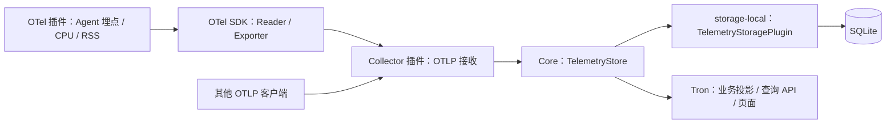

# 本地可观测

Tron 按 Profile 组合 Framework 的 OTel、Collector 和存储插件。链路与指标经过 OTLP/HTTP 接收器，通过 Framework 存储抽象写入 SQLite。

## 职责

| 位置 | 职责 |
| --- | --- |
| Framework Core | 通用链路、Span、指标模型及 `TelemetryStore` 接口 |
| OTel 插件 | Agent 埋点；可选 `runtime` 管理 SDK Provider、标准 Exporter、PeriodicReader 和进程采样 |
| Collector 插件 | HTTP/protobuf、授权校验、解压、解码、限流、提交确认、定时清理调度 |
| storage-local 插件 | SQLite 建表、事务写入、去重、查询、整条链路清理和指标过期清理 |
| Tron | Profile 路径和凭据、保留参数、业务属性、查询投影、接口与页面 |

`TelemetryPlugin` 仍支持宿主传入 Provider，由宿主管理其生命周期。只有启用 `runtime` 的 `OtelRuntimePlugin` 创建和关闭自己持有的 Provider。配置外部 endpoint 时，可以单独使用运行时插件。

## 接入

在可观测页面点击“复制 OTLP 配置”，可得到当前 Profile 的 endpoint、协议和授权请求头。接收器绑定 `127.0.0.1` 的动态端口，使用每次启动生成的 Bearer 凭据；重启后需要重新复制。配置接口响应带 `Cache-Control: no-store`。

- `POST /v1/traces` 和 `POST /v1/metrics` 使用 HTTP/protobuf，支持 gzip。
- 原始请求及解压后请求均限制为 8 MiB，每个请求最多 50,000 个 Span 或指标点。这是单次接收限制，不是指标存储条数限制。
- SQLite 事务提交后才返回成功。写入失败返回 503，并发处理超过 8 个返回 429，客户端可重试。相同 Span 按 Trace ID / Span ID 覆盖，相同指标点去重。
- 链路通过 `tron.workspace.code`、`tron.session.code`、`tron.run.code`、`tron.agent.code` 关联工作区和会话。Tron 的运行根 Span 自动添加这些属性。其他客户端可放在 Resource 或 Span 属性中。

当前实现接收链路和指标，协议为 HTTP/protobuf；尚未提供 OTLP/gRPC、OTLP/JSON 或日志管道。

## 指标

OTel Metrics 使用标准 MetricExporter 和 15 秒周期的 PeriodicReader。指标保留 Gauge、Sum、Histogram、ExponentialHistogram、Summary 数据点及 temporality、桶、exemplar 等内容。64 位整数以字符串返回给浏览器，累计值与增量值保持原来的语义。

Tron 每 15 秒采样当前后端进程：

| 名称 | 含义 | 单位 |
| --- | --- | --- |
| `process.cpu.utilization` | 单核 CPU 使用比例，多核工作时可超过 1 | `1` |
| `process.memory.usage` | RSS 常驻内存 | `By` |

进程指标经过相同的 OTLP 接收和持久化路径。页面从数据库读取，CPU 显示为百分比，内存显示为 MiB；刚启动尚未完成首轮导出时显示空值。

## 存储与清理

Collector 和 Tron 查询投影通过 Core 的 `TelemetryStore` 接口访问数据。`TelemetryStoragePlugin` 向插件容器注册存储服务，SQLite 实现复用 `storage-local` 的数据库 worker。数据库位于 Profile 业务数据库旁，使用 `.telemetry.sqlite3` 扩展名，包含 `ef_telemetry_traces`、`ef_telemetry_spans`、`ef_telemetry_metric_points` 三张表。

Tron 启动时会导入旧的 `traces`、`spans`、`metric_points` 表。全部数据导入成功后，才在事务中删除旧表；失败时保留旧表，允许下次重试。工作区、会话、运行和 Agent 字段转换为通用属性，Framework 存储层无需了解这些业务概念。

- 已结束链路超过 15 天，或已结束链路总数超过 50,000 条时，删除最旧的整条链路；外键级联删除全部 Span。运行中的链路不参与清理。
- 指标数据点只保留 5 天，不设存储条数上限。
- 启动时、每批数据写入时及每小时执行清理。异常退出留下的运行中链路，在下次打开数据库时标记为未知，再参与保留策略。
- 删除后 SQLite 页可以复用；清理不执行全库 VACUUM。

关闭时按插件依赖的逆序执行：停止采样并等待 SDK 导出剩余数据，随后停止接收器和清理任务，最后关闭数据库。进程指标使用本次启动的 `service.instance.id` 和 `process.pid` 查询，避免显示旧进程的样本。

Tron 的 Agent 埋点关闭详细错误报告，只保留错误类型；不会记录对话正文、工具参数或结果。其他 OTLP 客户端上报的内容由该客户端控制，Collector 保留原始 OTLP 结构。
