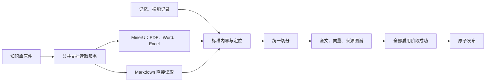
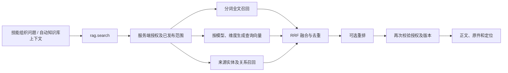

# 统一 RAG 入库与检索

知识库管理原件、资料及智能体授权；每个知识库自动生成同 ID 的 RAG 语料库。RAG 统一切分、索引、召回、融合、去重、重排和证据定位。只有记忆、技能两个内置语料库，技能正文与图谱共用一次入库和同一发布版本。

## 使用顺序

1. 在知识库、记忆或技能管理页维护来源。在智能体定义中分配知识库，再把智能体分配给空间。
2. 打开设置 → 数据 → RAG → **定义**，配置全文、向量、图谱和模型。修改索引配置后，状态显示“需要重建”及资料数；点击状态或三点菜单的“重建索引”，进入已筛选该语料库的入库列表。保存配置后的提示也提供入库入口。重排模型只影响检索，不要求重建。
3. 在 **入库** 勾选资料后执行重建；排队、运行或等待中的任务不可重复提交。语料库和状态筛选保存在地址中，刷新后保留。任务三点菜单支持取消、重试，并在当前页弹框查看文档分块、原件和图片。
4. 在 **检索** 选择可选语料库和返回数量，输入问题。页面按当前用户权限直接召回已发布资料，不要求选择空间或智能体，并展示检索范围、各路状态、融合结果、耗时和证据位置。

RAG 不提供创建语料库或上传资料的第二入口，也不要求配置 Profile、策略编号、存储映射、JSON 或 DAG。

定义页的向量维度暂时固定为 1024，请选择输出 1024 维的 Embedding 模型。图谱抽取可选择与 Agent 对话相同的 Auto 路由，或指定文本模型；技能包含哪些说明、脚本和参考文件由系统根据目录直接记录，不需要模型抽取。

## 入库



文档任务保留 MinerU 节点、租约和资源检查点；结构化记录任务保存内容、配置及向量批次检查点。它们进入同一个 RAG 索引执行器，均可取消和重试。文档租约过期后自动恢复，记录任务重启中断后明确标为失败，可人工重试。旧记录任务不能覆盖较新的来源版本。

向量请求沿用 Framework 的批量 Embedding 接口，默认每批最多 32 个分块、32,768 个保守估算 token，任一上限先到就结束当前批次。token 估算使用 Framework 的 UTF-8 字节数口径，不是模型分词器的精确计数。超出单批预算的分块会报错，不截断正文。

每批完整校验返回数量、索引唯一性及范围、维度、有限数值和模型身份，再按输入索引还原顺序并保存一个检查点。失败、取消或租约失效时不推进本批进度；自动或手动重试从已完成检查点之后继续，已完成批次不重复请求。全部启用阶段成功后才发布整份索引。

已启用的索引阶段失败时不发布部分结果，旧版本继续服务。删除来源会移除全文、向量及来源图谱证据。图片、页码、段落与单元格位置沿用公共解析服务结果。

## 检索



管理页通过 `POST /api/v1/rag/recall` 按当前登录用户的知识库所有权、记忆记录所有权及可管理的技能来源检索，并在召回后再次核对权限与发布版本。客户端不能指定用户身份或扩大来源范围。

Agent 调用继续检查智能体授权及智能体在空间的分配，知识库本身没有空间归属。记忆检查用户、空间或工作域范围，以及 ACTIVE、APPROVED、injectable 和有效期；技能按空间绑定的来源索引检索。客户端过滤条件只能缩小范围。

每个向量分区使用相同模型、维度、实际提供方模型和配置指纹生成查询向量。图谱仅返回关联原文分块的实体与关系。召回或重排失败会显示具体阶段与原因，不能将部分召回标为完整成功。默认全文和向量开启，返回 8 条；图谱按配置，重排未配置时关闭。

## 接口

响应沿用 `ApiResponse<T>`。

| 接口 | 用途 |
| --- | --- |
| `GET /api/v1/rag/corpora` | 当前用户可管理的内置、知识库语料库及索引统计 |
| `PUT /api/v1/rag/corpora/{id}/settings` | 配置索引及检索模型 |
| `POST /api/v1/rag/tasks` | 按来源提交重建，可指定知识库文档 |
| `GET /api/v1/rag/tasks` | 可访问任务、阶段、进度及失败原因 |
| `POST /api/v1/rag/tasks/{id}/cancel` | 取消任务 |
| `POST /api/v1/rag/tasks/{id}/retry` | 重试并复用有效检查点 |
| `POST /api/v1/rag/recall` | 当前用户管理权限下的直接召回测试 |
| `POST /api/v1/rag/search` | 校验空间及智能体授权后统一检索 |

Agent 工具身份由运行上下文注入，输入只包含 `query`、可选 `corpusIds`、`filters` 和 `limit`。管理页直接召回接口接受相同的查询字段，身份从登录态获取；智能体检索接口额外接受 `workspaceCode`、`agentCode`，服务端校验分配关系。结果包含正文、语料库、发布版本、渠道、分数、来源和定位。

## 数据边界与验证

RAG schema 为版本 2，不兼容旧 RAG 表、接口、Profile 或 DAG。检测到旧结构会明确拒绝启动，不自动迁移或清空数据库。开发或部署需显式使用新数据库。

全文索引使用 sqlite-simple 的中文分词，不再回退到 unicode61。开发 checkout 需拉取 Git LFS 中当前平台的动态库；只有 LFS 指针文件时，索引初始化会报错。macOS ARM64 使用 v0.7.1，上游发布包中 `libsimple.dylib` 的 SHA-256 为 `b5986159151ad95ccbf056ef8af22c7ae35112dbd081a96c047bb1720c66c9dc`，与仓库记录一致。运行时保留扩展连接，避免多次打开、关闭业务数据库时卸载进程级分词字典。

文档原件仍由 Resource 管理，知识库单位表为 `rag_<知识库ID>_units`；全文为对应 `_fts`，向量为 `_vec_d<维度>` 的 sqlite-vec 表。记忆、技能采用各自固定单位表；来源图谱在 `rag_graph_evidence`，记录任务在 `rag_record_tasks`。这些内部表不需要用户配置。

```sh
rtk proxy make fe-check
rtk proxy env PLAYWRIGHT_CHANNEL=chrome make fe-test TEST='unified-rag.spec.ts --workers=1'
rtk proxy env CARGO_INCREMENTAL=0 make be-test TEST='--test unified_rag --test unified_rag_api --test knowledge_base_api --test knowledge_base_ingestion --test knowledge_ingestion_queue'
rtk proxy env CARGO_INCREMENTAL=0 NO_PROXY=127.0.0.1,localhost,::1 TRON_UNIFIED_RAG_NATIVE_PDF=/absolute/path/to/test.pdf make be-test TEST='--test unified_rag_native -- --ignored --nocapture'
```

原生验收测试在临时数据库读取已有提供方连接及模型配置，解析指定的真实 PDF，验证切分、真实向量、发布、全文及向量召回、页码、原件字节、图片资源和撤权。它不修改现有用户数据库。

### 模型调用与向量批次配置

在「设置 → 通用 → 后端配置 → 模型调用」调整 `modelInvocation`，保存后下一次调用生效，无需重启。每种用途分别配置 `callTimeoutSeconds`（单次调用）和 `operationTimeoutSeconds`（包含重试、退避的总预算）；总预算不能小于单次超时。向量默认每批等待 180 秒，总预算 600 秒；这些是可调整的等待上限，不是耗时承诺。实际耗时取决于模型服务、输入和负载。

`modelInvocation.embedding.maxBatchInputs` 默认 32 条，`maxBatchTokens` 默认 32768，按条数和 Framework 估算的输入 token 总量先到的上限切批。单个分块超出 token 上限会明确报错，不会静默截断正文。两项应匹配模型服务的输入限制。每个新批次读取最新配置，已发出的请求沿用原预算；批次通过索引、数量和维度校验后才保存检查点，失败重试继续未完成部分。整份文档的多批请求不共享单批 600 秒预算。

内置智能体的调用和每步运行预算也可调整；正在运行的智能体保留启动时的预算。当前服务必须先加载包含这些配置能力的版本，之后才支持热更新。
