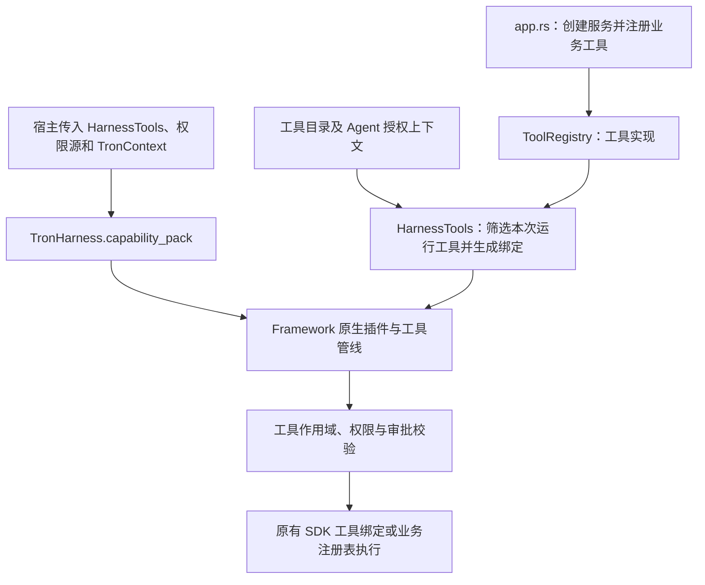

# tron-harness-capability

Tron 自有的原生能力包，统一提供宿主上下文、业务工具策略和内嵌技能。
宿主在 `framework_runtime/host_environment.rs` 中通过 `FrameworkBuilder` 装配。
运行时包 ID 保留 `tron.harness`，兼容已有 Agent 选择和扩展配置。

```text
tron-harness-capability/
├── src/       上下文作用域、工具授权和权限策略
├── build.rs   跟踪技能和配套资源变化
└── skills/    主题规范、记忆规范、记忆做梦
```

`TronHarness::new(tool_provider, shared_tool_catalog).capability_pack()` 返回能力包。
每次运行由可信宿主代码附加 `TronRunScope`；数据提供者继续校验当前权限和资源归属。
通用文件、命令、模型和 A2UI 能力仍由 Framework 对应包提供，不能被业务工具重定义。

技能通过 `capability_skills!()` 编译内嵌，构建脚本用 `capability_skills_build!()` 跟踪新增和修改。
宿主配置 `capability_skills_root(...)` 后，框架准备资源并提供原生 `skill_load` / `skill_read_resource`。
能力包内容页和 Agent 技能选择使用同一份内嵌目录，不依赖源码路径或另一个技能安装步骤。
技能脚本只随包分发，不会自动执行；记忆做梦需要使用方另外提供 `memory-dream` 命令。

本 crate 保留独立 workspace，隔离测试存储依赖。仓库根目录运行
`make harness-capability-check` / `make harness-capability-test`；
`agent-capability-*` 和 `agent-harness-*` 命令保留为兼容入口。

工具权限提示使用每次运行的 `TronToolPolicyLocale` 扩展，支持 `EnUs` 和 `ZhCn`。
宿主从 `AgentRunContext.locale` 解析后注入，审批继续运行时也会重新注入；
缺少扩展时按后端默认值使用中文。工具参数不能覆盖提示语言，风险与审批阈值保持原有规则。

## 插件和工具在哪里

本 crate 是依赖 Tron 宿主的 Harness 适配能力包。它已注册原生插件，
但业务工具的定义、实现和服务依赖仍在主后端，因此并非包含全部业务实现的独立分发包。

`TronHarness::capability_pack()` 在 `src/lib.rs` 中组装以下插件：

| 插件 ID | 注册内容 |
| --- | --- |
| `tron.harness.tools` | `ToolProviderPlugin`，从宿主传入的提供器获取工具绑定，并校验运行作用域及共享工具冲突 |
| `tron.harness.tool-permissions` | 配置权限策略时注册 `ToolPolicyPlugin`，处理执行、禁止和风险审批 |
| 上下文来源的 `block_id()` | 调用 `with_context_source` 时注册对应 `ContextContributorPlugin` |
| `framework.context-assembler` | 调用 `with_context_preparation` 时注册上下文准备插件；当前宿主传入 `TronContext` |

这些插件通过 Framework 的适配插件类型注册，代码没有另建 `plugins/` 目录。
插件是否存在应以 `capability_pack()` 的注册代码为准。

业务工具的主要入口均相对仓库根目录：

| 职责 | 源码入口 |
| --- | --- |
| 工具目录、名称、参数 schema 和本地化 | `tron-backend/src/application/agent/tool_catalog.rs` 及 `tool_catalog/` |
| 工具实现及业务服务调用 | `tron-backend/src/application/agent/business_tools.rs` 及 `business_tools/` |
| 创建服务并注册业务工具 | `tron-backend/src/app.rs` 中的 `register_default_agent_tools(...)` |
| 获取本次运行授权的工具并生成原生绑定 | `tron-backend/src/application/agent/framework_runtime/tools.rs` 中的 `HarnessTools::lease` |
| 将业务注册表调用适配到 Framework | `tron-backend/src/application/agent/tool_framework.rs` |
| 注入提供器、权限源和上下文准备策略 | `tron-backend/src/application/agent/framework_runtime/host_environment.rs` |



工具目录中的 schema 和描述只提供元数据，不能替代真实执行器。
已有 SDK 工具租约保留原始绑定及资源归属；产品工具通过宿主适配调用业务注册表。
文件、命令、媒体、PersonAI 和 A2UI 等共享工具继续由各自 Framework 能力包提供。
