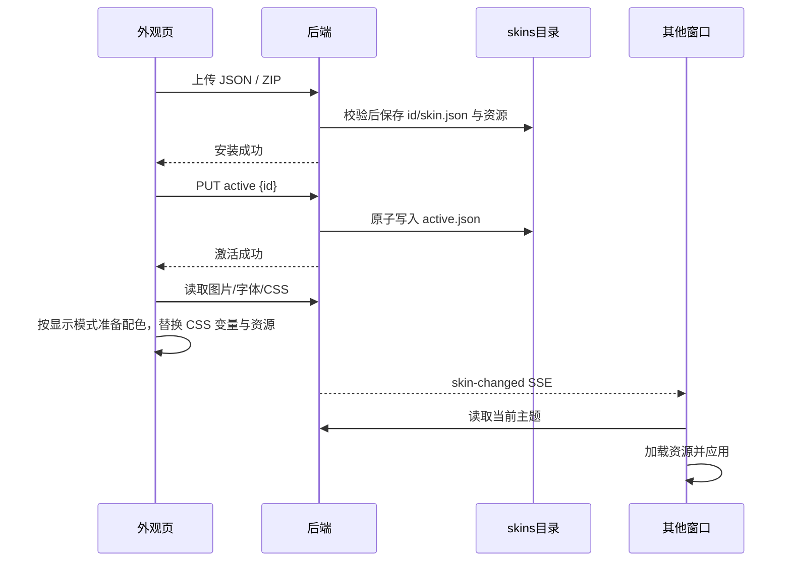

# 包格式与加载

## 格式

```text
my-theme.zip
├── skin.json
└── assets/
    ├── background.webp
    ├── interface.woff2
    ├── theme.css
    └── scanline.png
```

ZIP 根目录直接有 `skin.json`，不要带外层目录。只调颜色和组件尺寸时可导入单个 JSON。

```json
{
  "id": "my-theme",
  "name": "我的主题",
  "version": 3,
  "variants": {
    "light": {
      "--color-background": "#faf9f5",
      "--color-on-surface": "#30302b",
      "--color-primary": "#a84f35",
      "--color-on-primary": "#ffffff"
    },
    "dark": {
      "--color-background": "#262624",
      "--color-on-surface": "#e8e6dc",
      "--color-primary": "#e5a184",
      "--color-on-primary": "#30201a"
    }
  },
  "layout": {
    "--radius": "0.625rem"
  },
  "resources": {
    "background": null,
    "font": null,
    "css": null
  }
}
```

| 字段 | 规则 |
| --- | --- |
| id | 1–64 个小写字母、数字或连字符；内置 `default` / `brand` / `matrix` 及退役 ID `light` / `matrix-dark` / `matrix-particles` 不可覆盖 |
| name | 非空，UTF-8 最多 120 字节 |
| version | 包协议版本。固定为 3，不是主题发布版本；1 / 2 的旧包必须先补齐双配色并升级 |
| variants.light / variants.dark / layout | 两套配色必填，各包含 background、on-surface、primary、on-primary 四个 `--color-*` 变量；layout 可省略；变量名 `--[a-z0-9-]+`，最多 100 字符；非空字符串值最多 512 UTF-8 字节；三组共最多 1024 个条目 |
| resources | 可选 background / font / css。必须存放在 ZIP 内；单独 JSON 不能带本地资源或 CSS |
| marketId | 只出现在后端响应中，由市场安装写入；不要写进 `skin.json`，未知字段会被拒绝 |

不支持 JS、HTML、SVG、音效或图标替换。JSON 自定义属性值不接受分号、花括号、尖括号、反斜杠、@、CSS 注释、`url()`、`!important`。`var()`、`calc()`、`color-mix()` 等可用于变量值，但不能包含上述禁止字符或形成变量循环；变量值语法和颜色对比仍需浏览器验证。

本地资源路径只能用 ASCII 字母、数字、`-_.` 和 `/`，最多 240 字节；禁止空段、`.`、`..`、绝对路径或符号链接。图片扩展名是小写 png/jpg/jpeg/webp/gif，字体是 woff/woff2/ttf/otf。CSS 文件名必须是小写 `.css`。

CSS 可使用颜色、透明度、边框、阴影、滤镜、渐变、背景、伪元素、变换和动画；模块会保护组件尺寸和布局，仅[标准特效层选择器](effect-anchors.md)可改装饰自身尺寸和定位（`position: absolute`）。全局特效层固定覆盖 Tron Web 视口，跨页面显示且不拦截点击；普通选择器可以覆盖页面中所有匹配元素。CSS 选择器自动限定在 `body[data-tron-app][data-skin="主题ID"]` 子树，所以 `:root`、`html`、`body` 选择器不会成为有效入口，根变量应写在 `skin.json`。CSS 拒绝 @import、脚本构造、嵌套规则、`url()` 外部地址和未列入白名单的 CSS 函数；`url()` 只能引用包内文件，路径相对 ZIP 根目录。顶层 `@keyframes` 可用，名称会加主题 ID 前缀；关键帧只能用视觉属性。系统启用减少动态效果时，所有特效层及其伪元素的动画、过渡都会停止。CSS 文件最多 1 MiB。文件扩展名正确不等于内容有效，激活前浏览器还会真正加载/解码。

ZIP 最大 20 MiB，解压累计最大 40 MiB，最多 128 个条目，skin.json 最多 256 KiB。打包脚本只包含清单及所引用资源，不附加 README、系统元数据或脚本。

## 内置主题与在线市场

内置主题按固定顺序返回 `default`、`brand`、`matrix`。`matrix` 是正式内置主题；`light`、`matrix-dark`、`matrix-particles` 是退役 ID，不能再导入或激活。历史目录可能仍留在磁盘，但列表和激活逻辑会忽略它们。

「外观」页的在线主题市场使用统一账户服务：列表、安装和激活都由当前后端代理，前端只访问本地接口。市场安装会把远端 ZIP 存入 `skins/<id>/` 并写入只读的 `market-source.json`，响应中的 `marketId` 用于把已安装主题对应回市场条目。市场安装后可立即激活；手工导入不会自动激活。

## 三种交付方式

| 方式 | 用途 | 加载条件 |
| --- | --- | --- |
| 纯 JSON，无资源 | 配色、按钮、行样式 | 最简单，可直接导入 |
| ZIP + 相对资源 | 带背景/字体、离线使用 | 推荐；资源请求通过当前后端读取为 Blob |
| JSON/ZIP + HTTPS 背景/字体 | 共享远程素材 | 客户端需联网；字体服务器需允许跨域；URL 不含用户名/密码。CSS 不接受 HTTPS 文件 |

本地资源由后端上传保存，远程 URL 由每个前端直接访问，后端不会下载或缓存到包内。不能使用 file://、data:、http:// 或电脑绝对路径。

`resources.background` 还受本机外观偏好影响：用户设置自定义背景图或启用背景效果时，宿主会隐藏皮肤背景；主题仍应保证不依赖背景图时的可读性。字体由 Tron 以 `FontFace` 加载，远程字体需要 CORS。

## 随附 Ocean 示例

源文件：[assets/ocean-detail/skin.json](../assets/ocean-detail/skin.json)。它不依赖图片、字体或网络，可以直接导入 JSON；也可以复制目录、修改 ID 和变量后打包。

在此 skill 目录执行（从其他目录运行时，将脚本及源目录解析为绝对路径）：

```sh
python3 scripts/theme_pack.py validate assets/ocean-detail
python3 scripts/theme_pack.py pack assets/ocean-detail /你的输出目录/ocean-detail.zip
```

输出 ZIP 是交付产物；后续修改始终以 `assets/ocean-detail/` 为源。打包器拒绝覆盖已有输出，可指定新的文件名。

## 用户加载

1. 打开「设置 → 外观」。
2. 点击「导入主题」并选择 ZIP 或 JSON。导入只安装，不自动激活。
3. 点击该主题卡片。保存主题 ID 后，前端按当前显示模式加载配色和资源；准备完成后替换原主题。
4. 也可展开「在线主题」，安装市场条目；从市场安装会在安装成功后激活。
5. 在实际业务页面检查按钮状态、输入框、表格数据行、Composer、聊天历史索引、图片缩略图和弹窗。
6. 刷新或重启后从后端恢复。切换到默认主题可恢复默认效果。

重复 ID 会拒绝导入。发布修改版时改 ID（如 ocean-v2），version 使用 3。外观页支持卸载自定义和市场安装的主题；当前没有覆盖更新或导出界面。

## 存储与多窗口



目录为后端 `application_config_path` 同级 `skins/`，默认 `~/.tron/skins/`。它属于后端实例，不是前端机器，也不是每个 Profile 独立存储。同一后端的窗口共享激活主题；不同后端各自保存。明暗模式独立保存在本机 `tron.color-mode`，支持 light / dark / system；system 监听操作系统外观变化。同源窗口通过 storage 事件同步模式。字体大小也是本客户端偏好。

内置主题首次访问播种，清单缺失/损坏用编译内嵌文件兜底。active.json 不合法或指向不存在主题时回到 `default`。正常操作无需手工改磁盘文件。

开发时手工放目录要求名称与 id 一致。它不会触发 SSE；刷新或重新聚焦后重新读取清单。仅替换资源但清单不变可能命中缓存和前端签名，应改资源文件名并更新清单，或用新 ID 重新导入；当前不提供目录热监听。

旧单配色包需补齐 `variants.light`、`variants.dark` 并升级到版本 3 后重新导入。共享 CSS 使用配色变量，从而适应两种模式。

## 失败处理

- ZIP 缺根清单、资源缺失、路径越界、ID 冲突：拒绝安装，不覆盖已有目录。
- CSS 用了不在白名单内的函数、引用了包外文件、出现嵌套规则或危险声明：拒绝安装，并返回 CSS 文件和规则。
- 背景/字体请求、解码或激活保存失败：前端保留现有主题，旧资源不提前销毁；可重新选内置主题。资源请求及解码各有 10 秒超时阶段。
- 已激活主题的远程资源断网：该窗口保留现有主题/内置基底，外观页仍显示主题列表和重试入口。后端 active ID 不会被某个窗口的网络故障自动改写。
- 市场列表或下载失败：外观页保留已安装主题和当前激活主题，显示错误与重试入口；不会把远端失败写成新的激活状态。
- 多窗口网络不一致时，某个窗口可能暂时保留旧主题。SSE 重连和窗口聚焦会重读，不能承诺断网窗口瞬时一致。
- 切换成功清理旧装饰层、观察器、动态样式、FontFace 和 Blob URL；异步旧请求不能覆盖新选择。

## HTTP 自动化

沿用 Tron 当前实例的 Profile 保护和访问配置，不猜地址或 token。JSON 回包 `code="0"` 表示成功，`data` 为业务数据。错误码 `101025001` 非法内容/CSS/版本，`101025002` 不存在，`101025003` ID 冲突，`101025004` 存储失败，`101025005` 包体超限，`101025006` 内置主题受保护。

| 方法 | 路径 | 参数/数据 |
| --- | --- | --- |
| GET | `/api/v1/system/skins` | data 为数组，含内置 `default` / `brand` / `matrix` |
| POST | `/api/v1/system/skins` | 原始文件字节，不是 multipart；返回 data.skin；只安装，不激活 |
| GET | `/api/v1/system/skins/active` | data.skin |
| PUT | `/api/v1/system/skins/active` | JSON `{ "id": "my-theme" }`；返回 data.skin |
| DELETE | `/api/v1/system/skins/{id}` | 卸载自定义主题；内置或退役 ID 返回受保护/不存在 |
| GET | `/api/v1/system/skins/{id}/resources/{path}` | 二进制图片/字体/CSS；带 MIME 和 `nosniff` |
| GET | `/api/v1/system/skins/events` | SSE `skin-changed`，通知重新读取 |
| GET | `/api/v1/system/skins/market?current=1&size=20` | 市场分页；data 含 current / size / total / records |
| POST | `/api/v1/system/skins/market/{id}/install` | 下载并安装市场主题；返回 data.skin；不自动激活 |

API 激活只校验本地资源存在，不代表客户端能解码或获取远程 URL。需要真实渲染验证时使用外观页。

## 手工恢复

主题 UI 无法使用时，可关闭后端后仅将 `skins/active.json` 改为 `{"id":"default"}`，再启动；不要删除其他用户配置。已激活的自定义目录不会被自动清理，仍可在 UI 恢复后卸载。
