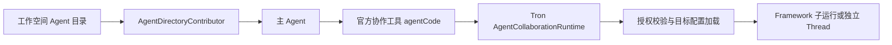

# Agent 协作

Tron 使用 Framework 官方 `agent_spawn` 和 `thread_*` 工具，不另建工具协议。

目录每次组装模型上下文时读取当前工作空间已授权的内部 Agent，提供编码、名称、说明和最多 512 字符的职责摘要。目录属于 Data 上下文，不作为系统指令；独立预算为 2048 tokens，放不下的条目整条省略，并提示省略数量。

派发时重新检查工作空间授权。目标 Agent 使用自己的角色、业务工具和 MCP 权限；模型沿用当前调用配置；Person-AI 请求会重新绑定目标会话与运行标识，避免沿用父会话。未知或未授权编码明确报错，不回退到主 Agent。省略 `agentCode` 时使用当前 Agent。

- `agent_spawn` 等待子运行结果。Framework 保留父运行的取消、截止时间、调用关系和预算约束。
- `agent_spawn` 不接受步数或工具调用次数参数；子运行的 `maxSteps`、`maxToolCalls` 和并行工具数使用目标 Agent 的有效定义（含工作空间覆盖），不再取父 Agent 次数上限的最小值。任务文本不应额外添加次数限制，用户明确要求时除外；token 总预算与原生延续运行的共享预算仍由 Framework 管理。`thread_*` 的请求预算行为保持原样。
- 每个 `agent_spawn` 使用独立临时会话和 AG-UI 流。右侧“子代理”标签展示代理、任务和运行状态，点开后才读取该临时会话；委派任务和子代理消息不进入主会话历史。
- 派发索引记录目标的 `avatarId`，侧栏复用智能体配置的头像并裁成 48px 圆形。运行时外圈旋转，等待时呼吸，结束后静止；状态保留悬停提示和无障碍名称，减少动态效果时停止动画。
- `thread_create` 启动独立会话并立即返回。Thread 固定绑定目标 Agent、用户、工作空间和执行目录，后续消息重新加载目标角色与工具权限。
- `thread_send`、`thread_answer`、`thread_wait`、`thread_read`、`thread_list`、`thread_close` 复用官方工具；已撤销授权的目标不能继续操作，其他用户或工作空间不能读取 Thread。
- MCP 工具租约由原生运行上下文持有，直到运行释放；取消子代理等待不会提前释放仍在使用的工具。

Thread 调度索引和结果缓存当前保存在进程内，最多 128 个 Thread。原生会话记录使用 Framework 共享存储；后端重启后不恢复协作 Thread 索引。关闭完成的 Thread 只移除协作索引，不删除会话历史。配置档关闭时由 Framework 关闭运行和共享服务。

本接入范围是工作空间内部 Agent，系统 CLI Agent 不在目录内。

## 子代理查询

- `GET /api/v1/chats/sessions/{sessionCode}/subagents` 读取持久化索引和原生运行摘要，不加载子代理消息或执行检查点。
- `GET /api/v1/chats/sessions/{sessionCode}/subagents/{runId}` 校验归属后，仅查询选中临时会话的原生历史和 AG-UI 流。
- 两个接口沿用父会话工作空间授权，并检查用户及子运行归属；临时会话不加入产品会话列表。
- Framework 历史 SQL 按物理 `session_id` 查询，分页版本、待处理交互和活跃运行也按会话隔离。子代理写入不影响父会话游标。

子代理索引随本接入后的派发写入共享存储，后端重启后仍可读取。此前未记录索引的子运行不会自动出现在标签中。

验证：`make be-check`、`make be-test TEST='--test agent_collaboration'`。

## 本次验证记录

协作集成测试覆盖命名派发、目标工具权限、目录读取后的撤权、父运行取消、Thread 目标绑定及用户隔离、Person-AI 子会话隔离。另运行知识库上下文和工作空间授权回归。

现有 `agent_runtime` 套件为 27/31 通过。使用未修改的分支 HEAD 和同一份 Framework 依赖，在独立源码目录复跑，以下四项出现相同失败，本次未改动这些行为或断言：

- `react_agent_completes_final_answer_and_publishes_metadata_only_events`
- `react_agent_continues_after_unauthorized_parallel_tool_call`
- `react_agent_executes_remaining_parallel_budget_before_failing`
- `framework_main_rich_input_and_remaining_output_budget_reach_actual_http_body`
