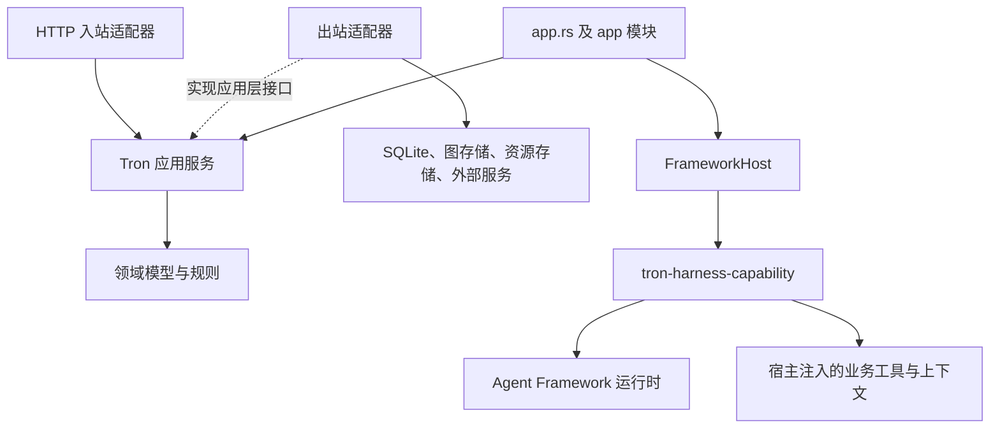

# 后端技术栈

本文说明当前后端的依赖、运行方式和职责划分。Rust 实现规则见[后端编码规范](spec/后端编码规范.md)，依赖版本以 [Cargo.toml](../Cargo.toml) 和 Cargo.lock 为准。

## 技术与职责

| 技术 | 当前用途 |
| --- | --- |
| Rust 2024、Cargo | 后端实现、依赖管理、构建与测试 |
| Tokio、Axum、Tower | 异步运行时、HTTP 路由、中间件与服务状态 |
| Serde、serde_yaml | JSON 序列化与 YAML 配置解析 |
| SQLite、rusqlite、tokio-rusqlite | 业务数据、身份登记及 Framework 本地持久化 |
| Grafeo | 嵌入式图存储 |
| OpenDAL | S3 资源存储适配；资源也支持本地文件存储 |
| EliteForge Agent Framework | Agent 运行、会话、工具执行、交互续跑及能力包装配 |
| socketioxide | 交互式终端的 Socket.IO 网关 |
| Framework PTY 后端 | 通过 portable-pty 提供伪终端进程，Tron 网关接入输入、输出与尺寸变化 |
| reqwest、PersonAI Rust SDK | 外部 HTTP 服务、模型及 PersonAI 接入 |
| utoipa、Scalar | 从代码生成 OpenAPI 文档并提供交互式预览 |
| Framework 可观测性插件 | 采集运行追踪与指标，提供查询及导出配置 |

## 代码与能力包

后端按 `domain`、`application` 和 `adapters` 分层，`src/app.rs` 及 `src/app/` 负责装配。Framework 运行逻辑由共享仓库提供，Tron 负责产品业务和宿主接入。



- `crates/tron-harness-capability` 的 Cargo 包名为 `tron-harness-capability`，运行时能力包 ID 为 `tron.harness`。
- 能力包装配工具插件、权限策略和上下文贡献器，并嵌入 `skills/` 下的主题、记忆与记忆整理技能。
- 业务工具定义位于 `src/application/agent/tool_catalog.rs` 及同名目录；实现位于 `business_tools.rs` 及同名目录，由宿主注册和注入。能力包当前依赖这些宿主服务。
- 通用本地工具、MCP、A2UI、AG-UI、模型与可观测性等能力由 Framework 的能力包或插件提供。具体装配见 `src/application/agent/framework_runtime/`。

外部 Agent 使用 `external_agent_pack(HostExternalAgent)` 的默认装配：绑定插件为 `framework.external-agent`，执行循环插件为 `framework.loop`，循环实现为 Framework 的 `ExternalAgentLoop`。Tron 注入的 `HostExternalAgent` 负责产品请求、结果及会话映射，CLI 协议由 Framework 的 external 实现插件处理。能力包工厂接收 `ExternalAgent` 契约实现，Framework 不依赖 Tron 类型。

CLI 模式的调用链：

```text
Framework ExternalAgentLoop
          | ExternalAgent 契约
          v
Tron HostExternalAgent（请求、结果、会话映射）
          v
Framework CLI 适配器 → Codex / OpenCode / dsh
```

dsh 的新会话统一归入原生工作区 `Tron harness`，工作区目录为业务数据库旁 `tron.workspaces/sessions`（默认 `~/.tron/tron.workspaces/sessions`）。普通聊天和协作调用使用同一配置。这个目录只用于原生会话分组；实际执行目录仍由 Tron 按项目、会话或 Dude 解析，再由 Framework external 插件在首轮模型请求前通过 dsh 的 `workingDirectory` 服务设置。AGENTS.md 与工具使用实际目录，沙箱的默认写入边界也保持为实际任务目录。已有非分组会话保留原目录续聊，不改写会话头或迁移到新组。

- Framework 的本地依赖路径位于仓库根目录 `.agent-deps/agent-framework`，由 `make agent-deps` 准备。

## Token 估算

通用的 `TextTokenizer`、`TokenizerRegistry`、匹配规则和精度标记由 Framework core 提供；HTTP 模型插件提供内嵌词表和默认注册表。Tron 只投影实际发送的消息、工具与协议字段，共享同一选择结果进行上下文装配、压缩和最终准入；不再在产品中维护具体模型枚举或词表。

```text
供应商实际模型名（忽略供应商路径，不使用目录 UUID）
  → 精确模型规则 → 不区分大小写的家族包含匹配 → Unicode 回退
  → 共享且按需加载的 TextTokenizer
  → 实际发送内容 + 协议开销估算 → 预算、压缩、准入
```

默认覆盖 Qwen、DeepSeek、GLM、Kimi、GPT 和 Claude/Opus。家族规则使用已固定的代表性词表，不代表所有版本的官方精确计数；已知具体模型的规则优先，宿主可克隆默认注册表后注册新分词器或覆盖模型规则。Qwen 3 与 3.5、GPT cl100k 与 o200k 分开选取。Opus 使用 Anthropic 发布的旧版词表作近似，不能视为当前 Opus 的官方 tokenizer。请求审计中的 `estimator` 区分已知模型词表、`family_estimate` 和其他估算；实际用量仍取供应商返回值。

词表和许可归 Framework HTTP 模型插件管理，运行时不联网下载；加载失败明确返回错误，不悄悄改用别的词表。导入 Hugging Face tokenizer 时关闭原文件中的 padding 和 truncation，完整计数长文本。注册和选路本身不解析词表，每个被使用的词表只加载一次，注册表副本共享已加载实例。

## 配置与存储

正式启动入口 `src/main.rs` 通过 `AppConfig::from_application_yaml()` 读取配置，默认文件是 `$HOME/.tron/application.yaml`。可用 `TRON_BACKEND_APPLICATION_CONFIG_PATH` 指定其他文件。仓库内的 `tron-backend/application.yaml` 是配置模板，运行 `make be-dev` 不会自动选择它。

配置按“运行时默认值 → YAML → 已支持的环境变量”依次覆盖。环境变量覆盖项由 `src/config.rs` 和 `src/config/` 明确定义；不能根据 YAML 字段名推断出任意环境变量。

通用设置按有效配置展示 `systemAgents.codexCommand`、`systemAgents.opencodeCommand` 和 `systemAgents.dshCommand`，即使 YAML 未写出这些字段；读取设置不把默认值写回文件。默认命令分别为 `codex`、`opencode`、`dsh`，修改后重启生效。`dshCommand` 留空停止扫描，默认命令在 macOS 的 PATH 中不可用时会检查 DeepSeek Harness 桌面安装包。

| 配置项 | 默认值或说明 |
| --- | --- |
| HTTP 地址 | `127.0.0.1:8080`；支持 `TRON_BACKEND_BIND_ADDRESS`、`TRON_BACKEND_PORT` |
| 业务 SQLite | `$HOME/.tron/tron.sqlite3`；支持 `TRON_BACKEND_DATABASE_URL` |
| 身份登记 SQLite | `$HOME/.tron/control/profiles.sqlite`；由 `ProfileRegistryService` 单独读取 `TRON_BACKEND_CONTROL_DATABASE_URL` |
| 图存储 | `$HOME/.tron/tron.graph.grafeo`；支持 `TRON_BACKEND_GRAPH_STORAGE_PATH` |
| 外部技能注册目录 | `$HOME/.tron/skills-registry`；对应 YAML 的 `skillsRegistryRoot` |
| 本地资源目录 | `$HOME/.tron/resources`；通过 YAML 的资源存储配置调整 |
| 前端静态资源 | 后端 crate 下的 `resources/frontend`；支持 `TRON_BACKEND_FRONTEND_DIST_DIR` |
| 普通终端默认目录 | `.`；支持 `TRON_TERMINAL_WORKING_DIRECTORY` |

身份登记库保存 PersonAI 身份和当前激活身份，与业务库分开配置。受保护的业务路由通过 `require_profile` 获取当前身份；现有请求上下文沿用历史类型名，但该中间件不执行本地登录或 Bearer token 校验。

数据库初始化统一定义在 `migrations/0001_init.sql`，按业务库和身份登记库分区执行。首次打开时在事务中创建最终表结构、索引、触发器和内置目录，并记录初始化完成；再次打开只检查标记，不重置用户数据。当前处于初期开发阶段，不提供旧数据库升级或数据迁移。

```text
SharedDatabase::open       → schema::initialize_business → 业务库区段
ProfileRegistryService::new → schema::initialize_profiles → 身份登记库区段
```

Framework 自有表仍由 Framework 存储插件初始化；RAG 按语料配置创建的动态全文、向量索引仍由运行时维护。

SQLite 中文分词和向量扩展复用 Framework 本地存储插件的 `bundled-native` 功能，原生库及字典按编译目标嵌入后端二进制，运行时由插件校验并释放到缓存目录。Tron 仅保留环境配置和连接生命周期适配，桌面打包无需复制 `resources/native`。

```text
Tron SQLite 连接 → ExtensionConfig → Framework 内嵌资源 → 校验及缓存 → 中文分词、向量查询
```

当前只面向 macOS、Linux 和 Windows。Framework 现有资源同时支持中文分词和向量查询的目标为 macOS x86_64/arm64、Linux GNU x86_64/arm64、Windows x86_64；Windows arm64 和 Linux musl 尚未配齐这两类资源。`TRON_SQLITE_EXTENSION_MODE` 支持 `disabled`、`preferred`（默认）和 `required`；`TRON_SQLITE_EXTENSION_RUNTIME_DIR` 指定缓存目录，默认是系统临时目录下的 `tron/sqlite-extensions`。

知识库解析产物使用独立的正文预算：移除图片二进制数据后的规范化文本最多 16 MiB，长文档最多 10,000 个分块，超限明确失败且不截断正文。原始解析产物仍受 100 MiB 预算约束；本地纯文本上传保持 2 MiB 限制。

## HTTP 与前端资源

- 产品 JSON 响应使用 `ApiResponse<T>`，字段为 `code`、`message`、`data`。普通成功响应的 `code` 为 `SUCCESS`；部分协议适配使用 `protocol_success` 返回 `0`。SSE、文件下载和 Socket.IO 遵循各自的传输格式。
- 请求语言由 `Accept-Language` 解析为 `zh-CN` 或 `en-US`，缺省或不支持时使用中文。当前仍有固定英文错误提示，不能据此宣称所有接口已完成国际化。
- `/api/docs` 提供 Scalar 预览，`/api/openapi.yaml` 提供 YAML。当前 OpenAPI 只登记健康检查、就绪检查及可观测性接口，尚未覆盖全部业务路由。
- `make openapi` 从 `src/openapi.rs` 导出仓库根目录的 `openapi.yaml`，不代表执行了完整 API 契约验证。
- Axum 可同时提供 API 和构建后的前端资源。静态文件必须存在于配置目录；前端页面路由回退到 `index.html`，`/api` 路径不参与页面回退。Vite 开发模式由单独进程提供页面并代理 API。

HTTP 入口通过 `into_make_service()` 在启动时展开路由，避免每条连接重复装配路由。`AppState` 通过 `Arc` 共享服务和配置，请求提取状态时只复制引用；宿主初始化时显式替换服务采用写时复制，保持各宿主的配置隔离。

观测看板的 `diskUsage` 统计 Tron 本地数据：默认覆盖 `~/.tron`，同时纳入配置在外部的数据库、图存储、技能和本地资源路径。自定义 YAML 位于代码仓库时，只统计配置文件及明确的数据路径，不扫描整个仓库。扫描在后台执行，结果缓存一分钟；初次采集或读取失败时 `bytes` 为 `null`。Unix 按文件系统已分配块计数并去重硬链接，其他平台按文件长度计数；路径重叠去重，不跟随目录内软链接。该值独立于工作区筛选，不包含远端存储。

```text
看板请求 → 返回缓存快照
             └─ 未采集或缓存过期 → 单次后台扫描 → 更新快照
```

## 终端与命令执行

普通交互式终端先通过 REST 取得连接票据，再连接 Socket.IO。票据有效期为 60 秒，消费后立即删除。当前票据保存在后端进程内存中，多实例部署时，票据签发与 socket 连接必须到达同一实例。

票据包含 `appCode` 时，服务检查应用所属工作区和启用状态，并使用 `App.localDirectory`；不包含时使用配置中的普通终端目录。PTY 进程由 Framework 后端持有。

Agent 文件与命令工具和外部子代理共用同一份执行目录。选定应用/worktree 时使用其目录；无项目会话使用数据库旁 `tron.workspaces/sessions/<用户>/<会话>`，Dude 使用 `tron.workspaces/dudes/<用户>/<Dude>`，目录随首次执行创建并跨运行保留。主代理能在执行上下文中看到实际 `localDirectory`。`agent_spawn`、`thread_create` 的 `workingDirectory` 指定子任务目录，省略时继承父目录；相对路径基于父目录解析，并保留父代理原有的文件访问权限。独立 Thread 续聊保持最初绑定的目录。显式目标缺失时仍应报错，不能借用普通终端的默认目录规则回退到后端进程目录。

删除归档会话时，清理会话记录、附件和该会话在 `tron.workspaces/sessions/<用户>/<会话>` 下的专属目录；项目仓库和 Dude 共用目录保留。目录清理失败时返回错误并回滚会话记录删除，修复文件访问问题后可重试。历史链路、日志和观测统计独立保留，删除会话不访问遥测数据库，也不重算历史统计。

## Dude 工具契约

Dude 使用 `dude_task_*` 和 `dude_memory_*`，不以普通工作区工具替代。记忆范围仅为当前用户和工作领域，不接收 `workspaceCode`；工具列表与执行权限在同一次运行中使用相同的分配快照。新运行或交互续跑重新读取配置，在 Framework 会话事件中保存目录版本，向模型注入新增、移除工具及重新发现 schema 的提示；不在工具执行中途替换目录。

```text
保存工具分配 → 新运行 / 交互续跑 → 重新准入 → 比较会话内目录版本
                                             └─ 有变化 → 提示模型新增 / 移除的工具
```

`dude_notification_page/get` 按当前 Dude 和用户绑定查询通知，返回当前已读、解决、归档时间；无浏览器或推送回执时，`delivery.received/pushed` 为 `null`。`dude_notify` 的首次标题、正文原样落库；相同 changeId 和内容重试复用原收据，内容不同返回 `NOTIFICATION_CONTENT_CONFLICT`，不改写或重发通知。归档或删除通知后重试也不会重建通知。

`task_get` / `dude_task_get` 及更新结果返回实际流程的 `taskFlow.statuses`。DEFAULT 状态为 `NOT_STARTED`、`IN_PROGRESS`、`REOPEN`、`CLOSED`，自定义流程使用自己的状态；当前只校验流程成员，不声明迁移图。非归档 CLOSED 任务用更新工具指定合法非关闭状态即可重开，省略进度时重置为 0，并恢复后续调度。归档任务先恢复；关闭任务仍不可追加 Progress/Blocked。

同任务的具体成果继续按指纹去重。不同成果但摘要高度相似时，`dude_work_change` 返回 `SIMILAR_WORK_CHANGE` 和已有事项、通知编号供模型检查，不自动合并或发送通知。

记忆筛选允许空查询；此时跳过重排并保留融合结果。检索告警分别提供 `stage`、`category` 和 `fallback`，区分非法查询、上游失败和执行错误；结构化上游错误保留供应商分类与 HTTP 状态，重排失败仍保留融合排序。

## 开发与验证入口

以下命令均在仓库根目录执行：

| 命令 | 用途 |
| --- | --- |
| `make be-check` | 检查后端编译 |
| `make be-test TEST='…'` | 运行后端测试，可指定测试目标或过滤条件 |
| `make harness-capability-check` / `make harness-capability-test` | 单独检查或测试 Tron Harness 能力包 |
| `make be-dev PORT=8080` | 启动后端，并加载存在的 `tron-backend/.env` |
| `make dev-api` | 启动后端与 Vite API 联调环境 |
| `make web-build` / `make web-dev` | 构建前端静态资源与后端，或构建后启动统一 Web 服务 |
| `make openapi` | 导出当前已登记的 OpenAPI 内容 |
| `make be-ui-acceptance` | 启动浏览器验收专用后端，由测试提供临时目录和端口 |

`examples/ui_acceptance_server.rs` 供 `terminal-pty.spec.ts`、`context-configuration.spec.ts` 和 `chat-framework.spec.ts` 使用。它复用真实路由、应用服务和 PTY，使用测试配置、临时业务数据库与内存身份登记库；测试负责启动、停止进程并清理临时目录。

## 应用日志

日志使用 `tracing`、`tracing-subscriber` 的标准 JSON 格式和 `tracing-appender` 的每日轮转，不维护应用日志缓存。文件位于 `application.yaml` 同级的 `logs/tron-backend.YYYY-MM-DD.jsonl`，按 UTC 日期切分。库在启动和轮转时自动清理旧文件，默认最多保留 30 个文件，可用 `TRON_BACKEND_LOG_MAX_FILES` 配置（1–3650）。`RUST_LOG` 控制采集级别；默认 `info,hyper=warn,reqwest=warn`。桌面端设置 `TRON_BACKEND_LOG_STDERR=false` 避免把同一批结构化日志重复写入旧的控制台捕获文件；原始启动失败和桌面进程生命周期信息仍由桌面端捕获。

`POST /api/v1/observability/logs/query` 接收用户日期、IANA 时区、级别、关键字和完整 Trace/Span ID。默认时区为 `Asia/Shanghai`，默认日期是该时区的当天。查询换算用户当地一天的实际时间范围，按需合并 UTC 每日文件，兼容夏令时 23/25 小时的日期，流式扫描后仅返回所选分页。连续日志视图通过 `beforeLogId`（文件名与数字行号）读取更早记录，新日志追加不会移动历史翻页边界；前端按写入顺序从早到晚展示完整内容，并在跟随模式下刷新已加载的连续范围。文件不会因后端重启清空。旧的 `tron-backend.log` 是桌面端捕获的文本文件，不作为新结构化查询的数据源。

用户菜单中的时区偏好按 PersonAI 用户 ID 保存在身份登记数据库 `profile_preferences` 表中，默认 `Asia/Shanghai`。引导接口返回时区，修改接口保存成功后刷新整个页面。后端时间统一存储 UTC，前端页面时间与日志日期筛选使用该用户时区。

时间处理链路：

```text
用户时区 ──保存──> profile_preferences
UTC 时间戳 ──接口──> 前端按用户时区格式化
日志当地日期 + 用户时区 ──> UTC 时间范围 ──> 对应 UTC 每日日志文件
切换时区 ──保存成功──> 整页刷新 ──引导读取──> 新时区重新渲染
```

观测看板的“重置统计”调用 `POST /api/v1/observability/reset`。确认后清空所有工作区的历史链路、Span、指标及关联属性和汇总表，不受页面工作区筛选影响。服务先刷新待导出的后端遥测，再通过 Framework `TelemetryStore::clear` 在单个事务中批量删除子表和主表；采集器继续写入新数据。该操作不可撤销，不删除聊天业务记录或应用日志文件。

```text
确认重置 → 刷新待导出遥测 → 事务清空八张观测表 → 刷新前端查询 → 自动采集新数据
```
