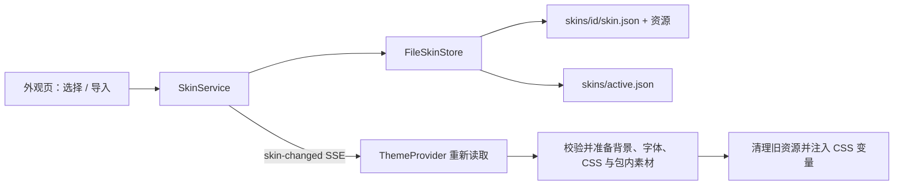

# Tron 皮肤包

在「设置 → 外观」选择“默认”、Brand 或 Matrix 主题，再选择浅色、深色或跟随系统。默认主题的深色配色沿用 Matrix 的深色基底；Brand 使用暖中性色和陶土橙；Matrix 使用绿色终端风格。每个主题包含两套配色，切换主题不会重置显示模式。主题 ID 保存在后端；显示模式保存在本机 `tron.color-mode`，跟随系统时监听系统外观变化，同源窗口同步显示模式。



皮肤目录位于后端 `application_config_path` 同级的 `skins/`，默认是 `~/.tron/skins/`。首次访问自动播种内置皮肤；内置文件缺失或损坏时使用编译期 JSON 兜底。无效的激活记录自动恢复默认主题。写入 `active.json` 使用同目录临时文件和原子替换；安装通过临时目录校验后整体移入。

内置主题 ID 为 `default`、`brand`、`matrix`。旧内置主题 `light`、`matrix-dark`、`matrix-particles` 已退役，本地保存的明暗偏好保留。旧单配色包需要补齐双配色并使用版本 3 后重新导入。

## 文件格式

ZIP 的根目录必须包含 `skin.json`，资源路径相对此目录。也可以单独导入 JSON；此时资源必须为空或使用 HTTPS URL。可直接导入 [Ocean 示例](examples/skins/ocean/skin.json)。

```text
ocean.zip
├── skin.json
├── theme.css
└── assets
    ├── background.webp
    └── interface.woff2
```

```json
{
  "id": "my-theme",
  "name": "我的主题",
  "version": 3,
  "variants": {
    "light": {
      "--color-background": "#faf9f5",
      "--color-on-surface": "#30302b",
      "--color-primary": "#a84f35",
      "--color-on-primary": "#ffffff"
    },
    "dark": {
      "--color-background": "#262624",
      "--color-on-surface": "#e8e6dc",
      "--color-primary": "#e5a184",
      "--color-on-primary": "#30201a"
    }
  },
  "layout": {
    "--radius": "0.625rem"
  },
  "resources": {
    "background": null,
    "font": null,
    "css": null
  }
}
```

- `id`：1–64 个小写字母、数字、连字符。ID 已存在时拒绝覆盖，包括内置主题。
- `version`：固定为 3。`variants.light`、`variants.dark` 都是必填颜色映射，分别包含 `--color-background`、`--color-on-surface`、`--color-primary`、`--color-on-primary`。
- `variants.light` / `variants.dark` / `layout`：CSS 自定义属性；合并时 `layout` 优先。常用颜色沿用 `packages/chat-theme/src/theme.scss` 的 `--color-*`，运行时将主要语义颜色同步到 shadcn 的 `--primary`、`--background` 等变量；显式声明的 shadcn 变量优先。
- `layout` 可设置 `--radius`、`--tron-card-radius`、`--tron-control-radius` 和 `--font-sans`。`--tron-system-font-size` 保留给字号设置，皮肤不可覆盖。未消费的变量不会改变界面。
- 能力中心、能力包详情和能力配置页消费 `--tron-capability-effective-fg`、`--tron-capability-inactive-fg`、`--tron-capability-provider-fg`，并暴露 `data-theme-part="capability-packs-page / capability-center-card / capability-pack-detail-page / capability-configuration-page / capability-extension-tabs"` 子部件选择器。主题制作说明与变量校验目录见 [tron-theme-spec](../../tron-backend/crates/tron-harness-capability/skills/tron-theme-spec/SKILL.md) 和 [tokens.md](../../tron-backend/crates/tron-harness-capability/skills/tron-theme-spec/references/tokens.md)。
- `resources.background`：PNG、JPEG、WebP、GIF；作为工作台及设置页的背景，内容面板保留自身表面色。`resources.font`：WOFF、WOFF2、TTF、OTF。两者都可以为空或 HTTPS URL。本地资源通过受保护的资源接口读取为 Blob URL，切换时撤销 URL 并移除字体。
- `resources.css`：版本 3 可选 CSS 文件，只能是包内 CSS 路径。CSS 解析后自动限定到 `body[data-tron-app][data-skin="主题ID"]` 子树，只接受颜色、边框、阴影、滤镜、背景、变换、伪元素内容及动画等视觉属性。尺寸、间距、布局、定位和层叠属性会被拒绝；独立特效层可使用定位和尺寸属性。`@import`、其他 at-rule、外部/数据 URL、脚本构造会被拒绝；`url()` 只能引用 ZIP 中的包内文件。CSS 加载错误会指出 CSS 文件和规则。
- 主题 CSS 可使用普通 CSS 选择器覆盖当前 Tron 页面中的所有匹配组件，例如 `button`、`input`、`[data-theme-part="app-sidebar"]`；规则会自动限定在当前主题页面内，不会影响其他网站内容。应用额外提供固定于视口的 `data-theme-effect-layer="global"` 全局特效层，跨导航页面持续显示，不参与布局、不拦截点击，支持伪元素、关键帧、栅格、暗角、辉光和扫描线。动画遵循系统的减少动态效果设置。组件装饰支持 `app-shell / sidebar / page / panel / card / chat / chat-message / dialog`，详见[锚点协议](../../tron-backend/crates/tron-harness-capability/skills/tron-theme-spec/references/effect-anchors.md)。

```css
[data-theme-part="app-sidebar"],
[data-theme-part="app-right-sidebar"],
[data-theme-part="app-bottom-sidebar"] {
  background-image: linear-gradient(135deg, #55ff880c, transparent 65%);
}

[data-theme-part="app-page"] {
  background-color: #06110a;
}

[data-slot="table-container"] {
  box-shadow: 0 0 18px #55ff8818;
}

input,
[data-slot="select-button"],
button {
  transition: box-shadow 180ms ease, border-color 180ms ease;
}

[data-theme-effect-layer="global"] {
  background-image: linear-gradient(#55ff8818 1px, transparent 1px),
    linear-gradient(90deg, #55ff8818 1px, transparent 1px);
  background-size: 18px 18px;
}

[data-theme-effect-layer="global"]::before {
  content: "";
  position: absolute;
  inset: -2px 0 auto;
  height: 2px;
  background: #76ff9a88;
  animation: scan 7s linear infinite;
}

@keyframes scan {
  from { transform: translateY(-2px); }
  to { transform: translateY(100vh); }
}
```
- 上限：上传 20 MiB、解压 40 MiB、128 个 ZIP 条目、清单 256 KiB、1024 个变量。拒绝路径穿越、符号链接、重复文件、脚本文件、样式规则注入以及变量中的 `url()`。

选择主题时先准备资源，再请求后端激活；资源加载或持久化失败时不替换当前皮肤。后台事件和窗口重新获得焦点都会重新读取当前皮肤，过期的异步结果不会覆盖后来的选择。SSE 重新连接时主动刷新一次，补齐断线期间的变更。

## HTTP 接口

接口挂在现有 Profile 保护下，JSON 使用 `ApiResponse`，成功 `code="0"`；错误码 `101025001`–`101025006` 分别表示非法内容、不存在、ID 冲突、存储失败、包体超限、内置主题受保护。错误文案使用请求语言。资源和 SSE 返回各自的二进制/事件格式。

| 方法 | 路径 | 内容 |
| --- | --- | --- |
| GET | `/api/v1/system/skins` | `data` 为皮肤数组 |
| GET | `/api/v1/system/skins/active` | `data.skin` 为当前皮肤 |
| PUT | `/api/v1/system/skins/active` | 请求 `{ "id": "ocean" }`，返回 `data.skin` |
| POST | `/api/v1/system/skins` | 原始 ZIP / JSON 文件字节，返回 `data.skin`；安装不自动激活 |
| GET | `/api/v1/system/skins/{id}/resources/{path}` | 本地图片、字体、CSS 及包内素材，带 MIME 和 `nosniff` |
| GET | `/api/v1/system/skins/events` | SSE `skin-changed`；变更后重新读取列表和当前皮肤 |
| GET | `/api/v1/system/skins/market?current=1&size=20` | 在线主题市场分页 |
| POST | `/api/v1/system/skins/market/{id}/install` | 下载并安装市场主题；不自动激活 |
| DELETE | `/api/v1/system/skins/{id}` | 卸载自定义主题 |

已接入切换、ZIP/JSON 导入、在线主题市场、背景及字体；AI 生成、智能体管理工具、音效和图标替换未接入。

## 验证

```sh
make be-check
make fe-check
```

在浏览器中核对中英文外观页、内置切换、JSON 导入、刷新恢复、自定义变量清理和 390px 窄屏，并记录实际使用的数据源。

## 主题作者 Skill

仓库提供 [tron-theme-spec](../../tron-backend/crates/tron-harness-capability/skills/tron-theme-spec/SKILL.md)，包含浅/深色模板、[组件变量目录](../../tron-backend/crates/tron-harness-capability/skills/tron-theme-spec/references/tokens.md)、[加载与故障恢复](../../tron-backend/crates/tron-harness-capability/skills/tron-theme-spec/references/format-and-loading.md)，以及纯 Python 标准库校验/打包脚本。

```sh
python3 tron-backend/crates/tron-harness-capability/skills/tron-theme-spec/scripts/theme_pack.py init ./my-theme --id my-theme --name "My Theme"
# 编辑 my-theme/skin.json 后：
python3 tron-backend/crates/tron-harness-capability/skills/tron-theme-spec/scripts/theme_pack.py validate ./my-theme
python3 tron-backend/crates/tron-harness-capability/skills/tron-theme-spec/scripts/theme_pack.py pack ./my-theme ./my-theme.zip
```

用户可阅读 SKILL.md 自行制作，也可将整个 `tron-theme-spec/` 目录安装到支持 SKILL.md 的智能体技能目录，再要求智能体制作。Skill 自带模板和校验器，不依赖 Tron 源码所在路径。生成的主题 ZIP 与 Skill 目录是不同交付物；外观页导入的是主题 ZIP。

## 覆盖审计

应用主框架、左侧导航、右侧工具栏、底部终端面板和页面主体分别提供 `data-theme-part` 标记；它们及其菜单、按钮、表格、筛选输入框和选择器都继承当前皮肤的语义色。主题包可进一步用 CSS 选择器对其中任意页面组件做针对性视觉覆盖。

| 范围 | 当前实现 |
| --- | --- |
| 公共按钮 | 主、次、边框、轻、危险、链接六类；普通/hover/active/disabled/focus；独立配色、边框、圆角、高度、字号 |
| 公共数据表 | 两种 DataTable 均接入；普通/斑马纹/hover/selected/expanded/focus；行高、padding、分隔线、表头；固定列同步 |
| 表单 | Input/Textarea/Forms 包装层含焦点、禁用、校验错误；Select 单独颜色/圆角 |
| 容器/弹层 | SurfaceCard、Portal 字体、Dialog/Sheet、下拉、遮罩分别有变量；手写弹窗使用语义表面色 |
| Markdown/代码 | 子元素原先固定的颜色改为语义回退和可覆盖的 Markdown/语法变量；CodeMirror 原本已接语义色 |
| 图谱/终端 | Canvas 和 ANSI 读取主题变量；同模式换皮肤也刷新 |
| 页面底色 | 修正 Shell、聊天、任务看板、图谱工具栏的固定白底；移除深色模式下强制覆盖白色工具类的补丁 |
| 边界 | 外部 webview 页面、媒体/PDF内容、OS窗口、品牌图片不改色；少数业务自绘装饰和固定阴影/几何尺寸保留；原生手写控件不保证拥有公共 Button 的所有变量 |

这不是任意 CSS 插件，也不以“扫描到零个 HEX”为覆盖标准。主题变量只对消费它的组件生效。新增业务控件应复用公共组件或显式接入变量，不靠全局 `!important` 覆盖业务语义。

主题视觉验收应在实际业务页面检查按钮、表单、数据行和弹层等公共组件的交互状态。使用 `make skill-theme-check` 校验技能结构。

### 本轮精细变量验收

Chromium 实际渲染（Profile/皮肤 HTTP 接口桩）：主按钮 normal/hover/active 分别为 `#245b8a` / `#1b476f` / `#12324f`；禁用色独立生效。数据行高 52px、padding 14px 20px，选中行与 sticky 单元格同色；输入框 focus 边框为 `#ee7700`。离线 ZIP 的真实 PNG/WOFF2 字节通过 Blob/FontFace 成功加载，Portal 弹窗背景和标题字体一致。切回浅色后背景为 none、自定义 FontFace 为 0、动态样式为 1，按钮圆角恢复 4px。Matrix 刷新恢复、390px 页面无横向溢出。未以这些接口桩结果冒充真实账户的桌面端到端测试。

可直接导入 [Ocean 组件级示例](../../tron-backend/crates/tron-harness-capability/skills/tron-theme-spec/assets/ocean-detail/skin.json) 查看按钮和行样式。深浅色模板由真实 Rust FileSkinStore 完成安装/激活验证，目录/ZIP 校验与打包由 Python 测试及 CLI 初始化→打包→校验流程验证。


## 共享聊天与 A2UI

主题技能现随 `tron-harness-capability` 内嵌分发，源码位于 `tron-backend/crates/tron-harness-capability/skills/`。
共享聊天使用 `--agent-ui-chat-*-color`，Markdown / 代码使用 `--agent-ui-markdown-*` / `--agent-ui-syntax-*`；旧 `--tron-markdown-*` / `--tron-syntax-*` 不再控制共享 Chat。
A2UI 控件、QuestionCard、图表及动效使用 `--agent-ui-*` / `--agent-ui-a2ui-*` / `--agent-ui-motion-*`。
Tron 当前显式配置的出现时长、位移和过渡时间优先于对应通用 CSS 变量；皮肤不能改变用户的关闭或减弱动画偏好。
完整说明见 [共享 UI 主题契约](../../tron-backend/crates/tron-harness-capability/skills/tron-theme-spec/references/agent-ui.md)。

## 组件锚点运行机制

组件只声明 `data-theme-anchor`。`effectLayers.ts` 按主题 CSS 实际引用的类型，为每个实例创建独立、`aria-hidden`、`inert` 且不接收指针的装饰视口和特效层。没有锚点特效的主题不创建这些节点。装饰视口裁剪越界的图片、变换及动画，防止增加业务滚动范围；层级由 Tron 管理。

- 工作台和设置外壳、侧栏、每个页面主体、右侧/底部面板均有锚点；因此所有使用公共布局的路由自动覆盖。
- SurfaceCard、MetricCard、Card、表格容器、Dialog/Sheet 及手写确认/编辑弹窗、任务看板列与任务卡、Agent 卡和主题选择卡分别接入。手写新组件必须显式声明锚点，不能靠扫描圆角 CSS 猜卡片。
- 共享 TronChatPanel 提供聊天区域及每条用户/助手气泡锚点，主聊天、Side Chat 和独立聊天窗口复用同一协议。外部 webview、Canvas 内部节点、PDF 像素和 OS 窗口不属于 DOM 锚点。
- ResizeObserver 跟随尺寸，捕获 scroll 保持滚动容器边框贴合，MutationObserver 合并处理动态挂载/卸载；不逐帧轮询全部元素。普通祖先滚动和动画由 DOM 定位自然跟随。
- 主题切换/预览替换整个装饰实例；退出预览重建已激活主题的装饰；卸载时断开观察器并移除节点。仅静态定位宿主临时获得定位上下文，清理时恢复；已有 fixed/absolute/sticky 不改动。
- CSS 几何权限仅适用于完整标准特效选择器列表，不能通过后代、兄弟、`:is()` 或混入按钮选择器扩大权限。position 仅接受 absolute、pointer-events 仅接受 none，不开放 z-index。关键帧仍只能用视觉属性，例如 transform、opacity。

协议使用 `version: 3`，后端响应与清单都包含双配色。前端编译器、Rust 安装校验器、Python 制作脚本同步维护选择器白名单。


### 锚点扩展验收（2026-09-26）

`make fe-check`、`make be-check`、主题/聊天组件 45 项前端单测、9 项 Rust 主题测试、10 项 Python 制作/打包测试及 skill 结构校验通过。浏览器使用独立 Profile/主题 API 桩验证英文外观页、中文应用页；共享 TronChatPanel 使用真实组件配合模拟消息验证。未修改真实账户或已安装主题。

浏览器检查通过：重复卡片、消息新增/删除、消息气泡从 77.5px 增高到 365.5px 后边框贴合、滚动及面板尺寸变化、点击穿透、手写确认弹窗挂载/卸载、390px 无横向溢出、减少动态效果停用动画、预览取消恢复、切回内置主题清除装饰。截图保存在工作区 `output/playwright/theme-effects-*.png`（验收产物，不作为主题素材）。
