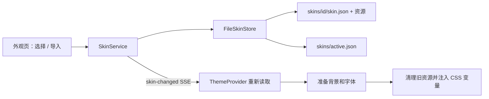

# Tron 皮肤包

在「设置 → 外观」选择主题，无需重启。内置浅色、Matrix 深色；导入后点击预览卡片应用。主题保存在当前后端实例，连接同一实例的窗口共享主题；UI 字号仍是当前客户端的独立偏好。



皮肤目录位于后端 `application_config_path` 同级的 `skins/`，默认是 `~/.tron/skins/`。首次访问自动播种内置皮肤；内置文件缺失或损坏时使用编译期 JSON 兜底。无效的激活记录自动恢复浅色。写入 `active.json` 使用同目录临时文件和原子替换；安装通过临时目录校验后整体移入。

## 文件格式

ZIP 的根目录必须包含 `skin.json`，资源路径相对此目录。也可以单独导入 JSON；此时资源必须为空或使用 HTTPS URL。可直接导入 [Ocean 示例](examples/skins/ocean/skin.json)。

```text
ocean.zip
├── skin.json
└── assets
    ├── background.webp
    └── interface.woff2
```

```json
{
  "id": "ocean",
  "name": "Ocean",
  "version": 1,
  "mode": "Light",
  "colors": {
    "--color-background": "#e8f1fb",
    "--color-primary": "#164b85",
    "--color-on-primary": "#ffffff"
  },
  "layout": {
    "--tron-card-radius": "20px",
    "--tron-control-radius": "8px"
  },
  "resources": {
    "background": "assets/background.webp",
    "font": "assets/interface.woff2"
  }
}
```

- `id`：1–64 个小写字母、数字、连字符。ID 已存在时拒绝覆盖，包括内置主题。
- `version`：当前协议固定为 `1`。`mode` 为 `Light` / `Dark`，控制未覆盖变量的基底、深色组件和终端 ANSI 默认配色。终端和图谱另有独立变量。
- `colors` / `layout`：CSS 自定义属性；合并时 `layout` 优先。常用颜色沿用 `packages/chat-theme/src/theme.scss` 的 `--color-*`，运行时将主要语义颜色同步到 shadcn 的 `--primary`、`--background` 等变量；显式声明的 shadcn 变量优先。
- `layout` 可设置 `--radius`、`--tron-card-radius`、`--tron-control-radius` 和 `--font-sans`。`--tron-system-font-size` 保留给字号设置，皮肤不可覆盖。未消费的变量不会改变界面。
- `resources.background`：PNG、JPEG、WebP、GIF；作为工作台及设置页的背景，内容面板保留自身表面色。`resources.font`：WOFF、WOFF2、TTF、OTF。两者都可以为空或 HTTPS URL。本地资源通过受保护的资源接口读取为 Blob URL，切换时撤销 URL 并移除字体。
- 上限：上传 20 MiB、解压 40 MiB、128 个 ZIP 条目、清单 256 KiB、512 个变量。拒绝路径穿越、符号链接、重复文件、脚本文件、样式规则注入以及变量中的 `url()`。

选择主题时先准备资源，再请求后端激活；资源加载或持久化失败时不替换当前皮肤。后台事件和窗口重新获得焦点都会重新读取当前皮肤，过期的异步结果不会覆盖后来的选择。SSE 重新连接时主动刷新一次，补齐断线期间的变更。

## HTTP 接口

接口挂在现有 Profile 保护下，JSON 使用 `ApiResponse`，成功 `code="0"`；错误码 `101025001`–`101025005` 分别表示非法内容、不存在、ID 冲突、存储失败、包体超限。错误文案使用请求语言。资源和 SSE 返回各自的二进制/事件格式。

| 方法 | 路径 | 内容 |
| --- | --- | --- |
| GET | `/api/v1/system/skins` | `data` 为皮肤数组 |
| GET | `/api/v1/system/skins/active` | `data.skin` 为当前皮肤 |
| PUT | `/api/v1/system/skins/active` | 请求 `{ "id": "ocean" }`，返回 `data.skin` |
| POST | `/api/v1/system/skins` | 原始 ZIP / JSON 文件字节，返回 `data.skin`；安装不自动激活 |
| GET | `/api/v1/system/skins/{id}/resources/{path}` | 本地图片 / 字体，带 MIME 和 `nosniff` |
| GET | `/api/v1/system/skins/events` | SSE `skin-changed`；变更后重新读取列表和当前皮肤 |

本次包含切换、ZIP/JSON 导入、背景及字体；市场、AI 生成、智能体管理工具、音效和图标替换未接入。

## 验证

```sh
make be-check
make be-test TEST='--lib adapters::outbound::skin::tests'
make be-test TEST='--test skin_api'
make fe-check
make fe-unit-test TEST=src/shared/theme
```

浏览器验证覆盖中英文外观页、内置切换、JSON 导入、刷新恢复、自定义变量清理和 390px 窄屏。浏览器使用接口桩隔离账户及已有实例；磁盘持久化、ZIP、路径边界和 SSE 协议由真实 Rust Store / Router 测试覆盖。

## 主题作者 Skill

仓库提供 [tron-theme-authoring](../../tron-skill/tron-theme-authoring/SKILL.md)，包含浅/深色模板、[组件变量目录](../../tron-skill/tron-theme-authoring/references/tokens.md)、[加载与故障恢复](../../tron-skill/tron-theme-authoring/references/format-and-loading.md)，以及纯 Python 标准库校验/打包脚本。

```sh
python3 tron-skill/tron-theme-authoring/scripts/theme_pack.py init ./my-theme --id my-theme --name "My Theme" --mode Light
# 编辑 my-theme/skin.json 后：
python3 tron-skill/tron-theme-authoring/scripts/theme_pack.py validate ./my-theme
python3 tron-skill/tron-theme-authoring/scripts/theme_pack.py pack ./my-theme ./my-theme.zip
```

用户可阅读 SKILL.md 自行制作，也可将整个 `tron-theme-authoring/` 目录安装到支持 SKILL.md 的智能体技能目录，再要求智能体制作。Skill 自带模板和校验器，不依赖 Tron 源码所在路径。生成的主题 ZIP 与 Skill 目录是不同交付物；外观页导入的是主题 ZIP。

## 覆盖审计

| 范围 | 当前实现 |
| --- | --- |
| 公共按钮 | 主、次、边框、轻、危险、链接六类；普通/hover/active/disabled/focus；独立配色、边框、圆角、高度、字号 |
| 公共数据表 | 两种 DataTable 均接入；普通/斑马纹/hover/selected/expanded/focus；行高、padding、分隔线、表头；固定列同步 |
| 表单 | Input/Textarea/Forms 包装层含焦点、禁用、校验错误；Select 单独颜色/圆角 |
| 容器/弹层 | SurfaceCard、Portal 字体、Dialog/Sheet、下拉、遮罩分别有变量；手写弹窗使用语义表面色 |
| Markdown/代码 | 子元素原先固定的颜色改为语义回退和可覆盖的 Markdown/语法变量；CodeMirror 原本已接语义色 |
| 图谱/终端 | Canvas 和 ANSI 读取主题变量；同模式换皮肤也刷新 |
| 页面底色 | 修正 Shell、聊天、任务看板、图谱工具栏的固定白底；移除深色模式下强制覆盖白色工具类的补丁 |
| 边界 | 外部 webview 页面、媒体/PDF内容、OS窗口、品牌图片不改色；少数业务自绘装饰和固定阴影/几何尺寸保留；原生手写控件不保证拥有公共 Button 的所有变量 |

这不是任意 CSS 插件，也不以“扫描到零个 HEX”为覆盖标准。主题变量只对消费它的组件生效。新增业务控件应复用公共组件或显式接入变量，不靠全局 `!important` 覆盖业务语义。

外观页的「组件预览」使用真实公共组件，可直接验证交互状态。脚本测试通过 `make skill-theme-test` 运行；模板另由 Rust Store 测试确认可安装激活。

### 本轮精细变量验收

Chromium 实际渲染（Profile/皮肤 HTTP 接口桩）：主按钮 normal/hover/active 分别为 `#245b8a` / `#1b476f` / `#12324f`；禁用色独立生效。数据行高 52px、padding 14px 20px，选中行与 sticky 单元格同色；输入框 focus 边框为 `#ee7700`。离线 ZIP 的真实 PNG/WOFF2 字节通过 Blob/FontFace 成功加载，Portal 弹窗背景和标题字体一致。切回浅色后背景为 none、自定义 FontFace 为 0、动态样式为 1，按钮圆角恢复 4px。Matrix 刷新恢复、390px 页面无横向溢出。未以这些接口桩结果冒充真实账户的桌面端到端测试。

可直接导入 [Ocean 组件级示例](../../tron-skill/tron-theme-authoring/assets/ocean-detail/skin.json) 查看按钮和行样式。深浅色模板由真实 Rust FileSkinStore 完成安装/激活验证，目录/ZIP 校验与打包由 Python 测试及 CLI 初始化→打包→校验流程验证。
