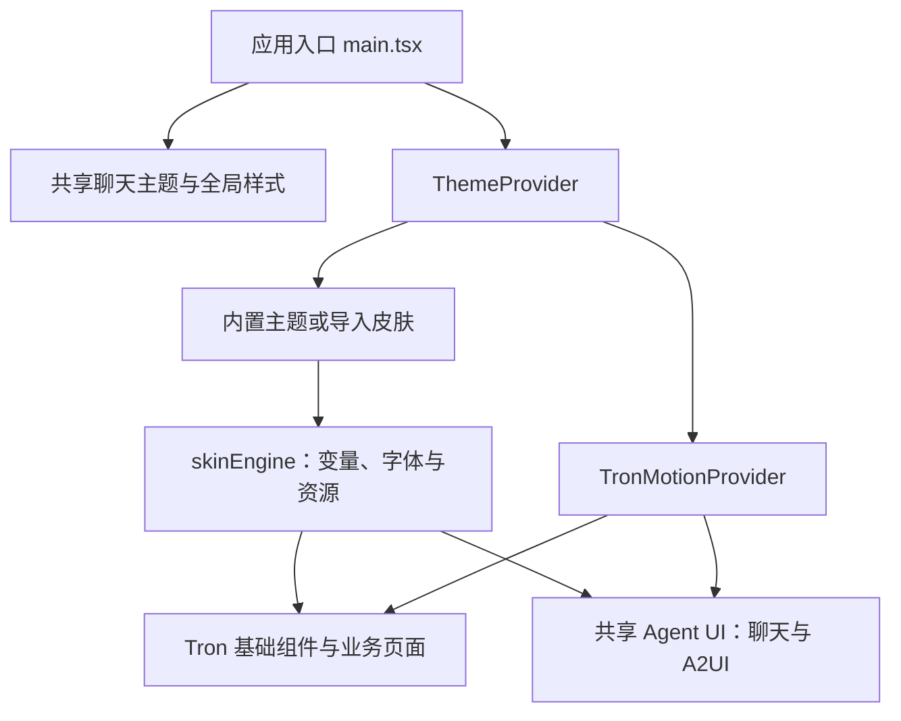

# Tron 界面设计规范

本规范描述当前 Tron 前端的设计约定与实现边界。颜色、尺寸和交互状态以主题文件及组件源码为准；本文中的默认值用于说明现有实现，不应复制为页面中的固定样式。

## 设计目标

界面优先呈现任务、会话和工作区信息。通过清晰的分组、稳定的操作位置和适量留白支持密集信息，减少重复标题、说明和装饰。浅色、Matrix 深色和导入皮肤共享相同的业务结构与操作语义。

## 实现与职责

- `src/app/styles/globals.css` 引入 Tailwind CSS 4、组件样式和字体，提供基础样式及主题映射。
- `src/shared/theme/builtin/light.json`、`matrix-dark.json` 定义内置皮肤；`ThemeProvider.tsx` 管理当前皮肤、字号和外观偏好。
- `src/shared/theme/skinEngine.ts` 应用皮肤变量和资源；`effectLayers.ts` 管理装饰层及其清理。
- `src/components/ui` 提供基础控件，`src/shared/layout` 提供应用布局，领域页面组合这些组件。
- `AgentChatWindow.tsx` 位于 `src/domain/chat/components`，负责 Tron 上下文和数据适配。聊天窗口、流式呈现、队列、停止和回放使用共享 Agent UI 的 `ChatRuntimeWindow`。

## 颜色与主题

页面使用语义变量和组件公开变量。Tron 语义色使用 `--color-*`，基础组件也使用 `--background`、`--foreground`、`--primary` 等变量。两组变量在内置皮肤中分别声明，不能假定它们的值始终相同。

以下仅为内置浅色皮肤中的部分语义色：

| 用途 | 变量 | 浅色默认值 |
| --- | --- | --- |
| 页面背景 | `--color-background` | `#fdf8f8` |
| 浮起表面 | `--color-elevated-surface` | `#ffffff` |
| 主要文字 | `--color-on-surface` | `#1c1b1b` |
| 次要文字 | `--color-on-surface-variant` | `#444748` |
| 强调色 | `--color-accent` | `#2f5f9f` |
| 焦点色 | `--color-focus-ring` | `#2f5f9f` |
| 成功、警告、错误 | `--color-success`、`--color-warning`、`--color-error` | `#4f6f52`、`#8a6a1f`、`#ba1a1a` |

Matrix 深色皮肤使用另一组配色，导入皮肤还可以覆盖组件、聊天和 A2UI 变量。新增页面不得把浅色默认值写死；状态也应通过文字、图标或语义属性表达，不能只依赖颜色。

具体控件优先使用 `--tron-button-*`、`--tron-input-*`、`--tron-select-*`、`--tron-table-*`、`--tron-card-*` 等公开变量。共享聊天颜色使用 `--agent-ui-chat-*-color` 入口，Markdown 和代码高亮使用 `--agent-ui-markdown-*`、`--agent-ui-syntax-*`，A2UI 使用 `--agent-ui-a2ui-*`。其他 Agent UI 变量见主题技能中的共享组件说明。不要修改共享库内部派生变量。

## 字体与信息密度

默认无衬线字体为 `Inter Variable`。全局样式还引入 Geist，导入皮肤可以加载字体资源，并通过 `--tron-skin-font` 和 `--font-sans` 应用。字体资源的应用与清理由主题引擎负责。

系统字号默认值为 `14px`，用户可在外观设置中调整。页面内仍有按用途设置的字号和尺寸，不能声称全部文字都随系统字号等比例缩放。不要用皮肤覆盖用户字号偏好，也不要继续维护一套脱离组件实现的固定标题字号表。

正文、标签、辅助信息应有明确层级。数值比较区域可使用等宽数字或 `tabular-nums`；长标识符、代码和路径按内容需求使用等宽字体。调整密度时先优化间距和列布局，再检查可读性与触控范围。

## 布局与响应式

应用包含导航侧栏、可编辑标签页、内容区，以及按上下文显示的右侧和底部面板。设置页使用独立布局。页面可根据表格、表单、聊天或图谱选择布局，当前实现没有统一强制的十二列网格。

`Sidebar` 基础组件默认桌面宽度为 `16rem`，移动抽屉为 `18rem`，图标折叠宽度为 `3rem`；调用方可通过公开配置调整。设置页在 `lg` 下使用 `260px` 侧栏。因此，不应把所有侧栏定义为固定 `280px`。

Tailwind 使用默认断点，常用 `sm=640px`、`md=768px`、`lg=1024px`、`xl=1280px`。各布局按实际空间切换；侧栏在移动端使用抽屉。表格可横向滚动，面板内容允许收缩，避免长文本挤出按钮或遮挡操作。

间距优先复用已有组件及 Tailwind 尺度。表格与列表按内容密度选择行高和内边距；斑马纹由表格样式及主题控制，不以列数决定是否启用。

## 页头与导航

页面顶部优先放置导航、操作和必要的标签页。避免副标题、宣传文字、重复说明和“此处可以……”等页面介绍。

当前 `PageHeader` 接受 `title`、`actions` 和 `breadcrumbs`，但只渲染面包屑及操作区；两者都为空时返回 `null`，`title` 本身不会显示。不要依靠传入 `title` 生成可见标题。新增可见标题时，先检查应用壳和标签页是否已表达同一信息。

顶层模块一般不显示面包屑。创建、编辑、详情等子页面按层级提供面包屑，父项可以跳转，当前项显示为文本。标签和导航文案由调用方翻译。

## 控件、表面与层级

- 按钮使用现有 `Button` 的 `default`、`outline`、`secondary`、`ghost`、`destructive`、`link` 变体。主操作、危险操作和普通操作保持明确区别。
- 输入控件分别呈现默认、悬停、焦点、禁用和无效状态；焦点样式由组件公开变量控制。
- 卡片用于确有分组意义的内容。避免为每段文字增加卡片；`SurfaceCard` 默认圆角为 `8px`，内边距为 `1.25rem`，可由公开变量覆盖。
- 控件圆角按组件和皮肤定义。按钮与输入常用的圆角回退值为 `4px`；不能把所有控件、卡片和外层容器统一规定为 `8px/16px/24px`。
- 表格保留语义结构，区分悬停、选中和展开状态。固定列的背景应与所在行一致，不能在滚动时透出下层内容。
- 弹窗、抽屉、下拉菜单和提示使用现有 Portal 组件，检查遮罩、焦点与滚动行为。

当前层级由各组件实现：例如 Dialog/Sheet 常用 `z-50`，Tooltip 使用 `120`，全局 Toast 容器使用 `130`。项目没有统一落实旧文档中的 `0/20/40/60/80` 层级表；新增浮层需核对真实叠放上下文，避免随意提高层级。

## 聊天与 A2UI

聊天和 A2UI 使用共享 Agent UI 的样式、组件和动效能力，Tron 提供产品上下文、接口适配、翻译与主题变量。消息呈现遵循共享组件的角色与状态，不再规定“系统消息灰色、Agent 消息白色”的固定气泡样式。

结构化提问、图表和其他 A2UI 内容沿用共享组件公开接口。表单字段错误应在字段附近显示；需要用户确认或补充信息时使用相应交互。Toast 用于短暂反馈，不承载所有提示，也不替代持久错误、确认弹窗或聊天中的提问卡片。

## 动效与装饰

`TronMotionProvider` 向共享 `MotionProvider` 注册 React Bits 的 `enter` 和 `fade` 适配器。目前配置为入场时长 `180ms`、位移 `8px`、过渡时长 `120ms`。这组值不代表所有控件的动画时长；Portal 控件和其他效果仍有各自样式。

外观设置保存 `system`、`reduced`、`off` 到 `tron.motion.mode`。共享动效运行时根据偏好、系统减少动效设置和页面可见性调整播放。Portal 通过根元素的 `data-tron-motion-policy` 接收同一策略。适配器配置的优先级高于 CSS 动效变量，皮肤中的时长不保证覆盖宿主配置。

入场动画用于明确的视图切换。数据更新不应重复触发；保活路由和非活动标签页停用入场。不要通过不断改变 React `key` 重播动画，否则会破坏焦点、草稿和滚动位置。

主题装饰依附 `data-theme-anchor` 容器，由运行时生成不接收指针事件、对辅助技术隐藏的装饰层。可用锚点包括 `global`、`app-shell`、`sidebar`、`page`、`panel`、`card`、`chat`、`chat-message`、`dialog`。不要把锚点放在输入框、表格行或外部媒体上；不得让装饰改变内容尺寸、遮挡操作或抢占焦点。

## 国际化与无障碍

支持 `en-US` 和 `zh-CN`。可见文案、控件名称、错误和状态通过翻译资源提供；用户内容、代码、路径和业务标识保持原样。当前部分基础组件仍有英文默认无障碍文案，使用及修改时应核对，不能据本文推断全部组件已经完成双语覆盖。

检查键盘操作、焦点可见性、弹窗焦点返回、表单关联标签及状态播报。图标按钮需有可访问名称。两种语言、两种内置主题、导入皮肤及减少动效模式都应保持操作可用。

## 维护入口

- [前端编码规范](前端编码规范.md)：目录职责、数据接入和国际化约定。
- [界面组件规范](界面组件规范.md)：基础组件目录、公开接口和主题约定。
- [质量检查](质量检查.md)：按变更范围执行的检查与证据要求。
- [主题技能](../../../tron-backend/crates/tron-harness-capability/skills/tron-theme-spec/SKILL.md)：皮肤格式、公开变量及资源约束。
- [共享 Agent UI 主题说明](../../../tron-backend/crates/tron-harness-capability/skills/tron-theme-spec/references/agent-ui.md)：聊天、A2UI 和动效的公开主题接口。
