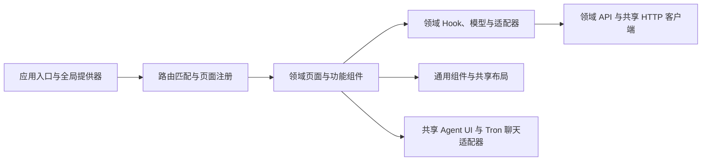

# 前端编码规范

本规范适用于 `tron-frontend` 的源码修改。目录与接口说明以当前实现为基础；新增功能按职责扩展，不要求为每个领域创建一套空目录。

## 技术与职责

应用使用 React、TypeScript、Vite、React Router、TanStack Query、Zustand、i18next 和 Tailwind CSS。基础组件沿用 shadcn 风格，当前交互组件主要基于 `@base-ui/react`；不要将 Radix UI 当成所有现有组件的底层依赖。依赖版本以 `package.json` 和锁文件为准。



页面负责组合和交互，领域 Hook 管理查询与操作，API 模块描述后端契约，适配器转换数据。通用组件保留可复用的交互能力，避免依赖某一领域的数据模型。

## 目录与命名

当前主要目录如下：

```text
tron-frontend/
├── packages/                  # Tron 聊天契约与适配器工作区包
└── src/
    ├── app/                   # main.tsx、App.tsx、RoutedApp.tsx、提供器与全局样式
    ├── router/                # routes.tsx、pageRegistry.ts
    ├── domain/                # agent、chat、memory、task 等领域模块
    ├── components/
    │   ├── ui/                # 通用基础控件
    │   ├── forms/             # 表单封装
    │   ├── table/             # 表格与服务端查询封装
    │   └── editable-tabs/     # 可编辑标签页与可见性上下文
    ├── shared/                # 布局、API、主题、动效、Hook 与工具
    ├── store/                 # 应用壳、认证、导航和标签页等状态
    ├── i18n/                  # 初始化与两种语言的翻译资源
    ├── hooks/                 # 现有通用 Hook
    └── lib/                   # 现有基础工具与兼容入口
```

领域内按需使用 `api`、`constants`、`schema`、`model`、`adapters`、`hooks`、`components`、`features`、`pages`、`mock`。`pages` 负责页面组合；`features` 表达创建、导入等用户操作；`mock` 只存放开发或测试样例。

- 新建 React 组件文件使用 PascalCase，如 `UserCard.tsx`。
- 以类型或接口为主要导出的 TypeScript 文件使用 PascalCase，如 `TaskModel.ts`。
- 普通模块使用 camelCase，如 `taskApi.ts`、`taskStore.ts`；Hook 文件以 `use` 开头。
- 多词领域和功能目录使用 kebab-case，如 `knowledge-graph`。
- `index.ts` 用作明确的目录公开入口，避免将无关实现藏在汇总文件中。
- 现有 `src/components/ui` 等目录保留其组件生成约定和小写连字符文件名，如 `dropdown-menu.tsx`。修订文档不要求批量改名源码。

跨领域共享能力放入 `components` 或 `shared` 的对应模块，领域特有行为保留在领域内。使用 `@/` 别名及公开导出，避免循环依赖和对组件内部实现的深层引用。

## 路由、状态与生命周期

`App.tsx` 装配 `BrowserRouter`、主题与动效提供器，`RoutedApp.tsx` 负责入口、身份选择、保护路由和重定向。`src/router/routes.tsx` 与 `pageRegistry.ts` 管理页面元数据及注册；新页面需核对两者及实际导航，不应只新增一个路径字符串。

默认侧栏层级涉及 `src/shared/constants/shellNavigation.ts` 和后端内置 SQLite 菜单迁移；调整默认菜单时一起修改。API 驱动的导航使用持久化树，不能只改前端静态列表。

服务端数据优先沿用现有领域查询方式；TanStack Query 管理相应请求缓存。Zustand 管理跨页面客户端状态；组件局部状态留在组件内。不要为同一数据再增加一份无同步规则的全局副本。

路由和可编辑标签页可能保留组件实例。定时器、订阅、请求和动效要考虑活动状态，并在停用或卸载时释放资源。使用稳定的页面身份和明确的重播条件，保留输入草稿、焦点和滚动位置。

## 数据接入与错误处理

项目同时存在真实 API 接入和 Mock 开发路径，不能要求所有组件只使用 Mock，也不能把接口接入描述成未来工作。

`src/shared/api/serviceConfig.ts` 为使用它的领域提供数据源切换：`VITE_TRON_<领域键>_DATA_SOURCE` 优先于 `VITE_TRON_DATA_SOURCE`，未配置时回退到 `mock`。这不是所有请求的统一开关；部分功能直接调用领域 API，仍会请求后端。验证时必须说明实际使用的数据源。

- 领域 API 模块定义端点、请求及响应类型；通用请求行为沿用 `src/shared/api/httpClient.ts`。
- 普通 JSON 接口按后端 `ApiResponse<T>` 的 `code`、`message`、`data` 处理；SSE、文件和附件按各自协议处理。HTTP 成功不能替代业务状态检查。
- `VITE_TRON_API_BASE_URL` 控制共享 HTTP 客户端的服务地址，开发代理以 Vite 配置为准。端口冲突时调整前后端对应配置。
- 请求传递当前身份、工作区及语言上下文；不要在组件中硬编码令牌、工作区或语言。
- 区分加载、空数据、请求失败与可重试状态；API 失败不能悄悄改用 Mock 数据伪装成功。
- 字段校验和持续错误靠近相关内容显示；短暂操作反馈使用共享 Toast；确认和结构化提问使用相应弹窗或卡片。

聊天请求由 `packages/chat-internal-adapter` 接入 Tron 协议，`packages/chat-agent-ui-adapter` 映射到共享 Agent UI。新增聊天行为先检查现有适配边界，避免在领域页面复制流式状态、回放或队列管理。

## Hook 依赖与异步行为

依赖应反映实际的查询或状态变化。传入会更新状态、发起请求或触发 Effect 的对象和函数时，避免每次渲染创建新引用导致重复执行。

调用方可用 `useMemo`、`useCallback` 稳定参数；共享 Hook 可通过 ref 读取最新回调，将重执行绑定到明确的语义参数。`serviceConfig.ts` 已使用回调 ref 和显式 `deps`，调用方仍需正确描述查询依赖。

不要通过省略依赖掩盖旧闭包问题。请求需处理取消、参数切换后的迟到响应和重复提交；订阅及监听器需对称清理。React StrictMode 下重复装配也应保持行为正确。

## 国际化

`src/i18n/index.ts` 初始化 i18next，支持 `en-US` 和 `zh-CN`，回退语言为 `en-US`。初始语言依次读取 `tron.locale`、受支持的浏览器语言和回退语言；切换时更新 `document.documentElement.lang` 和本地偏好，并监听其他窗口的存储变更。

目前语言偏好保存在本地存储，不能宣称已经同步到用户服务端资料。实际资源包括 `common`、`shell`、`console`、`pages` 和 `observability` 等命名空间；按现有资源扩展，不要将尚未创建的词汇表或命名空间写成已实现能力。

- 页面、导航、表单、校验、表头、按钮、弹窗、空状态、提示及无障碍名称使用翻译键。
- 缺失键在开发环境记录警告，并按 i18next 配置回退。当前 TypeScript 严格模式不等于所有翻译键都已获得静态校验；修改键时核对两种资源及调用点。
- 普通 HTTP、Chat API、SSE 和附件请求应携带当前可见文档语言的 `Accept-Language`。共享客户端已有 `applyCurrentLocaleHeader`，聊天适配器按调用方提供的动态语言头发送；其他直连请求需自行核对。
- 日期、时间、数字、百分比、大小和金额使用适合当前语言的 `Intl` 格式化。
- 用户内容、日志、代码、路径、模型名称和标识符按原样显示；不得将敏感值写入文案或日志。

操作名称使用简短动词：保存、编辑、创建、删除、提交、取消、归档、刷新、搜索。上下文已明确对象时无需重复；多个对象容易混淆时允许补充对象名称。

## 组件复用与维护

新增控件前查阅[界面组件规范](界面组件规范.md)和对应源码。优先使用现有公开属性、`className`、主题变量或组合方式；领域行为放入领域组件。仅当现有基础控件确实无法表达通用交互时才增加基础组件。

新增或实质性修改基础组件时，同次更新目录、主要导出、使用说明、键盘与焦点行为、国际化限制和实际测试覆盖。不要重复实现已有按钮、输入框、表格、菜单或弹窗，也不要在通用控件中加入领域查询和业务规则。

视觉与交互参见 [DESIGN.md](DESIGN.md)，检查要求参见[质量检查](质量检查.md)。通过仓库根目录 Makefile 执行相应命令，并在交付说明中区分源码核对、单元检查、浏览器检查和真实后端验证。
