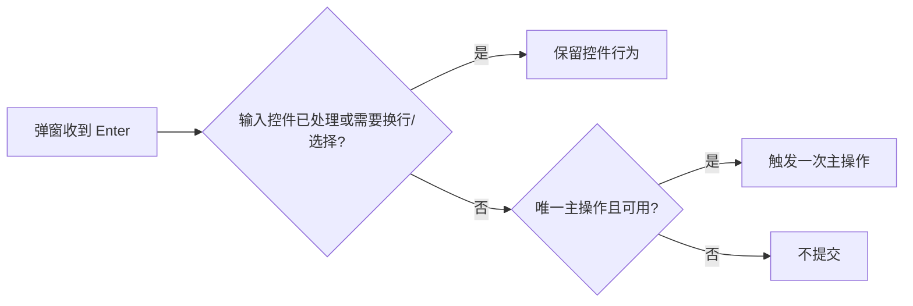

# 界面组件规范

本目录记录 `src/components/ui` 的通用基础组件。页面和领域组件新增控件前，先核对本表及对应源码。组件名称、导出和路径保留代码标识，说明统一使用中文。

## 使用规则

优先复用现有控件，通过公开属性、组合、`className` 和主题变量调整。业务规则、查询、校验流程和领域数据映射保留在领域内。通用封装还包括 `src/components/forms`、`table`、`data-table`、`editable-tabs` 等目录；它们组合基础组件，不应再复制一套控件。

当前基础组件主要使用 `@base-ui/react`。保留底层组件提供的键盘、焦点和语义行为，图标按钮提供可访问名称。调用方传入翻译后的标签、描述、错误和状态文案。部分组件仍有英文默认文案，详见下文限制。

## 基础组件目录

以下文件均位于 `src/components/ui`。主要导出列列出供调用方选择的接口；具体属性以源码类型为准。

| 文件 | 主要导出 | 用途与使用要点 |
| --- | --- | --- |
| `badge.tsx` | `Badge`、`badgeVariants`、`BadgeProps` | 状态、分类和元信息；同时提供文字含义，避免只靠颜色 |
| `button.tsx` | `Button`、`buttonVariants` | 普通、危险及图标操作；使用原生禁用语义，图标按钮补充名称 |
| `card.tsx` | `Card`、`CardHeader`、`CardTitle`、`CardDescription`、`CardAction`、`CardContent`、`CardFooter` | 分组内容；标题和说明由调用方提供 |
| `combobox.tsx` | `Combobox`、`ComboboxInput`、`ComboboxTrigger`、`ComboboxPopup`、`ComboboxItem`、`ComboboxValue`、`ComboboxList`、`ComboboxClear`、`ComboboxEmpty`、`ComboboxGroup`、`ComboboxGroupLabel`、`ComboboxSeparator`、`ComboboxRow`、`ComboboxStatus`、`ComboboxCollection`、`ComboboxChips`、`ComboboxChip`、`ComboboxChipRemove`、`ComboboxChipsInput`、`useComboboxFilter`、`ComboboxPrimitive` | 可搜索的单选或多选；核对输入标签、空状态、清除和移除操作名称 |
| `context-menu.tsx` | `ContextMenu`、`ContextMenuTrigger`、`ContextMenuContent`、`ContextMenuItem`、`ContextMenuSeparator` | 上下文操作；触发对象需有语义，不能只考虑鼠标右键 |
| `dialog.tsx` | `Dialog`、`DialogTrigger`、`DialogPortal`、`DialogClose`、`DialogOverlay`、`DialogContent`、`DialogHeader`、`DialogFooter`、`DialogTitle`、`DialogDescription` | 模态操作及确认；提供标题、描述，检查关闭后焦点返回 |
| `dropdown-menu.tsx` | `DropdownMenu`、`DropdownMenuPortal`、`DropdownMenuTrigger`、`DropdownMenuContent`、`DropdownMenuGroup`、`DropdownMenuLabel`、`DropdownMenuItem`、`DropdownMenuSub`、`DropdownMenuSubTrigger`、`DropdownMenuSubContent`、`DropdownMenuCheckboxItem`、`DropdownMenuRadioGroup`、`DropdownMenuRadioItem`、`DropdownMenuSeparator`、`DropdownMenuShortcut` | 操作及选项菜单；沿用键盘导航和选中状态，翻译条目文案 |
| `field.tsx` | `Field`、`FieldLabel`、`FieldItem`、`FieldDescription`、`FieldError`、`FieldControl`、`FieldValidity`、`FieldPrimitive` | 字段布局、标签和错误关联；校验规则及文案由业务表单提供 |
| `input.tsx` | `Input` | 单行输入；关联标签、说明和错误。当前没有公开导出 `InputPrimitive` 或 `InputProps` |
| `item.tsx` | `Item`、`ItemMedia`、`ItemContent`、`ItemActions`、`ItemGroup`、`ItemSeparator`、`ItemTitle`、`ItemDescription`、`ItemHeader`、`ItemFooter` | 通用列表项组合；调用方决定链接、按钮或静态内容的语义 |
| `label.tsx` | `Label` | 控件标签；使用 `htmlFor` 等关联方式 |
| `popover.tsx` | `Popover`、`PopoverTrigger`、`PopoverContent` | 可容纳链接、表单和交互面板的锚定浮层；通过 `render` 组合触发器，`side`、`align`、`sideOffset` 控制定位。调用方提供翻译后的 `aria-label`；沿用 Base UI 的焦点转移、Escape 关闭及关闭后焦点返回，内容超高时内部滚动 |
| `resizable.tsx` | `ResizablePanelGroup`、`ResizablePanel`、`ResizableHandle` | 可调整尺寸的面板；保持焦点和键盘调整能力 |
| `scroll-area.tsx` | `ScrollArea`、`ScrollBar`、`ScrollAreaPrimitive` | 带滚动条的内容区；核对长内容及键盘滚动 |
| `select.tsx` | `Select`、`SelectButton`、`SelectTrigger`、`SelectValue`、`SelectPopup`、`SelectContent`、`SelectItem`、`SelectSeparator`、`SelectGroup`、`SelectLabel`、`SelectGroupLabel`、`SelectPrimitive`、`selectTriggerVariants`、`selectTriggerIconClassName`、`SelectButtonProps` | 单值选择；`SelectContent` 是 `SelectPopup` 的兼容别名，提供标签和占位文案 |
| `separator.tsx` | `Separator` | 水平或垂直分隔；按实际用途选择语义或装饰性分隔 |
| `sheet.tsx` | `Sheet`、`SheetTrigger`、`SheetClose`、`SheetContent`、`SheetHeader`、`SheetFooter`、`SheetTitle`、`SheetDescription` | 边缘抽屉；支持四个方向，检查标题、焦点和窄屏布局 |
| `sidebar.tsx` | `SidebarProvider`、`Sidebar`、`SidebarHeader`、`SidebarContent`、`SidebarFooter`、`SidebarGroup`、`SidebarGroupAction`、`SidebarGroupContent`、`SidebarGroupLabel`、`SidebarInput`、`SidebarInset`、`SidebarMenu`、`SidebarMenuAction`、`SidebarMenuBadge`、`SidebarMenuButton`、`SidebarMenuItem`、`SidebarMenuSkeleton`、`SidebarMenuSub`、`SidebarMenuSubButton`、`SidebarMenuSubItem`、`SidebarRail`、`SidebarSeparator`、`SidebarTrigger`、`useSidebar` | 桌面侧栏与移动抽屉；调用方负责导航和翻译，核对折叠后的操作名称 |
| `skeleton.tsx` | `Skeleton` | 加载占位；容器提供加载状态，避免辅助技术反复读取装饰 |
| `spinner.tsx` | `Spinner` | 等待指示；核对可访问名称，避免重复播报 |
| `switch.tsx` | `Switch`、`SwitchPrimitive` | 二值设置；关联名称，按业务要求处理保存及失败回退 |
| `table.tsx` | `Table`、`TableHeader`、`TableBody`、`TableFooter`、`TableRow`、`TableHead`、`TableCell`、`TableCaption` | 语义表格；排序、选择和分页由上层封装提供 |
| `tabs.tsx` | `Tabs`、`TabsList`、`TabsTrigger`、`TabsContent`、`tabsListVariants` | 同级视图切换；保留键盘导航和面板关联 |
| `textarea.tsx` | `Textarea` | 多行输入；关联标签和说明，处理长内容及禁用状态 |
| `toast.tsx` | `ToastProvider`、`AnchoredToastProvider`、`toastManager`、`anchoredToastManager`、`useToast`、`ToastPosition`、`ToastProviderProps`、`AnchoredToastProviderProps`、`ToastPrimitive` | 全局或锚定的短暂反馈；持久错误和待确认操作使用相应交互 |
| `tooltip.tsx` | `Tooltip`、`TooltipProvider`、`TooltipTrigger`、`TooltipContent` | 简短辅助说明；当前公开接口是 `TooltipContent`，不是 `TooltipPopup`，不能用提示替代控件名称 |

## 表单组合示例

调用方先通过翻译资源取得标签和说明，再传入通用字段：

```tsx
import { useId } from "react";
import { Field, FieldDescription, FieldLabel } from "@/components/ui/field";
import { Input } from "@/components/ui/input";

export function NameField({
  label,
  description,
}: {
  label: string;
  description: string;
}) {
  const id = useId();
  return (
    <Field>
      <FieldLabel htmlFor={id}>{label}</FieldLabel>
      <Input id={id} aria-describedby={`${id}-help`} />
      <FieldDescription id={`${id}-help`}>{description}</FieldDescription>
    </Field>
  );
}
```

示例仅演示关联和组合。输入值、校验、提交、必填标记及错误显示由调用方按表单要求补充。使用现有 `Forms.tsx` 封装时，也要核对它与底层 Field 的关联行为。

## 国际化与无障碍限制

目录中的基础组件并非全部达到同等的国际化覆盖。当前 `Dialog` 和 `Sheet` 的部分默认关闭文案仍为 `Close`，其他控件也需核对默认名称；`Forms.tsx` 的字段说明按钮还有中文默认名称。调用方应在公开接口允许时传入当前语言文案，或关闭默认按钮并组合有翻译名称的关闭控件。修改组件默认文案时补充相应行为验证，不要将这些限制写成已解决。

键盘检查至少包括 Tab 顺序、触发与关闭、焦点返回、菜单与选项移动、禁用状态。错误信息通过字段关联呈现，加载和操作结果按需使用状态播报。Portal 内容同样需要标题、名称和当前语言；不能因其位于应用 DOM 外就省略这些要求。

## 主题变量与装饰锚点

基础组件使用 `src/shared/theme/components.css` 和组件类中的公开变量：

| 范围 | 约定 |
| --- | --- |
| 按钮 | `--tron-button-*` 控制六类变体的默认、悬停、按下、禁用、焦点、边框、尺寸和文字；主题中的 `primary` 对应组件 `default` |
| 输入与表单 | `--tron-input-*` 控制默认、悬停、焦点、禁用和无效状态，以及圆角与密度 |
| 选择器 | `--tron-select-*` 控制颜色与圆角，未指定时按组件规则回退到输入变量 |
| 表格 | `--tron-table-*` 控制普通、条纹、悬停和选中行，及表头、行高、内边距和分隔；选中/展开状态优先于悬停 |
| 卡片 | `--tron-card-*` 控制颜色与圆角；`SurfaceCard` 还提供内边距和阴影变量 |

设置页面由 `SettingsShell` 的 `data-settings-content` 限定平面布局。`SurfaceCard` 提供 `data-slot="surface-card"`，与 `Card`、`DataTable` 一起在此范围内去除容器背景、圆角、阴影和外框，连续分组使用分隔线。自定义结构容器可标记 `data-settings-section`，不要把此标记用于输入框、预览、选项卡片、统计指标或弹层。规则不影响设置页面以外的组件，也不作用于 Portal 弹层。核对通用设置、列表、详情和表单时，应同时检查滚动、焦点与窄屏布局。

设置页与主界面共用外层间距变量：顶部栏高为 `2.5rem`，右侧和底部各保留 `0.5rem` 或设备安全区所需的间距，左侧为导航宽度加 `--tron-shell-gutter`。右侧内容面板填满剩余高度，内容在面板内滚动。

设置页标题使用 `1.75rem` 图标容器，导航滚动区域与标题栏之间保留 `0.75rem` 固定间距；退出入口使用带后退图标的描边按钮。设置页导航保留原生滚动，始终隐藏滚动条且不预留轨道空间，悬停或键盘聚焦时也不显示；滚轮、触控板和键盘仍可滚动，移动端横向导航采用相同样式。

能力包等独立条目卡片使用 `data-settings-card` 保留背景、边框、圆角和内边距，不参与设置页结构容器的平面化，也不添加相邻分组分隔线。

工作区右侧栏展开时可拖动至内容区宽度的 `80%`，主内容区至少保留 `20%`；调整后的宽度按标签页保存。

`src/components/editable-tabs/EditableTabs.tsx` 支持可选 `onDetach(tab, position)`；条目设置 `detachable` 后显示独立窗口按钮，并允许将标题拖离标签栏 24px 后打开系统窗口。关闭按钮与拖动互不触发，键盘用户可聚焦独立窗口按钮。

右侧网页标签的窗口生命周期由 `useDetachedBrowserTabs.tsx` 在全局标签注册表管理。网页使用 `PageView`，保留原 `pageId`、最新地址及原会话注释回调；Electron 子窗口复用受限 webview 配置，Web 使用普通浏览器弹窗。Web 的完整注释能力仍受原有 iframe 限制，只有 Electron 显示注释入口。窗口主题和语言跟随主界面。草稿转正式会话时调用 `useRightPanelTabs().reassignOwner` 迁移网页标签归属，保留稳定标识和顺序；返回地址从当前主标签读取。会话归属不一致时关闭注释入口，防止把旧网页注释发送到另一会话。

```text
网页标签 → 拖出 / 独立窗口按钮 → 原位置保留占位 + 独立系统窗口
独立窗口 → 放回原位置         → 回到所属工作空间和主标签，恢复原顺序
独立窗口 → 关闭 / 刷新        → 自动恢复原标签，不切换当前主页面
原标签关闭 / 主页面退出       → 清理对应窗口和事件监听
```

拆分与合并会重新加载网页，不保留网页内部表单、滚动位置和浏览历史。窗口被浏览器拦截时保留原标签并提示允许弹窗。验证应覆盖拖出、按钮打开、关闭恢复、同组多标签顺序、跨页面返回和 Electron 注释附件归属。


工作区默认导航宽度与设置页一致，使用 `clamp(10rem, 12vw, 11rem)`，使主内容面板左侧边缘对齐；用户手动调整过的导航宽度继续保留。

主侧栏菜单和会话标题使用 `1rem`，跟随外观设置的基准字号；分组标题使用 `0.875rem`。工作空间选择器只显示当前空间名称，悬停提示完整层级路径。随聊、主题和工作区共用会话行，最小高度 `2.75rem`，标题换行至两行后截断，完整标题保留在悬停提示中。待回复会话显示问答图标，优先于运行指示；状态按会话轮询并随运行事件刷新。侧栏头像展开时为 `3rem`，折叠时为 `2.5rem`。
主界面顶部工具栏高为 `2.5rem`；主内容面板右侧和底部各保留 `0.5rem` 或设备安全区所需的间距，底部间距与设置页一致。顶部工具按钮使用紧凑间距，保留完整点击区域。
| 弹窗与浮层 | Dialog/Sheet、下拉和选择弹层使用对应背景、文字和遮罩变量，保持 Portal 字体继承 |

固定列正文背景使用 `var(--_tron-row-bg)`，表头使用 `var(--tron-table-header-bg, var(--color-elevated-surface))`。`--_tron-row-bg` 是表格内部计算结果，仅供固定单元格沿用当前行背景，不能作为皮肤公开变量覆盖。

单个组件可在元素上设置同名公开变量；不要在后代选择器中重置继承变量。`className` 和 `style` 是调用方显式覆盖，调整后仍需检查所有交互状态。主题变更不得改变业务行为或禁用语义。

完整契约见[主题变量说明](../../../tron-backend/crates/tron-harness-capability/skills/tron-theme-spec/references/tokens.md)及同目录的 `tokens.json`。新增公开变量需同步两者。共享聊天与 A2UI 的变量和边界见[共享 Agent UI 主题说明](../../../tron-backend/crates/tron-harness-capability/skills/tron-theme-spec/references/agent-ui.md)。

`Card`、`SurfaceCard` 和 `MetricCard` 提供 `card` 装饰锚点，`Table` 的外层滚动容器提供 `panel`，`Sidebar` 的桌面和移动表面提供 `sidebar`，`DialogContent` 与 `SheetContent` 提供 `dialog`。

新增容器确有需要时可声明 `data-theme-anchor`。锚点属于可承载子节点的容器，不放在输入框、表格行或外部媒体上。运行时装饰层不接收指针事件、对辅助技术隐藏；装饰尺寸由运行时管理，不得改变消费组件的内容布局。

## 界面动效

应用通过 `src/shared/motion/TronMotionProvider.tsx` 注册 `enter`、`fade` 适配器，与共享 Chat/A2UI 使用相同的动效偏好。`system`、`reduced`、`off` 保存在 `tron.motion.mode`；运行时处理系统偏好和页面可见性。

- 从 `@/shared/motion` 使用 `MotionReveal`，保持原有节点语义和子节点。用 `replayKey` 表达明确的视图身份变化，避免改变 React `key` 重建组件。
- `SurfaceCard` 和 `MetricCard` 挂载时入场，普通数据更新不重播。保活路由和非活动标签页停用入场效果。
- `ShinyText` 用于简短加载文字，接受翻译后的子节点并继承颜色；容器按需提供状态语义。不要对流式 Markdown 或历史消息逐字增加装饰动画。
- 弹窗、抽屉、选择器、菜单和提示保留原有交互，通过 `html[data-tron-motion-policy]` 接收 Portal 动效策略。减少或关闭动效不应破坏焦点、草稿或滚动。
- GSAP 适配器停用或卸载时清理自身上下文并恢复样式；来源和许可证见 `src/shared/motion/NOTICE.md`。

## 现有验证与维护要求

前端自动化测试已移除。通过 `make fe-check` 检查类型与生产构建，再在浏览器中验证受影响的标签页保活、表格状态、主题、动效、页面反馈和聊天交互。

新增或实质性修改基础组件时：

1. 确认现有控件与组合方式无法满足需求，再增加通用接口。
2. 保持明确的类型、公开导出、语义结构及键盘行为。
3. 核对名称、描述、错误、禁用和焦点状态，以及两种语言。
4. 为改变的交互补充针对性验证；核对用户可见行为，而不只检查样式字符串。
5. 同次更新本目录、用途、导出、限制和实际验证范围。
6. 按[质量检查](质量检查.md)通过 Makefile 执行相关检查；视觉要求见 [DESIGN.md](DESIGN.md)。

## 操作按钮的文字呈现

原有带名称的操作按钮使用纯文字，移除名称前的装饰图标。原有纯图标按钮保留图标和紧凑尺寸，例如关闭、清除、移除、更多操作、分页、侧栏开关、缩放和聊天发送；通过翻译后的 `aria-label` 或 `sr-only` 文字提供可访问名称，不把名称直接显示为按钮正文。

选择勾选、展开状态和下拉方向等功能指示不属于名称前的装饰图标。保留这些指示及其状态变化。共享 Agent UI 的聊天操作沿用共享组件的图标和尺寸，宿主样式不得统一隐藏按钮 SVG，也不得通过伪元素把 `aria-label` 变成可见文字。Tooltip 只补充说明，不能代替可访问名称。

## 提示交互

`TooltipContent` 默认使用单列块布局、左对齐和自然换行；段落、列表等内容纵向排列，不使用横向 flex 将说明拆成多列。长路径或标识符允许断行，内容宽度仍受提示框上限约束。领域组件在内容内部组织段落间距。

`Tooltip` 统一由鼠标悬停打开，焦点恢复、自动聚焦和点击不会打开提示。不提供 `open` / `defaultOpen` 控制入口；全局（包括嵌套 Provider）同一时间只有一个提示。默认打开延迟 350ms，移出延迟 150ms，允许鼠标进入提示内容阅读；不使用移动或退出动画，避免覆盖触发区域和旧提示残留。`TooltipTrigger` 不设置原生 `title`，避免双重提示。`InfoTooltip` 使用至少 28px 的命中区域。聊天折叠侧栏的会话提示也复用该组件，禁止另行实现聚焦弹出或独立定时浮层。交互验证使用浏览器中的真实鼠标和键盘操作。

## 状态颜色

`success`、`warning`、`info`、`error` 标签使用浅色背景及对应的可读前景色。主题引擎将状态前景映射到 `--color-on-*-container`；`--color-on-error` 等实色前景只用于实色背景。基础组件别名复制主题值，避免与 Tailwind 的 `--color-*` 映射形成循环。Brand 的浅色和深色模式都沿用此规则。

## 参与网格布局的侧栏

Sidebar 新增可选的 position="flow"，默认仍为 fixed。flow 模式在桌面移除固定定位容器和占位块，让侧栏直接参与父布局；保留 useSidebar 状态、折叠标记及键盘入口。移动端仍使用现有 Base UI Sheet。工作台通过 className 控制网格位置和宽度，导航条目仍来自持久化树。Dialog 限制在动态视口内并内部滚动；表格在自身容器横向滚动。

工作空间管理采用主卡片内的左右分栏：层级树贴合卡片左侧及上下边缘，与右侧详情共用外框，通过竖向分隔线区分。操作栏属于右侧详情区域；桌面端两栏独立滚动，窄屏改为上下排列，层级树限制高度并保留滚动。

空间与领域选择器固定在侧栏底部头像上方，展开和移动导航中并排等宽，只呈现标签与当前名称，不显示图标、下拉箭头或卡片底色。折叠侧栏中改为纵向的紧凑文字入口。切换弹层不提供搜索，宽度上限为 16rem，向上展开，折叠时在侧栏右侧展开，并限制高度以便滚动。TRON Harness 标识在侧栏顶部工具栏高度内左对齐、垂直居中，折叠后居中；原生窗口按钮仍保留占位，标签页继续位于顶部工具栏。切换弹层的条目只呈现名称、必要描述和选中勾选，移除名称前的装饰图标，保留空间层级展开操作；领域弹层不重复显示当前空间。小屏顶部的导航开关使用 PanelLeftOpen / PanelLeftClose，与右侧栏开关保持同系列和 17px 尺寸。

空间树首次打开时仅展示第一级，用户手动展开或收起节点。关闭、重开选择器及切换空间时保留当前展开状态，不随选中节点或列表刷新重置；叶子节点预留与展开按钮等宽的位置，各层按 1rem 缩进。

空间和领域切换弹层的标题右侧提供设置图标按钮，分别跳转至工作空间管理和菜单领域管理。跳转时关闭浮层，并记录来源页面供退出设置时返回；图标按钮提供翻译后的可访问名称与 Tooltip。

主题、工作区和随聊分组共用 `SectionHeader`；标题旁的展开箭头在鼠标移入标题行或键盘聚焦时显示，平时隐藏并保留占位。展开时箭头向下、收起时向右，触屏设备保持可见。

## 长按快捷键提示

`src/shared/shortcuts/ShortcutHints.tsx` 提供应用级 `ShortcutHintsProvider` 和控件旁的 `ShortcutHint`。平时不显示快捷键键帽，持续按住 Ctrl 或 Cmd 400ms 后显示小标签，松开两个修饰键、窗口失焦或页面进入后台时隐藏。提示不拦截按键，也不改变原有快捷键执行逻辑。

控件通过 `action` 引用 `shortcutBindings`，禁用或清空绑定时不显示；设置页用于编辑快捷键的内容仍保持可见。`compact` 用于紧凑图标控件，省略当前按住的 Ctrl/Cmd，保留 Shift、Alt 和目标键。提示复用 `Badge`，通过 Portal 悬浮在控件边缘，不占布局空间、不接收指针事件；隐藏控件不显示提示。标签页的数字切换提示放在左侧，当前标签的关闭提示放在关闭按钮旁，避免重叠。

## 弹窗键盘操作与输入框统计

模态弹窗统一使用 `Dialog` / `DialogContent`；`ModalDialog` 和 `ConfirmDialog` 也基于同一组件，使用焦点约束、关闭后的焦点恢复及最上层弹窗的 Escape 处理。Escape 取消或关闭；提交中的弹窗由调用方原有的 pending 条件阻止关闭。

`DialogContent` 的普通 Enter 激活唯一主操作：优先使用 `data-dialog-primary`，其次使用 `DialogFooter` / `footer` 中唯一的 default 或 destructive 按钮，或唯一的表单提交按钮。多个主操作时必须显式标记；不能根据按钮文字、位置或最后一个按钮推断。禁用和 busy 操作不触发，表单提交保留原生校验。调用方的 `onKeyDown` 优先执行，已处理事件不再提交。

输入法组合、组合快捷键、长按重复按键、多行编辑、下拉菜单和选择器保留原有行为；按钮或链接获得焦点时 Enter 激活该控件。通过 Portal 打开的内层弹窗不会触发外层主操作。需要自定义 Enter 的字段可使用 `data-dialog-enter="ignore"`。验证覆盖新建主题、确认弹窗、原生表单、禁用动作、多行换行、内层选择器以及 Escape 关闭。



聊天统计以 `.ef-chat__composer` 的实际宽度作为容器查询条件：小于 36rem 时隐藏整组速度、缓存和上下文指标，宽度恢复后显示；浮动窗口、分栏和完整聊天使用同一规则，不依赖浏览器整体宽度。
