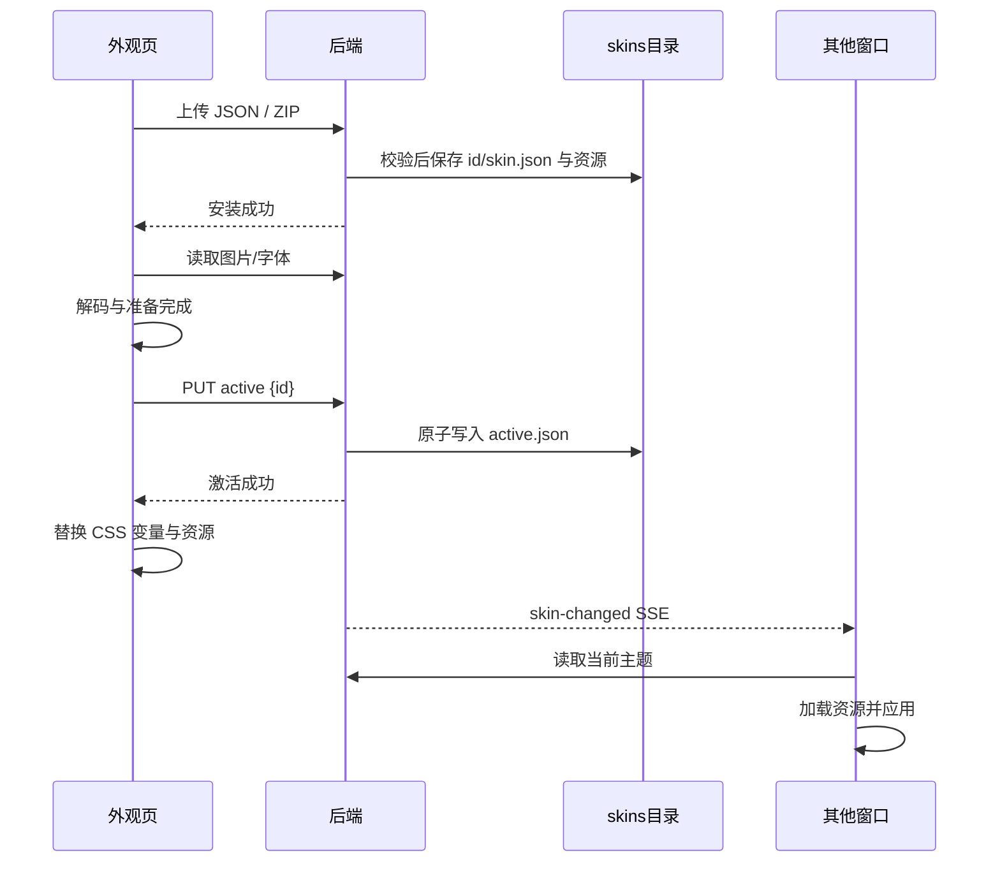

# 包格式与加载

## 格式

```text
my-theme.zip
├── skin.json
└── assets/
    ├── background.webp
    └── interface.woff2
```

ZIP 根目录直接有 `skin.json`，不要带外层目录。只调颜色和组件尺寸时可导入单个 JSON。

```json
{
  "id": "my-theme",
  "name": "我的主题",
  "version": 1,
  "mode": "Light",
  "colors": { "--tron-button-primary-bg": "#245b8a" },
  "layout": { "--tron-button-radius": "8px", "--tron-table-row-height": "44px" },
  "resources": { "background": null, "font": null }
}
```

| 字段 | 规则 |
| --- | --- |
| id | 1–64 个小写字母、数字或连字符；内置 light/matrix-dark 不可覆盖 |
| name | 非空，UTF-8 最多 120 字节 |
| version | 协议版本，固定 1，不是主题发布版本 |
| mode | Light / Dark；未覆盖的变量继承此模式 |
| colors / layout | 可省略；变量名 `--[a-z0-9-]+`，最多 100 字符；非空字符串值最多 512 UTF-8 字节；两组共最多 512 个条目 |
| resources | 可省略；仅 background / font，null 表示没有资源 |

不支持任意 CSS、JS、HTML、SVG、音效、图标替换。值中不接受分号、花括号、尖括号、反斜杠、@、CSS 注释、`url()`、`!important`。可以使用 `var()`、`calc()`、`color-mix()`；变量值语法和颜色对比仍需浏览器验证。

本地资源路径只能用 ASCII 字母、数字、`-_.` 和 `/`，最多 240 字节；禁止空段、`.`、`..`、绝对路径或符号链接。图片扩展名是小写 png/jpg/jpeg/webp/gif，字体是 woff/woff2/ttf/otf。文件扩展名正确不等于内容有效，激活前浏览器还会真正加载/解码。

ZIP 最大 20 MiB，解压累计最大 40 MiB，最多 128 个条目，skin.json 最多 256 KiB。打包脚本只包含清单及所引用资源，不附加 README、系统元数据或脚本。

## 三种交付方式

| 方式 | 用途 | 加载条件 |
| --- | --- | --- |
| 纯 JSON，无资源 | 配色、按钮、行样式 | 最简单，可直接导入 |
| ZIP + 相对资源 | 带背景/字体、离线使用 | 推荐；资源请求通过当前后端读取为 Blob |
| JSON/ZIP + HTTPS 资源 | 共享远程素材 | 客户端需联网；字体服务器需允许跨域；URL 不含用户名/密码 |

本地资源由后端上传保存，远程 URL 由每个前端直接访问，后端不会下载或缓存到包内。不能使用 file://、data:、http:// 或电脑绝对路径。

## 随附 Ocean 示例

源文件：[assets/ocean-detail/skin.json](../assets/ocean-detail/skin.json)。它不依赖图片、字体或网络，可以直接导入 JSON；也可以复制目录、修改 ID 和变量后打包。

在此 skill 目录执行（从其他目录运行时，将脚本及源目录解析为绝对路径）：

```sh
python3 scripts/theme_pack.py validate assets/ocean-detail
python3 scripts/theme_pack.py pack assets/ocean-detail /你的输出目录/ocean-detail.zip
```

输出 ZIP 是交付产物；后续修改始终以 `assets/ocean-detail/` 为源。打包器拒绝覆盖已有输出，可指定新的文件名。

## 用户加载

1. 打开「平台配置 → 外观」。
2. 点击「导入主题」并选择 ZIP 或 JSON。导入只安装，不自动激活。
3. 点击该主题卡片。前端先加载背景和字体，成功后请求后端保存当前 ID，再替换变量与资源。
4. 展开「组件预览」检查按钮状态、输入框、表格数据行和弹窗。
5. 刷新或重启后从后端恢复。切换到内置浅色/Matrix 可恢复默认效果。

重复 ID 会拒绝导入。发布修改版时改 ID（如 ocean-v2），version 仍为 1。当前没有覆盖更新、删除或导出界面。

## 存储与多窗口



目录为后端 `application_config_path` 同级 `skins/`，默认 `~/.tron/skins/`。它属于后端实例，不是前端机器，也不是每个 Profile 独立存储。同一后端的窗口共享激活主题；不同后端各自保存。未进入 Profile 前使用本机保存的内置深浅模式，进入后以后端为准。字体大小是本客户端偏好。

内置主题首次访问播种，清单缺失/损坏用编译内嵌文件兜底。active.json 不合法或指向不存在主题时回到浅色。正常操作无需手工改磁盘文件。

开发时手工放目录要求名称与 id 一致。它不会触发 SSE；刷新或重新聚焦后重新读取清单。仅替换资源但清单不变可能命中缓存和前端签名，应改资源文件名并更新清单，或用新 ID 重新导入；当前不提供目录热监听。

## 失败处理

- ZIP 缺根清单、资源缺失、路径越界、ID 冲突：拒绝安装，不覆盖已有目录。
- 背景/字体请求、解码或激活保存失败：前端保留现有主题，旧资源不提前销毁；可重新选内置主题。资源请求及解码各有 10 秒超时阶段。
- 已激活主题的远程资源断网：该窗口保留现有主题/内置基底，外观页仍显示主题列表和重试入口。后端 active ID 不会被某个窗口的网络故障自动改写。
- 多窗口网络不一致时，某个窗口可能暂时保留旧主题。SSE 重连和窗口聚焦会重读，不能承诺断网窗口瞬时一致。
- 切换成功清理旧动态样式、FontFace 和 Blob URL；异步旧请求不能覆盖新选择。
- 主题 UI 无法使用时，可关闭后端后仅将 `skins/active.json` 改为 `{"id":"light"}`，再启动；不要删除其他用户配置。

## HTTP 自动化

沿用 Tron 当前实例的 Profile 保护和访问配置，不猜地址或 token。JSON 回包 `code="0"` 表示成功，`data` 为业务数据。

| 方法 | 路径 | 参数/数据 |
| --- | --- | --- |
| GET | /api/v1/system/skins | data 为数组 |
| POST | /api/v1/system/skins | 原始文件字节，不是 multipart；返回 data.skin |
| GET | /api/v1/system/skins/active | data.skin |
| PUT | /api/v1/system/skins/active | JSON `{ "id": "my-theme" }`；返回 data.skin |
| GET | /api/v1/system/skins/{id}/resources/{path} | 二进制图片/字体 |
| GET | /api/v1/system/skins/events | SSE skin-changed，通知重新读取 |

API 激活只校验本地资源存在，不代表客户端能解码或获取远程 URL。需要真实渲染验证时使用外观页。
